# assets-2d-pixel

2D 픽셀 스프라이트와 타일셋. RPG·로그라이크·플랫포머·타워디펜스·슈팅에 바로 쓸 수 있는 CC0 팩.

## 수록 팩

### Micro Roguelike 1.2
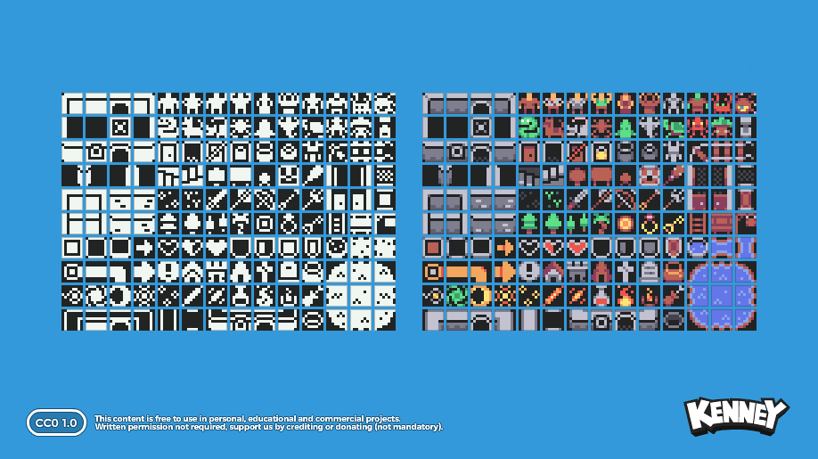
- 파일: `kenney_microroguelike_1.2.zip` (PNG 286개: 타일·몬스터·아이템)
- 제작: Kenney / 라이선스: CC0 / 원본: https://kenney.nl/assets/micro-roguelike

### 1-Bit Platformer Pack
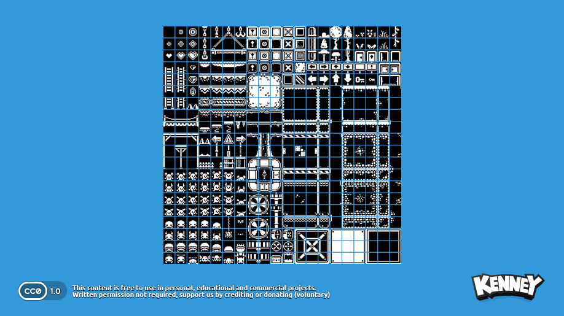
- 파일: `1bitplatformerpack.zip` (PNG 806개: 타일·캐릭터·적·UI)
- 제작: Kenney / 라이선스: CC0 / 원본: https://kenney.nl/assets/1-bit-platformer-pack

### Tower Defense (Top-Down)

- 파일: [릴리스 v1.0 첨부 다운로드](https://github.com/sigco3111/assets-2d-pixel/releases/download/v1.0/tower-defense-top-down.zip) (3.3MB, GitHub 웹 제한으로 릴리스로 배포) (PNG 603개: 타일·지형·타워·유닛·UI + SVG 원본)
- 제작: Kenney / 라이선스: CC0 / 원본: https://kenney.nl/assets/tower-defense-top-down

### Alien UFO Pack
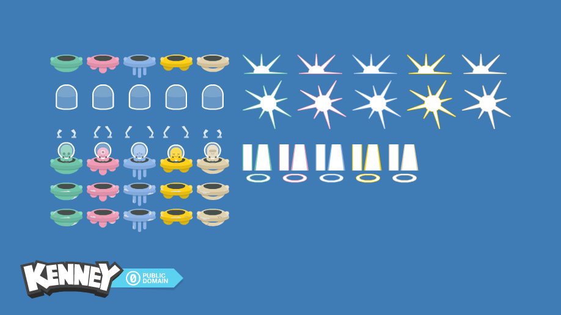
- 파일: `alien-ufo-pack.zip` (PNG 50개: UFO·빔·폭발 이펙트 + 스프라이트시트)
- 제작: Kenney / 라이선스: CC0 / 원본: https://kenney.nl/assets/alien-ufo-pack

## 사용 방법

1. 원하는 zip을 내려받아 프로젝트에 압축 해제 (Code 탭 → 파일 클릭 → Download)
2. CC0이므로 귀속 표기 없이 사용 가능 (표기 시 "Kenney (kenney.nl)")

## 출처와 라이선스 기록

- 원본 라이선스 전문: 각 zip 안에 제작자가 배포한 License.txt 원본이 그대로 보존되어 있습니다 (법적 효력은 이 원본 기준).
- 이 저장소 루트의 LICENSE.md는 원본을 대체하지 않는 수집자 요약본입니다.
- 원본 배포 페이지의 라이선스 조건(CC0)과 동봉된 License.txt를 확인했습니다.
- 파일 바이트는 Kenney 공식 미러 github.com/ETdoFresh/kenney.nl 에서 확보했으며, 공식 사이트 원본과 바이트 대조는 하지 않았습니다.

전체 인덱스와 장르 태그: [game-asset-catalog](https://github.com/sigco3111/game-asset-catalog)

## 2026-10-28 추가 팩 (릴리스 v2.0)

### Background Elements

- 파일: [릴리스 v2.0 첨부 다운로드](https://github.com/sigco3111/assets-2d-pixel/releases/download/v2.0/background-elements.zip) (1MB, PNG 125개: 스크롤 배경 레이어)
- 제작: Kenney / 라이선스: CC0 / 원본: https://kenney.nl/assets/background-elements
### Roguelike Modern City

- 파일: [릴리스 v2.0 첨부 다운로드](https://github.com/sigco3111/assets-2d-pixel/releases/download/v2.0/roguelike-modern-city.zip) (0.5MB, 현대 도시 로그라이크 타일셋)
- 제작: Kenney / 라이선스: CC0 / 원본: https://kenney.nl/assets/roguelike-modern-city
### Animal Pack

- 파일: [릴리스 v2.0 첨부 다운로드](https://github.com/sigco3111/assets-2d-pixel/releases/download/v2.0/animal-pack.zip) (2.5MB, PNG 89개: 동물 캐릭터 스프라이트)
- 제작: Kenney / 라이선스: CC0 / 원본: https://kenney.nl/assets/animal-pack
### Particle Pack

- 파일: [릴리스 v2.0 첨부 다운로드](https://github.com/sigco3111/assets-2d-pixel/releases/download/v2.0/particle-pack.zip) (15MB, PNG 193개: 불·연기·폭발 파티클)
- 제작: Kenney / 라이선스: CC0 / 원본: https://kenney.nl/assets/particle-pack
### Smoke Particles

- 파일: [릴리스 v2.0 첨부 다운로드](https://github.com/sigco3111/assets-2d-pixel/releases/download/v2.0/smoke-particles.zip) (13MB, PNG 79개: 연기 이펙트)
- 제작: Kenney / 라이선스: CC0 / 원본: https://kenney.nl/assets/smoke-particles

## 2026-10-28 추가 팩 (릴리스 v3.0)

### Top-down Shooter

- 파일: [릴리스 v3.0 첨부 다운로드](https://github.com/sigco3111/assets-2d-pixel/releases/download/v3.0/top-down-shooter.zip) (2.8MB, 파일 602개)
- 제작: Kenney / 라이선스: CC0 / 원본: https://kenney.nl/assets/top-down-shooter
### Roguelike/RPG Pack

- 파일: [릴리스 v3.0 첨부 다운로드](https://github.com/sigco3111/assets-2d-pixel/releases/download/v3.0/roguelike-rpg-pack.zip) (0.7MB, 타일시트·맵)
- 제작: Kenney / 라이선스: CC0 / 원본: https://kenney.nl/assets/roguelike-rpg-pack
### Roguelike Caves & Dungeons

- 파일: [릴리스 v3.0 첨부 다운로드](https://github.com/sigco3111/assets-2d-pixel/releases/download/v3.0/roguelike-caves-dungeons.zip) (0.2MB, 스프라이트시트)
- 제작: Kenney / 라이선스: CC0 / 원본: https://kenney.nl/assets/roguelike-caves-dungeons
### Roguelike Indoors

- 파일: [릴리스 v3.0 첨부 다운로드](https://github.com/sigco3111/assets-2d-pixel/releases/download/v3.0/roguelike-indoors.zip) (0.2MB, 타일시트)
- 제작: Kenney / 라이선스: CC0 / 원본: https://kenney.nl/assets/roguelike-indoors
### Jumper Pack

- 파일: [릴리스 v3.0 첨부 다운로드](https://github.com/sigco3111/assets-2d-pixel/releases/download/v3.0/jumper-pack.zip) (1.5MB, 파일 133개)
- 제작: Kenney / 라이선스: CC0 / 원본: https://kenney.nl/assets/jumper-pack
### Platformer Art Pixel

- 파일: [릴리스 v3.0 첨부 다운로드](https://github.com/sigco3111/assets-2d-pixel/releases/download/v3.0/platformer-art-pixel.zip) (0.3MB, 파일 908개)
- 제작: Kenney / 라이선스: CC0 / 원본: https://kenney.nl/assets/platformer-art-pixel
### Sokoban

- 파일: [릴리스 v3.0 첨부 다운로드](https://github.com/sigco3111/assets-2d-pixel/releases/download/v3.0/sokoban.zip) (1.6MB, 파일 216개)
- 제작: Kenney / 라이선스: CC0 / 원본: https://kenney.nl/assets/sokoban
### Puzzle Pack 2

- 파일: [릴리스 v3.0 첨부 다운로드](https://github.com/sigco3111/assets-2d-pixel/releases/download/v3.0/puzzle-pack-2.zip) (3.9MB, 파일 861개)
- 제작: Kenney / 라이선스: CC0 / 원본: https://kenney.nl/assets/puzzle-pack-2
### Physics Assets

- 파일: [릴리스 v3.0 첨부 다운로드](https://github.com/sigco3111/assets-2d-pixel/releases/download/v3.0/physics-assets.zip) (2.6MB, 파일 369개)
- 제작: Kenney / 라이선스: CC0 / 원본: https://kenney.nl/assets/physics-assets
### Board Game Pack

- 파일: [릴리스 v3.0 첨부 다운로드](https://github.com/sigco3111/assets-2d-pixel/releases/download/v3.0/boardgame-pack.zip) (2.2MB, 파일 583개)
- 제작: Kenney / 라이선스: CC0 / 원본: https://kenney.nl/assets/boardgame-pack
### Hexagon Pack

- 파일: [릴리스 v3.0 첨부 다운로드](https://github.com/sigco3111/assets-2d-pixel/releases/download/v3.0/hexagon-pack.zip) (4.4MB, 파일 330개)
- 제작: Kenney / 라이선스: CC0 / 원본: https://kenney.nl/assets/hexagon-pack
### Map Pack

- 파일: [릴리스 v3.0 첨부 다운로드](https://github.com/sigco3111/assets-2d-pixel/releases/download/v3.0/map-pack.zip) (2.3MB, 파일 198개)
- 제작: Kenney / 라이선스: CC0 / 원본: https://kenney.nl/assets/map-pack
### Tappy Plane

- 파일: [릴리스 v3.0 첨부 다운로드](https://github.com/sigco3111/assets-2d-pixel/releases/download/v3.0/tappy-plane.zip) (1MB, 파일 90개)
- 제작: Kenney / 라이선스: CC0 / 원본: https://kenney.nl/assets/tappy-plane
### Abstract Platformer

- 파일: [릴리스 v3.0 첨부 다운로드](https://github.com/sigco3111/assets-2d-pixel/releases/download/v3.0/abstract-platformer.zip) (2.5MB, 파일 401개)
- 제작: Kenney / 라이선스: CC0 / 원본: https://kenney.nl/assets/abstract-platformer
### Fish Pack

- 파일: [릴리스 v3.0 첨부 다운로드](https://github.com/sigco3111/assets-2d-pixel/releases/download/v3.0/fish-pack.zip) (1.4MB, 파일 263개)
- 제작: Kenney / 라이선스: CC0 / 원본: https://kenney.nl/assets/fish-pack
### Shooting Gallery

- 파일: [릴리스 v3.0 첨부 다운로드](https://github.com/sigco3111/assets-2d-pixel/releases/download/v3.0/shooting-gallery.zip) (0.8MB, 파일 124개)
- 제작: Kenney / 라이선스: CC0 / 원본: https://kenney.nl/assets/shooting-gallery
### Letter Tiles

- 파일: [릴리스 v3.0 첨부 다운로드](https://github.com/sigco3111/assets-2d-pixel/releases/download/v3.0/letter-tiles.zip) (15.5MB, 파일 240개)
- 제작: Kenney / 라이선스: CC0 / 원본: https://kenney.nl/assets/letter-tiles
### Space Shooter Extension

- 파일: [릴리스 v3.0 첨부 다운로드](https://github.com/sigco3111/assets-2d-pixel/releases/download/v3.0/space-shooter-extension.zip) (2.8MB, 파일 566개; 확장팩(기본 Space Shooter Redux 미포함·공식 페이지 폐지로 기본팩 미수록))
- 제작: Kenney / 라이선스: CC0 / 원본: https://kenney.nl/assets/space-shooter-extension
### Pirate Pack

- 파일: [릴리스 v3.0 첨부 다운로드](https://github.com/sigco3111/assets-2d-pixel/releases/download/v3.0/pirate-pack.zip) (2.6MB, 파일 411개)
- 제작: Kenney / 라이선스: CC0 / 원본: https://kenney.nl/assets/pirate-pack
### Medieval RTS

- 파일: [릴리스 v3.0 첨부 다운로드](https://github.com/sigco3111/assets-2d-pixel/releases/download/v3.0/medieval-rts.zip) (1.8MB, 파일 270개)
- 제작: Kenney / 라이선스: CC0 / 원본: https://kenney.nl/assets/medieval-rts
### Sports Pack

- 파일: [릴리스 v3.0 첨부 다운로드](https://github.com/sigco3111/assets-2d-pixel/releases/download/v3.0/sports-pack.zip) (1.3MB, 파일 238개)
- 제작: Kenney / 라이선스: CC0 / 원본: https://kenney.nl/assets/sports-pack
### Foliage Sprites

- 파일: [릴리스 v3.0 첨부 다운로드](https://github.com/sigco3111/assets-2d-pixel/releases/download/v3.0/foliage-sprites.zip) (2.4MB, 파일 107개)
- 제작: Kenney / 라이선스: CC0 / 원본: https://kenney.nl/assets/foliage-sprites
### Platformer Characters

- 파일: [릴리스 v3.0 첨부 다운로드](https://github.com/sigco3111/assets-2d-pixel/releases/download/v3.0/platformer-characters.zip) (1.4MB, 파일 178개)
- 제작: Kenney / 라이선스: CC0 / 원본: https://kenney.nl/assets/platformer-characters

## 2026-10-28 추가 팩 (릴리스 v4.0)

### 1-Bit Pack

- 파일: [릴리스 v4.0 첨부 다운로드](https://github.com/sigco3111/assets-2d-pixel/releases/download/v4.0/1-bit-pack.zip) (684K, 파일 24개)
- 제작: Kenney / 라이선스: CC0 / 원본: https://kenney.nl/assets/1-bit-pack
### Foliage Pack

- 파일: [릴리스 v4.0 첨부 다운로드](https://github.com/sigco3111/assets-2d-pixel/releases/download/v4.0/foliage-pack.zip) (2.2M, 파일 238개)
- 제작: Kenney / 라이선스: CC0 / 원본: https://kenney.nl/assets/foliage-pack
### Hexagon Buildings

- 파일: [릴리스 v4.0 첨부 다운로드](https://github.com/sigco3111/assets-2d-pixel/releases/download/v4.0/hexagon-buildings.zip) (344K, 파일 94개)
- 제작: Kenney / 라이선스: CC0 / 원본: https://kenney.nl/assets/hexagon-buildings
### Hexagon Tiles

- 파일: [릴리스 v4.0 첨부 다운로드](https://github.com/sigco3111/assets-2d-pixel/releases/download/v4.0/hexagon-tiles.zip) (540K, 파일 113개)
- 제작: Kenney / 라이선스: CC0 / 원본: https://kenney.nl/assets/hexagon-tiles
### Isometric Blocks

- 파일: [릴리스 v4.0 첨부 다운로드](https://github.com/sigco3111/assets-2d-pixel/releases/download/v4.0/isometric-blocks.zip) (7.0M, 파일 163개)
- 제작: Kenney / 라이선스: CC0 / 원본: https://kenney.nl/assets/isometric-blocks
### Isometric Tiles Buildings

- 파일: [릴리스 v4.0 첨부 다운로드](https://github.com/sigco3111/assets-2d-pixel/releases/download/v4.0/isometric-tiles-buildings.zip) (1.7M, 파일 138개)
- 제작: Kenney / 라이선스: CC0 / 원본: https://kenney.nl/assets/isometric-tiles-buildings
### Isometric Tiles City

- 파일: [릴리스 v4.0 첨부 다운로드](https://github.com/sigco3111/assets-2d-pixel/releases/download/v4.0/isometric-tiles-city.zip) (972K, 파일 150개)
- 제작: Kenney / 라이선스: CC0 / 원본: https://kenney.nl/assets/isometric-tiles-city
### Isometric Tiles Landscape

- 파일: [릴리스 v4.0 첨부 다운로드](https://github.com/sigco3111/assets-2d-pixel/releases/download/v4.0/isometric-tiles-landscape.zip) (1.1M, 파일 136개)
- 제작: Kenney / 라이선스: CC0 / 원본: https://kenney.nl/assets/isometric-tiles-landscape
### Isometric Tiles Vehicles

- 파일: [릴리스 v4.0 첨부 다운로드](https://github.com/sigco3111/assets-2d-pixel/releases/download/v4.0/isometric-tiles-vehicles.zip) (2.2M, 파일 605개)
- 제작: Kenney / 라이선스: CC0 / 원본: https://kenney.nl/assets/isometric-tiles-vehicles
### Pixel Vehicle Pack

- 파일: [릴리스 v4.0 첨부 다운로드](https://github.com/sigco3111/assets-2d-pixel/releases/download/v4.0/pixel-vehicle-pack.zip) (64K, 파일 92개)
- 제작: Kenney / 라이선스: CC0 / 원본: https://kenney.nl/assets/pixel-vehicle-pack
### Platformer Art Buildings

- 파일: [릴리스 v4.0 첨부 다운로드](https://github.com/sigco3111/assets-2d-pixel/releases/download/v4.0/platformer-art-buildings.zip) (412K, 파일 106개)
- 제작: Kenney / 라이선스: CC0 / 원본: https://kenney.nl/assets/platformer-art-buildings
### Platformer Art Candy

- 파일: [릴리스 v4.0 첨부 다운로드](https://github.com/sigco3111/assets-2d-pixel/releases/download/v4.0/platformer-art-candy.zip) (580K, 파일 103개)
- 제작: Kenney / 라이선스: CC0 / 원본: https://kenney.nl/assets/platformer-art-candy
### Platformer Art Deluxe

- 파일: [릴리스 v4.0 첨부 다운로드](https://github.com/sigco3111/assets-2d-pixel/releases/download/v4.0/platformer-art-deluxe.zip) (6.4M, 파일 1055개)
- 제작: Kenney / 라이선스: CC0 / 원본: https://kenney.nl/assets/platformer-art-deluxe
### Platformer Art Extended Tileset

- 파일: [릴리스 v4.0 첨부 다운로드](https://github.com/sigco3111/assets-2d-pixel/releases/download/v4.0/platformer-art-extended-tileset.zip) (1012K, 파일 411개)
- 제작: Kenney / 라이선스: CC0 / 원본: https://kenney.nl/assets/platformer-art-extended-tileset
### Platformer Art Mushrooms

- 파일: [릴리스 v4.0 첨부 다운로드](https://github.com/sigco3111/assets-2d-pixel/releases/download/v4.0/platformer-art-mushrooms.zip) (420K, 파일 62개)
- 제작: Kenney / 라이선스: CC0 / 원본: https://kenney.nl/assets/platformer-art-mushrooms
### Platformer Art Requests

- 파일: [릴리스 v4.0 첨부 다운로드](https://github.com/sigco3111/assets-2d-pixel/releases/download/v4.0/platformer-art-requests.zip) (488K, 파일 106개)
- 제작: Kenney / 라이선스: CC0 / 원본: https://kenney.nl/assets/platformer-art-requests
### Platformer Art Winter

- 파일: [릴리스 v4.0 첨부 다운로드](https://github.com/sigco3111/assets-2d-pixel/releases/download/v4.0/platformer-art-winter.zip) (500K, 파일 104개)
- 제작: Kenney / 라이선스: CC0 / 원본: https://kenney.nl/assets/platformer-art-winter
### Platformer Bricks

- 파일: [릴리스 v4.0 첨부 다운로드](https://github.com/sigco3111/assets-2d-pixel/releases/download/v4.0/platformer-bricks.zip) (240K, 파일 163개)
- 제작: Kenney / 라이선스: CC0 / 원본: https://kenney.nl/assets/platformer-bricks
### Platformer Pack Industrial

- 파일: [릴리스 v4.0 첨부 다운로드](https://github.com/sigco3111/assets-2d-pixel/releases/download/v4.0/platformer-pack-industrial.zip) (1.5M, 파일 246개)
- 제작: Kenney / 라이선스: CC0 / 원본: https://kenney.nl/assets/platformer-pack-industrial
### Platformer Pack Medieval

- 파일: [릴리스 v4.0 첨부 다운로드](https://github.com/sigco3111/assets-2d-pixel/releases/download/v4.0/platformer-pack-medieval.zip) (1.8M, 파일 285개)
- 제작: Kenney / 라이선스: CC0 / 원본: https://kenney.nl/assets/platformer-pack-medieval
### Puzzle Pack 1

- 파일: [릴리스 v4.0 첨부 다운로드](https://github.com/sigco3111/assets-2d-pixel/releases/download/v4.0/puzzle-pack-1.zip) (564K, 파일 85개)
- 제작: Kenney / 라이선스: CC0 / 원본: https://kenney.nl/assets/puzzle-pack-1
### Road Textures

- 파일: [릴리스 v4.0 첨부 다운로드](https://github.com/sigco3111/assets-2d-pixel/releases/download/v4.0/road-textures.zip) (508K, 파일 288개)
- 제작: Kenney / 라이선스: CC0 / 원본: https://kenney.nl/assets/road-textures
### RPG Urban Pack

- 파일: [릴리스 v4.0 첨부 다운로드](https://github.com/sigco3111/assets-2d-pixel/releases/download/v4.0/rpg-urban-pack.zip) (308K, 파일 497개)
- 제작: Kenney / 라이선스: CC0 / 원본: https://kenney.nl/assets/rpg-urban-pack
### Sci-fi RTS

- 파일: [릴리스 v4.0 첨부 다운로드](https://github.com/sigco3111/assets-2d-pixel/releases/download/v4.0/sci-fi-rts.zip) (2.0M, 파일 279개)
- 제작: Kenney / 라이선스: CC0 / 원본: https://kenney.nl/assets/sci-fi-rts
### Scribble Platformer

- 파일: [릴리스 v4.0 첨부 다운로드](https://github.com/sigco3111/assets-2d-pixel/releases/download/v4.0/scribble-platformer.zip) (916K, 파일 226개)
- 제작: Kenney / 라이선스: CC0 / 원본: https://kenney.nl/assets/scribble-platformer
### Simplified Platformer Pack

- 파일: [릴리스 v4.0 첨부 다운로드](https://github.com/sigco3111/assets-2d-pixel/releases/download/v4.0/simplified-platformer-pack.zip) (676K, 파일 107개)
- 제작: Kenney / 라이선스: CC0 / 원본: https://kenney.nl/assets/simplified-platformer-pack
### Tanks

- 파일: [릴리스 v4.0 첨부 다운로드](https://github.com/sigco3111/assets-2d-pixel/releases/download/v4.0/tanks.zip) (1.1M, 파일 191개)
- 제작: Kenney / 라이선스: CC0 / 원본: https://kenney.nl/assets/tanks
### Top-down Tanks

- 파일: [릴리스 v4.0 첨부 다운로드](https://github.com/sigco3111/assets-2d-pixel/releases/download/v4.0/top-down-tanks.zip) (356K, 파일 101개)
- 제작: Kenney / 라이선스: CC0 / 원본: https://kenney.nl/assets/top-down-tanks
### Tower Defense

- 파일: [릴리스 v4.0 첨부 다운로드](https://github.com/sigco3111/assets-2d-pixel/releases/download/v4.0/tower-defense.zip) (1.5M, 파일 249개)
- 제작: Kenney / 라이선스: CC0 / 원본: https://kenney.nl/assets/tower-defense

## 2026-10-28 분류 정정 (릴리스 v5.0)

3D 저장소에 잘못 들어가 있던 2D 스프라이트·타일 6팩과 이미지 텍스처 1팩을 옮겼습니다. 팩 안에 3D 모델 파일(GLB·OBJ·FBX 등)이 없는 것을 확인했습니다. 파일은 원본과 동일합니다(SHA-256 대조).
### Brick Pack

- 파일: [릴리스 v5.0 첨부 다운로드](https://github.com/sigco3111/assets-2d-pixel/releases/download/v5.0/brick-pack.zip) (PNG 109개: 색상별 벽돌 스프라이트와 스프라이트시트)
- 제작: Kenney / 라이선스: CC0 / 원본: https://kenney.nl/assets/brick-pack
### Modular Characters

- 파일: [릴리스 v5.0 첨부 다운로드](https://github.com/sigco3111/assets-2d-pixel/releases/download/v5.0/modular-characters.zip) (PNG 437개: 얼굴·옷·신발 등 조합형 캐릭터 파츠와 스프라이트시트)
- 제작: Kenney / 라이선스: CC0 / 원본: https://kenney.nl/assets/modular-characters
### Prototype Textures

- 파일: [릴리스 v5.0 첨부 다운로드](https://github.com/sigco3111/assets-2d-pixel/releases/download/v5.0/prototype-textures.zip) (PNG 80개: 1024x1024 그리드 프로토타입 텍스처 (3D 모델 없음))
- 제작: Kenney / 라이선스: CC0 / 원본: https://kenney.nl/assets/prototype-textures
### Racing Pack

- 파일: [릴리스 v5.0 첨부 다운로드](https://github.com/sigco3111/assets-2d-pixel/releases/download/v5.0/racing-pack.zip) (PNG 429개: 탑다운 레이싱 도로 타일·차량·오브젝트와 스프라이트시트)
- 제작: Kenney / 라이선스: CC0 / 원본: https://kenney.nl/assets/racing-pack
### Robot Pack

- 파일: [릴리스 v5.0 첨부 다운로드](https://github.com/sigco3111/assets-2d-pixel/releases/download/v5.0/robot-pack.zip) (PNG 56개: 측면·탑뷰 로봇 스프라이트와 스프라이트시트)
- 제작: Kenney / 라이선스: CC0 / 원본: https://kenney.nl/assets/robot-pack
### Toon Characters

- 파일: [릴리스 v5.0 첨부 다운로드](https://github.com/sigco3111/assets-2d-pixel/releases/download/v5.0/toon-characters.zip) (PNG 677개: 캐릭터별 포즈·애니메이션 프레임과 타일시트)
- 제작: Kenney / 라이선스: CC0 / 원본: https://kenney.nl/assets/toon-characters
### Voxel Pack

- 파일: [릴리스 v5.0 첨부 다운로드](https://github.com/sigco3111/assets-2d-pixel/releases/download/v5.0/voxel-pack.zip) (PNG 197개: 복셀풍 타일·캐릭터·아이템 스프라이트시트)
- 제작: Kenney / 라이선스: CC0 / 원본: https://kenney.nl/assets/voxel-pack
### Sci-Fi Essentials Kit - 4K Textures

- 파일: [릴리스 v6.0 첨부 다운로드](https://github.com/sigco3111/assets-2d-pixel/releases/download/v6.0/sci-fi-essentials-kit-textures.zip) (4K PBR 텍스처 PNG 36개: BaseColor/Emissive/Normal/ORM) — 11MB 분할 7조각(.z01~.z06 + .zip)
- 제작: Quaternius / 라이선스: CC0 / 원본: https://opengameart.org/content/sci-fi-essentials-kit
- 3D 저장소에서 재분류(2026-10-28): 모델 파일 없는 이미지 전용 팩. 대응 모델은 assets-3d-lowpoly의 Sci-Fi Essentials Kit에 있습니다. assets-3d-lowpoly v6.0 릴리스에도 동일 바이트 사본이 남아 있습니다.
- 분할 zip은 모두 받은 뒤 같은 폴더에서 `zip -s 0 sci-fi-essentials-kit-textures.zip --out sci-fi-essentials-kit-textures-full.zip`으로 합친 뒤 압축 해제(Windows는 7-Zip으로 .zip을 바로 열면 됩니다).

## 2026-10-28 추가 팩 6차 (릴리스 v6.1)

모두 rubberduck (OpenGameArt) CC0 2D 팩. 원본 배포본에 라이선스 파일이 없어 수집자 작성 LICENSE-SOURCE.txt를 동봉했습니다. 분할 팩 재결합: `cat <팩명>.zip.part* > <팩명>.zip` (Windows: `copy /b part01+part02+... <팩명>.zip`).

### 10 free isometric graphics from 3D Models
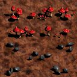
- 파일: `10-free-isometric-graphics-from-3d-models.zip` — 릴리스 v6.1 첨부, 단일
- 제작: rubberduck / 라이선스: CC0 / 원본: https://opengameart.org/content/10-free-isometric-graphics-from-3d-models

### 100 glitch icons
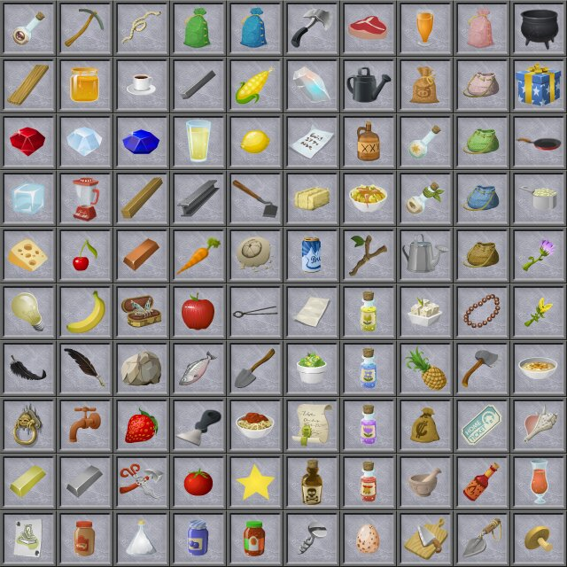
- 파일: `100-glitch-icons.zip` — 릴리스 v6.1 첨부, 단일
- 제작: rubberduck / 라이선스: CC0 / 원본: https://opengameart.org/content/100-glitch-icons

### 25 special effects rendered with blender
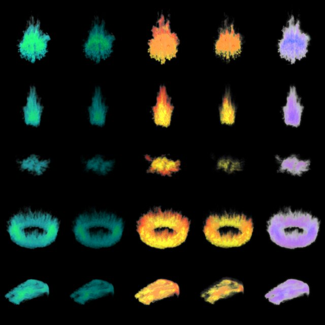
- 파일: `25-special-effects-rendered-with-blender.zip` — 릴리스 v6.1 첨부, 24.7MB plain split 2조각
- 제작: rubberduck / 라이선스: CC0 / 원본: https://opengameart.org/content/25-special-effects-rendered-with-blender

### 40 game backgrounds #1 - painted style and photorealistic
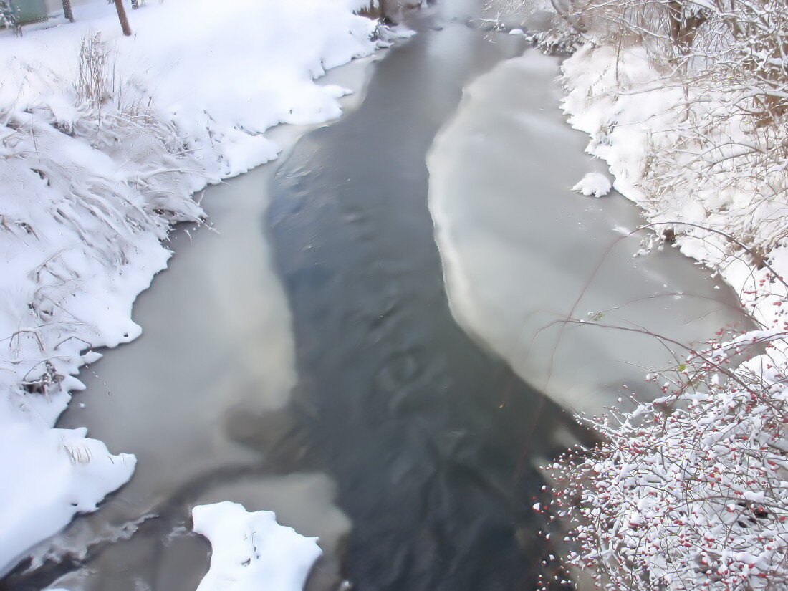
- 파일: `40-game-backgrounds-1-painted-style-and-photorealistic.zip` — 릴리스 v6.1 첨부, 49.6MB plain split 4조각
- 제작: rubberduck / 라이선스: CC0 / 원본: https://opengameart.org/content/40-game-backgrounds-1-painted-style-and-photorealistic

### 5x special effects - 2D
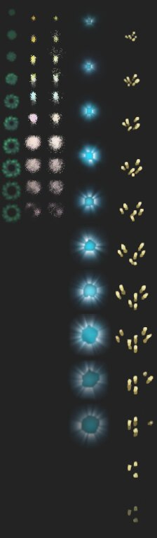
- 파일: `5x-special-effects-2d.zip` — 릴리스 v6.1 첨부, 단일
- 제작: rubberduck / 라이선스: CC0 / 원본: https://opengameart.org/content/5x-special-effects-2d

### animated fountain (isometric)
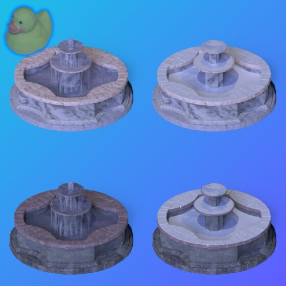
- 파일: `animated-fountain-isometric.zip` — 릴리스 v6.1 첨부, 19.8MB plain split 2조각
- 제작: rubberduck / 라이선스: CC0 / 원본: https://opengameart.org/content/animated-fountain-isometric

### blender colored gui theme
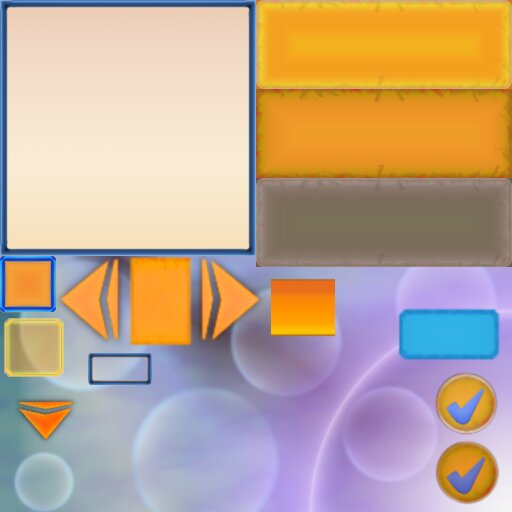
- 파일: `blender-colored-gui-theme.zip` — 릴리스 v6.1 첨부, 단일
- 제작: rubberduck / 라이선스: CC0 / 원본: https://opengameart.org/content/blender-colored-gui-theme

### Colony Sim Extended Version
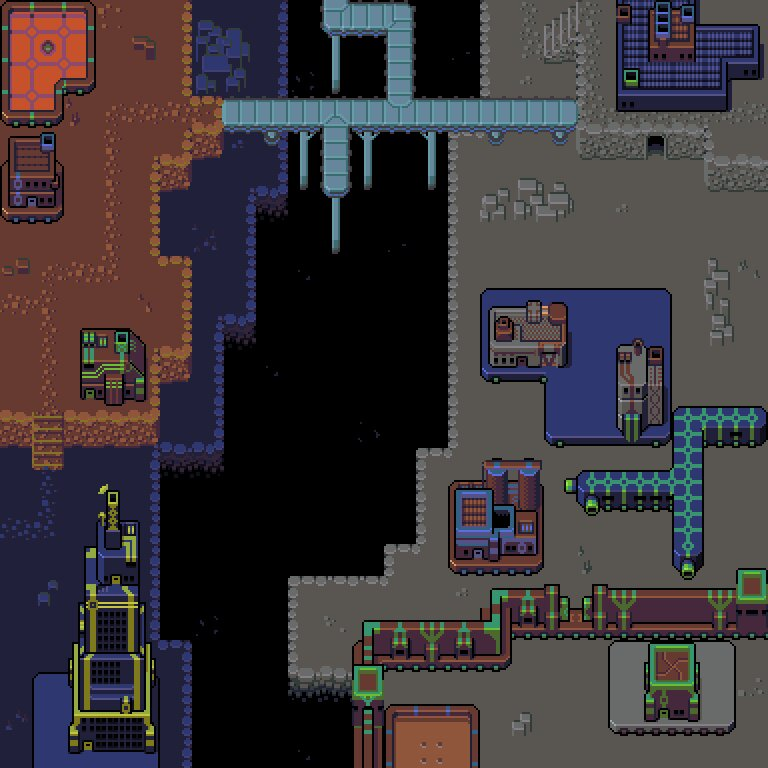
- 파일: `colony-sim-extended-version.zip` (원본 3개 아카이브 병합) — 릴리스 v6.1 첨부, 단일
- 제작: rubberduck / 라이선스: CC0 / 원본: https://opengameart.org/content/colony-sim-extended-version

## 2026-10-28 추가 팩 7차 (릴리스 v6.2)

모두 rubberduck (OpenGameArt) CC0 2D 팩. 원본 배포본에 라이선스 파일이 없어 수집자 작성 LICENSE-SOURCE.txt를 동봉했습니다. 분할 팩 재결합: `cat <팩명>.zip.part* > <팩명>.zip` (Windows: `copy /b part01+part02+... <팩명>.zip`).

### Customizable Character Pack
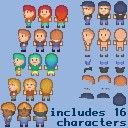
- 파일: `customizable-character-pack.zip` — 릴리스 v6.2 첨부, 단일
- 제작: rubberduck / 라이선스: CC0 / 원본: https://opengameart.org/content/customizable-character-pack

### Dungeon Tileset with Walls and Floors
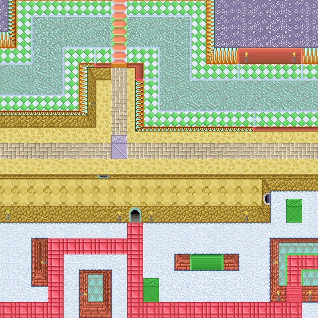
- 파일: `dungeon-tileset-with-walls-and-floors.zip` — 릴리스 v6.2 첨부, 단일
- 제작: rubberduck / 라이선스: CC0 / 원본: https://opengameart.org/content/dungeon-tileset-with-walls-and-floors

### Free Isometric Cave-Extras
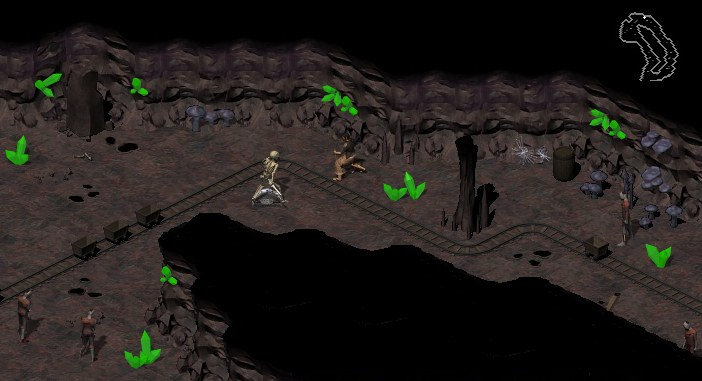
- 파일: `free-isometric-cave-extras.zip` — 릴리스 v6.2 첨부, 단일
- 제작: rubberduck / 라이선스: CC0 / 원본: https://opengameart.org/content/free-isometric-cave-extras

### Free Isometric Plants-Pack
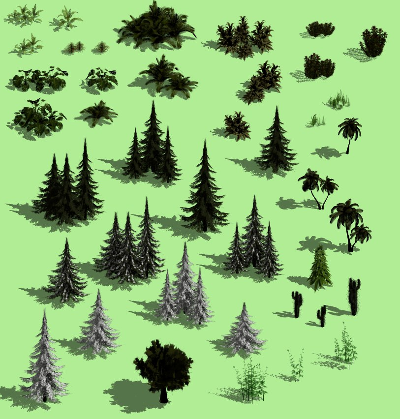
- 파일: `free-isometric-plants-pack.zip` — 릴리스 v6.2 첨부, 24.5MB plain split 2조각
- 제작: rubberduck / 라이선스: CC0 / 원본: https://opengameart.org/content/free-isometric-plants-pack

### Free Isometric Ruins
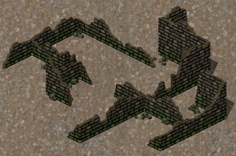
- 파일: `free-isometric-ruins.zip` — 릴리스 v6.2 첨부, 단일
- 제작: rubberduck / 라이선스: CC0 / 원본: https://opengameart.org/content/free-isometric-ruins

### Grassland Tileset
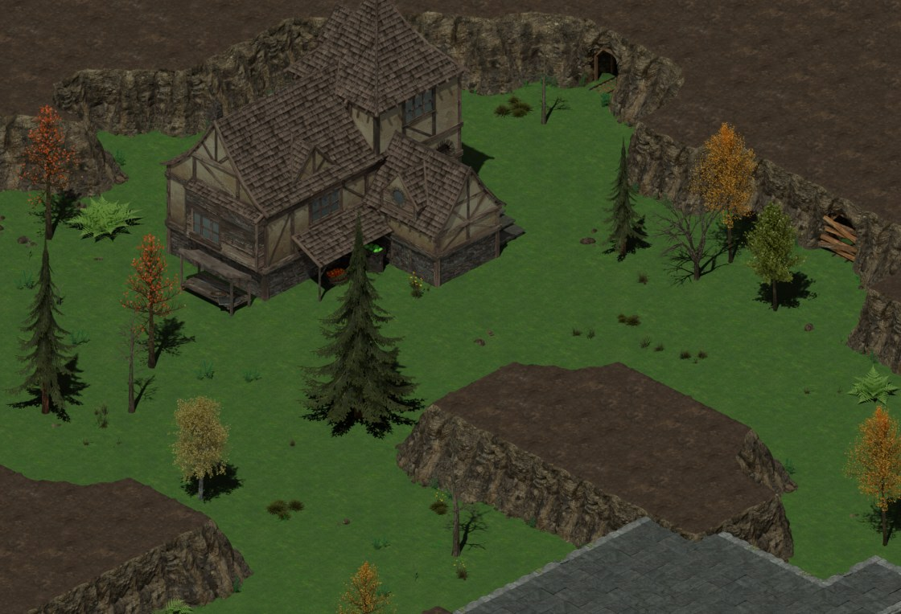
- 파일: `grassland-tileset-1.zip` — 릴리스 v6.2 첨부, 61.7MB plain split 4조각
- 제작: rubberduck / 라이선스: CC0 / 원본: https://opengameart.org/content/grassland-tileset-1

### Isometric Crystals
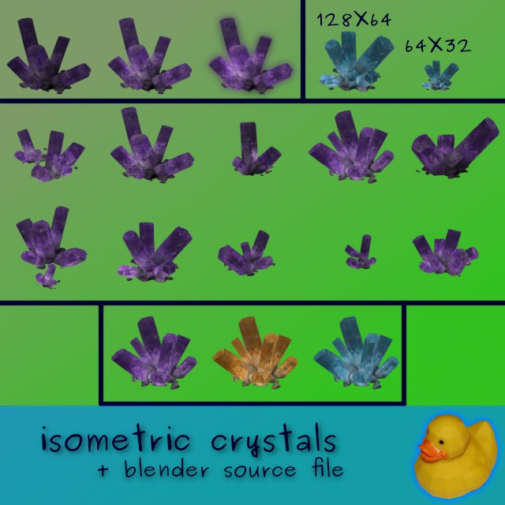
- 파일: `isometric-crystals.zip` — 릴리스 v6.2 첨부, 45.4MB plain split 3조각
- 제작: rubberduck / 라이선스: CC0 / 원본: https://opengameart.org/content/isometric-crystals

### Isometric Ground Tiles
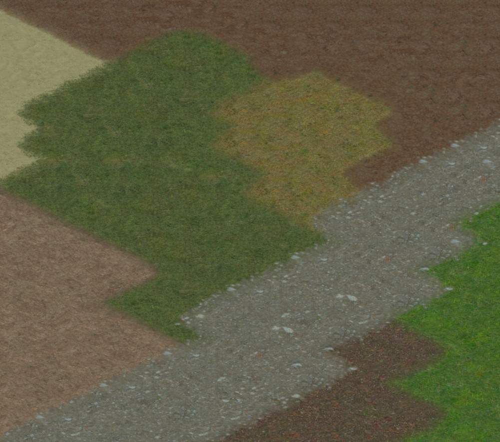
- 파일: `isometric-ground-tiles.zip` — 릴리스 v6.2 첨부, 162MB plain split 11조각
- 제작: rubberduck / 라이선스: CC0 / 원본: https://opengameart.org/content/isometric-ground-tiles

## 2026-10-28 추가 팩 8차 (릴리스 v6.3)

모두 rubberduck (OpenGameArt) CC0 2D 팩. 원본 배포본에 라이선스 파일이 없어 수집자 작성 LICENSE-SOURCE.txt를 동봉했습니다. 분할 팩 재결합: `cat <팩명>.zip.part* > <팩명>.zip` (Windows: `copy /b part01+part02+... <팩명>.zip`).

### Isometric Log Cabins
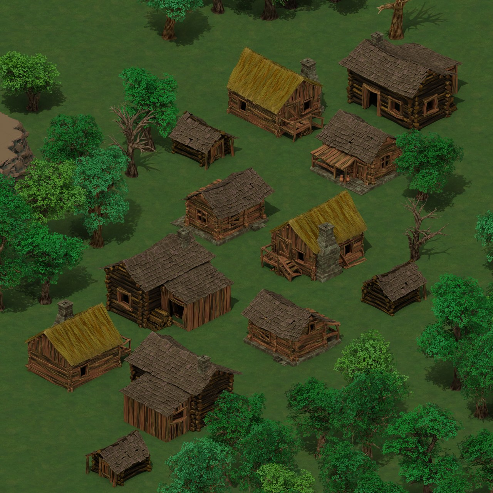
- 파일: `isometric-log-cabins.zip` — 릴리스 v6.3 첨부, 41.3MB plain split 3조각
- 제작: rubberduck / 라이선스: CC0 / 원본: https://opengameart.org/content/isometric-log-cabins

### Isometric Medieval Buildings
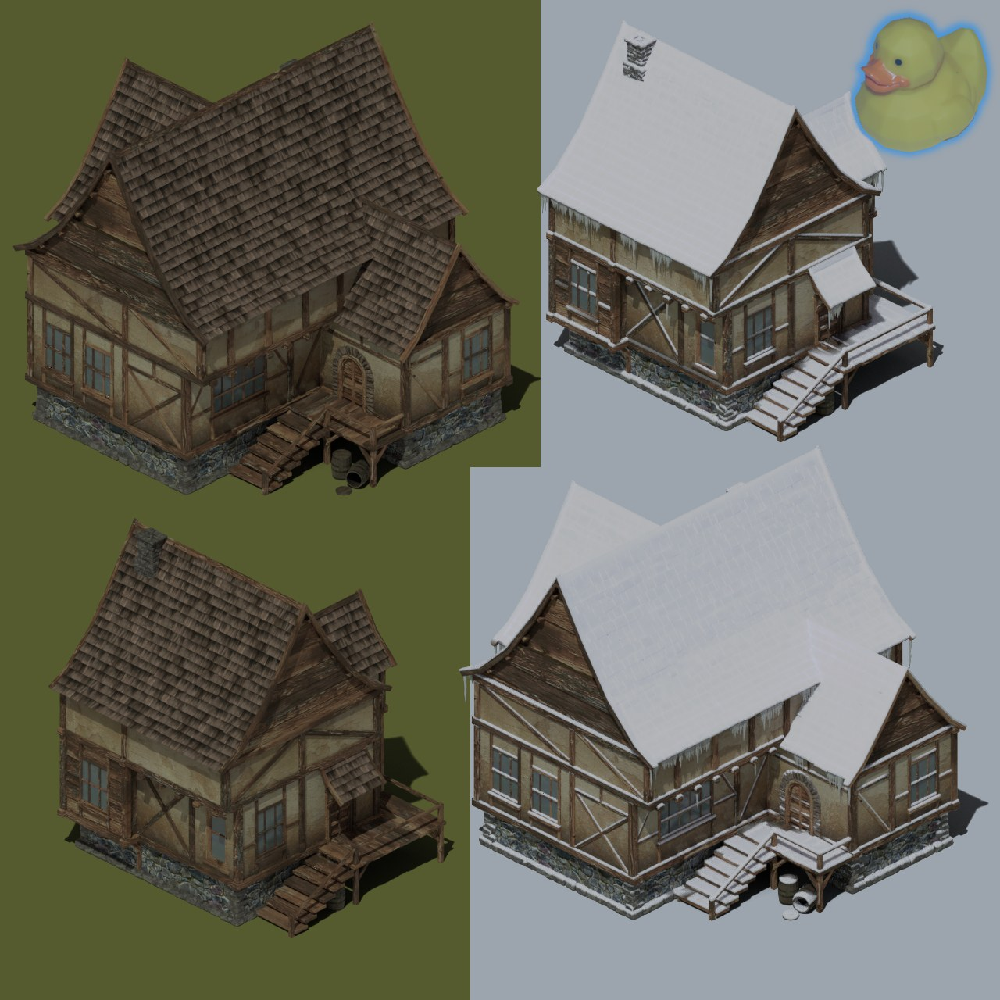
- 파일: `isometric-medieval-buildings.zip` — 릴리스 v6.3 첨부, 102.2MB plain split 7조각
- 제작: rubberduck / 라이선스: CC0 / 원본: https://opengameart.org/content/isometric-medieval-buildings

### Isometric Medieval Buildings #2
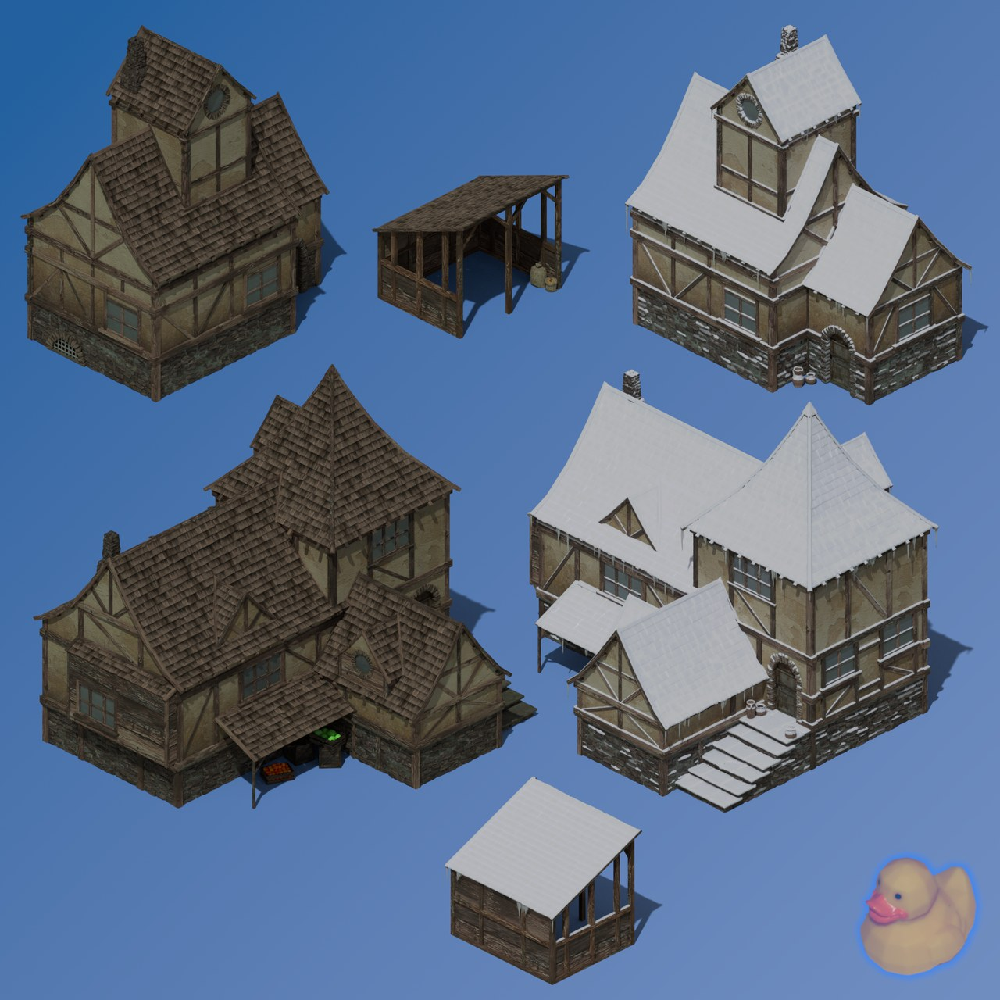
- 파일: `isometric-medieval-buildings-2.zip` — 릴리스 v6.3 첨부, 170.5MB plain split 11조각
- 제작: rubberduck / 라이선스: CC0 / 원본: https://opengameart.org/content/isometric-medieval-buildings-2

### Isometric Medieval Props
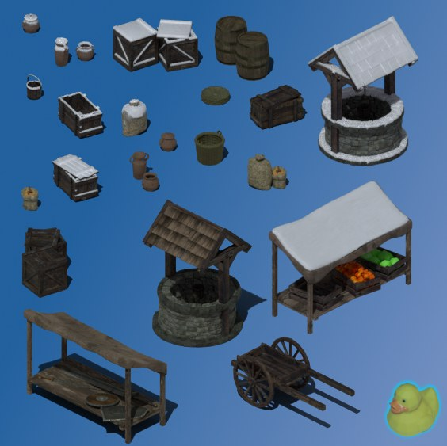
- 파일: `isometric-medieval-props.zip` — 릴리스 v6.3 첨부, 92.4MB plain split 6조각
- 제작: rubberduck / 라이선스: CC0 / 원본: https://opengameart.org/content/isometric-medieval-props

### Isometric Mug and Torch Pack (Flare)
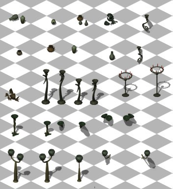
- 파일: `isometric-mug-and-torch-pack-flare.zip` — 릴리스 v6.3 첨부, 20.3MB plain split 2조각
- 제작: rubberduck / 라이선스: CC0 / 원본: https://opengameart.org/content/isometric-mug-and-torch-pack-flare

### Isometric Props and Tents
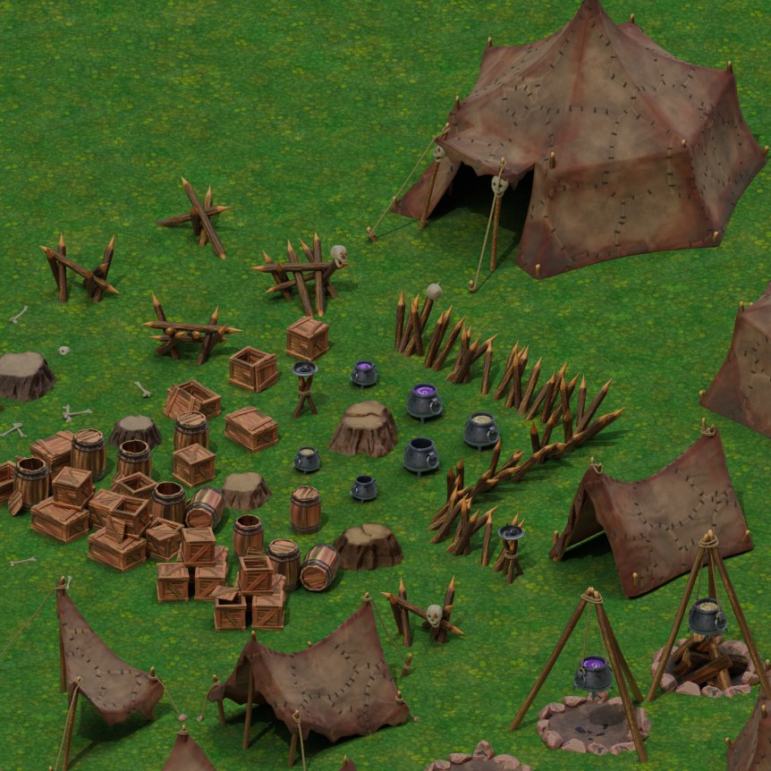
- 파일: `isometric-props-and-tents.zip` — 릴리스 v6.3 첨부, 56.5MB plain split 4조각
- 제작: rubberduck / 라이선스: CC0 / 원본: https://opengameart.org/content/isometric-props-and-tents

### Isometric Spikes
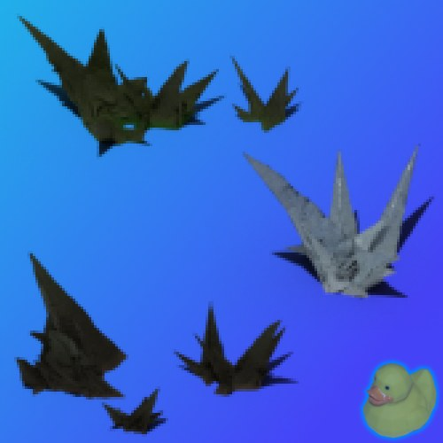
- 파일: `isometric-spikes.zip` — 릴리스 v6.3 첨부, 단일
- 제작: rubberduck / 라이선스: CC0 / 원본: https://opengameart.org/content/isometric-spikes

### Isometric Trees
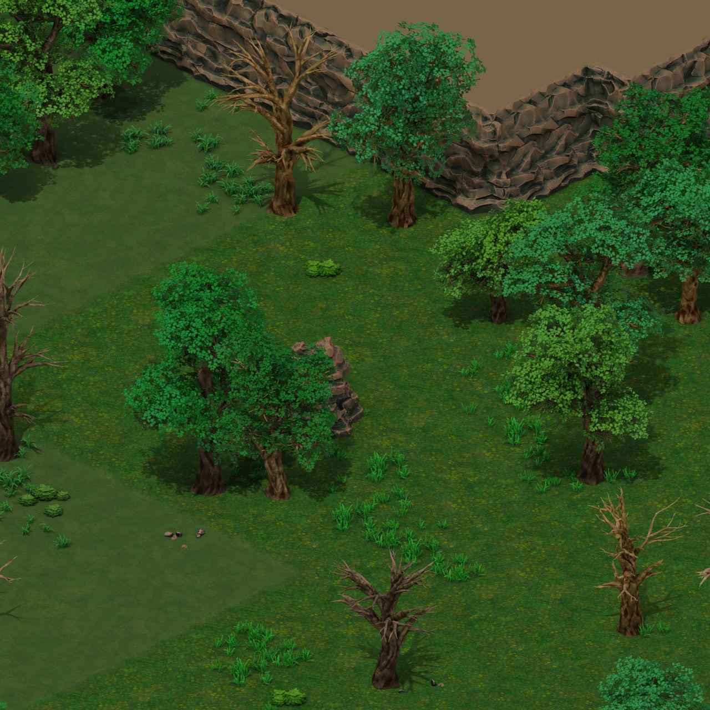
- 파일: `isometric-trees-1.zip` — 릴리스 v6.3 첨부, 27.5MB plain split 2조각
- 제작: rubberduck / 라이선스: CC0 / 원본: https://opengameart.org/content/isometric-trees-1

## 2026-10-28 추가 팩 9차 (릴리스 v6.4)

모두 rubberduck (OpenGameArt) CC0 2D 팩. 원본 배포본에 라이선스 파일이 없어 수집자 작성 LICENSE-SOURCE.txt를 동봉했습니다. 분할 팩 재결합: `cat <팩명>.zip.part* > <팩명>.zip` (Windows: `copy /b part01+part02+... <팩명>.zip`).

### Alien-Planet-Platformer-Tileset
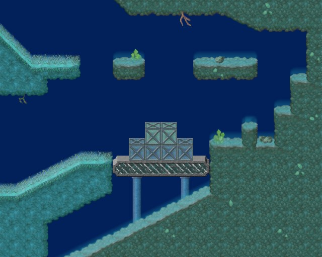
- 파일: `alien-planet-platformer-tileset.zip` — 릴리스 v6.4 첨부, 단일
- 제작: rubberduck / 라이선스: CC0 / 원본: https://opengameart.org/content/alien-planet-platformer-tileset

### Another Background made from Glitch-Assets
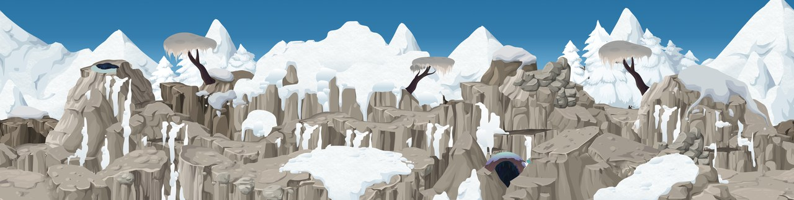
- 파일: `another-background-made-from-glitch-assets.zip` — 릴리스 v6.4 첨부, 20.8MB plain split 2조각
- 제작: rubberduck / 라이선스: CC0 / 원본: https://opengameart.org/content/another-background-made-from-glitch-assets

### Background from Glitch-Assets
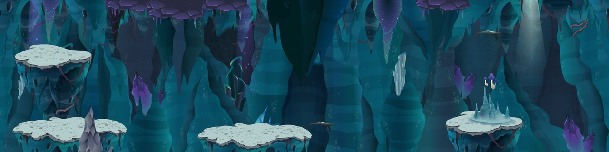
- 파일: `background-from-glitch-assets.zip` — 릴리스 v6.4 첨부, 단일
- 제작: rubberduck / 라이선스: CC0 / 원본: https://opengameart.org/content/background-from-glitch-assets

### Factory Tileset
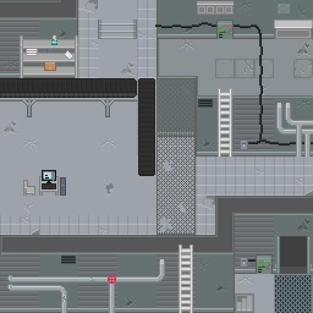
- 파일: `factory-tileset.zip` — 릴리스 v6.4 첨부, 단일
- 제작: rubberduck / 라이선스: CC0 / 원본: https://opengameart.org/content/factory-tileset

### Modern City Extension
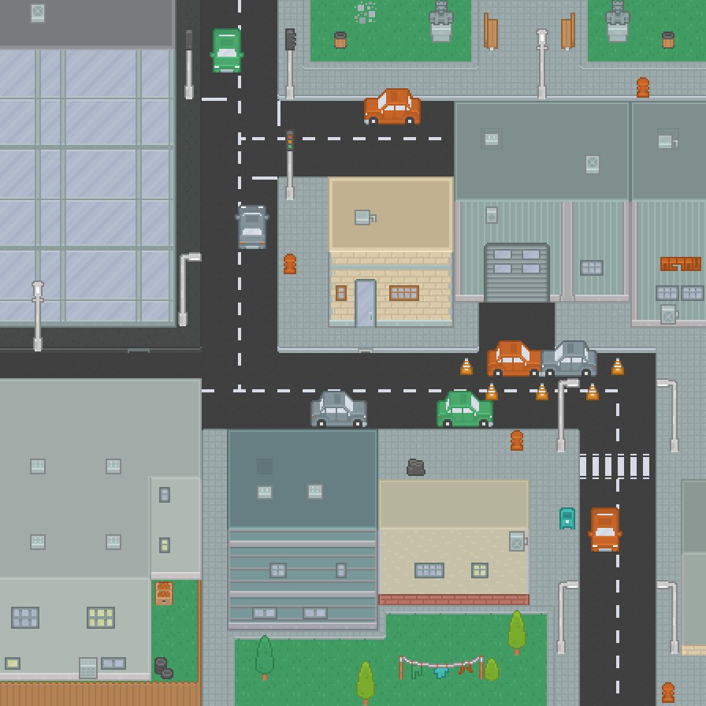
- 파일: `modern-city-extension.zip` — 릴리스 v6.4 첨부, 단일
- 제작: rubberduck / 라이선스: CC0 / 원본: https://opengameart.org/content/modern-city-extension

### Pixel Art Castle Tileset
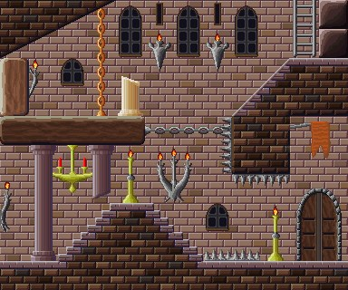
- 파일: `pixel-art-castle-tileset.zip` — 릴리스 v6.4 첨부, 단일
- 제작: rubberduck / 라이선스: CC0 / 원본: https://opengameart.org/content/pixel-art-castle-tileset

### Simple Glitch-Tileset
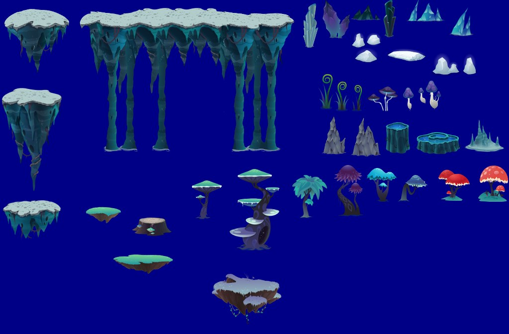
- 파일: `simple-glitch-tileset.zip` — 릴리스 v6.4 첨부, 단일
- 제작: rubberduck / 라이선스: CC0 / 원본: https://opengameart.org/content/simple-glitch-tileset

### Two Dungeon Wall Tilesets
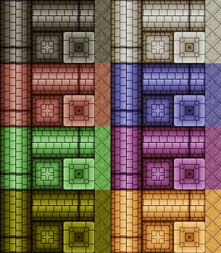
- 파일: `two-dungeon-wall-tilesets.zip` — 릴리스 v6.4 첨부, 단일
- 제작: rubberduck / 라이선스: CC0 / 원본: https://opengameart.org/content/two-dungeon-wall-tilesets

## 2026-10-28 추가 팩 10차 (릴리스 v6.5)

모두 rubberduck (OpenGameArt) CC0 2D 팩. 원본 배포본에 라이선스 파일이 없어 수집자 작성 LICENSE-SOURCE.txt를 동봉했습니다. 분할 팩 재결합: `cat <팩명>.zip.part* > <팩명>.zip` (Windows: `copy /b part01+part02+... <팩명>.zip`).

### Extension for DawnBlocker Ortho
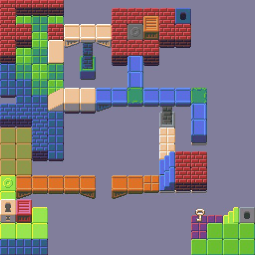
- 파일: `extension-for-dawnblocker-ortho.zip` — 릴리스 v6.5 첨부, 단일
- 제작: rubberduck / 라이선스: CC0 / 원본: https://opengameart.org/content/extension-for-dawnblocker-ortho

### Extension for Sci-fi Platformer Tiles (32x32)
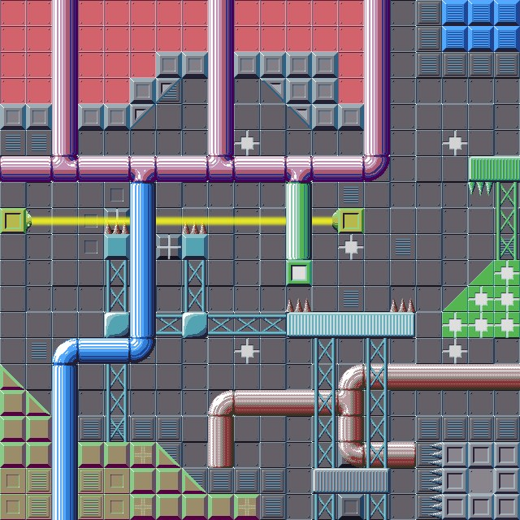
- 파일: `extension-for-sci-fi-platformer-tiles-32x32.zip` — 릴리스 v6.5 첨부, 단일
- 제작: rubberduck / 라이선스: CC0 / 원본: https://opengameart.org/content/extension-for-sci-fi-platformer-tiles-32x32

### Magic Flame
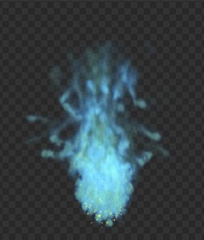
- 파일: `magic-flame.zip` — 릴리스 v6.5 첨부, 단일
- 제작: rubberduck / 라이선스: CC0 / 원본: https://opengameart.org/content/magic-flame

### More Isometric Parts
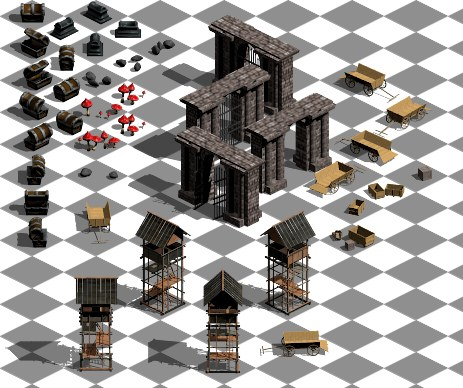
- 파일: `more-isometric-parts.zip` — 릴리스 v6.5 첨부, 21.7MB plain split 2조각
- 제작: rubberduck / 라이선스: CC0 / 원본: https://opengameart.org/content/more-isometric-parts

### RPG Icon Base Pack
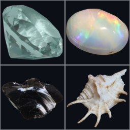
- 파일: `rpg-icon-base-pack.zip` — 릴리스 v6.5 첨부, 단일
- 제작: rubberduck / 라이선스: CC0 / 원본: https://opengameart.org/content/rpg-icon-base-pack

### Sparkling Fireball Effect
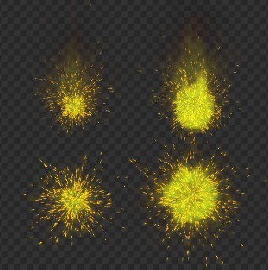
- 파일: `sparkling-fireball-effect.zip` — 릴리스 v6.5 첨부, 35.6MB plain split 3조각
- 제작: rubberduck / 라이선스: CC0 / 원본: https://opengameart.org/content/sparkling-fireball-effect

### Platformer-Tileset-Template
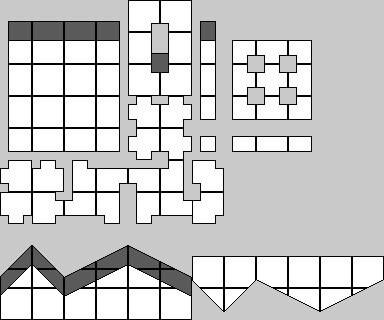
- 파일: `platformer-tileset-template.zip` — 릴리스 v6.5 첨부, 단일
- 제작: rubberduck / 라이선스: CC0 / 원본: https://opengameart.org/content/platformer-tileset-template

## 2026-10-28 추가 팩 11차 (릴리스 v6.6)

모두 rubberduck (OpenGameArt) CC0 2D 팩. 원본 배포본에 라이선스 파일이 없어 수집자 작성 LICENSE-SOURCE.txt를 동봉했습니다. 분할 팩 재결합: `cat <팩명>.zip.part* > <팩명>.zip` (Windows: `copy /b part01+part02+... <팩명>.zip`). Stylized Grassland Tileset과 Updated Grassland Tileset (Stylized)은 이름상 버전 관계로 보이며, 바이트 해시 기준 중복 파일은 0건입니다(재인코딩된 동일 그림 가능성까지는 배제하지 않음).

### Stylized Grassland Tileset
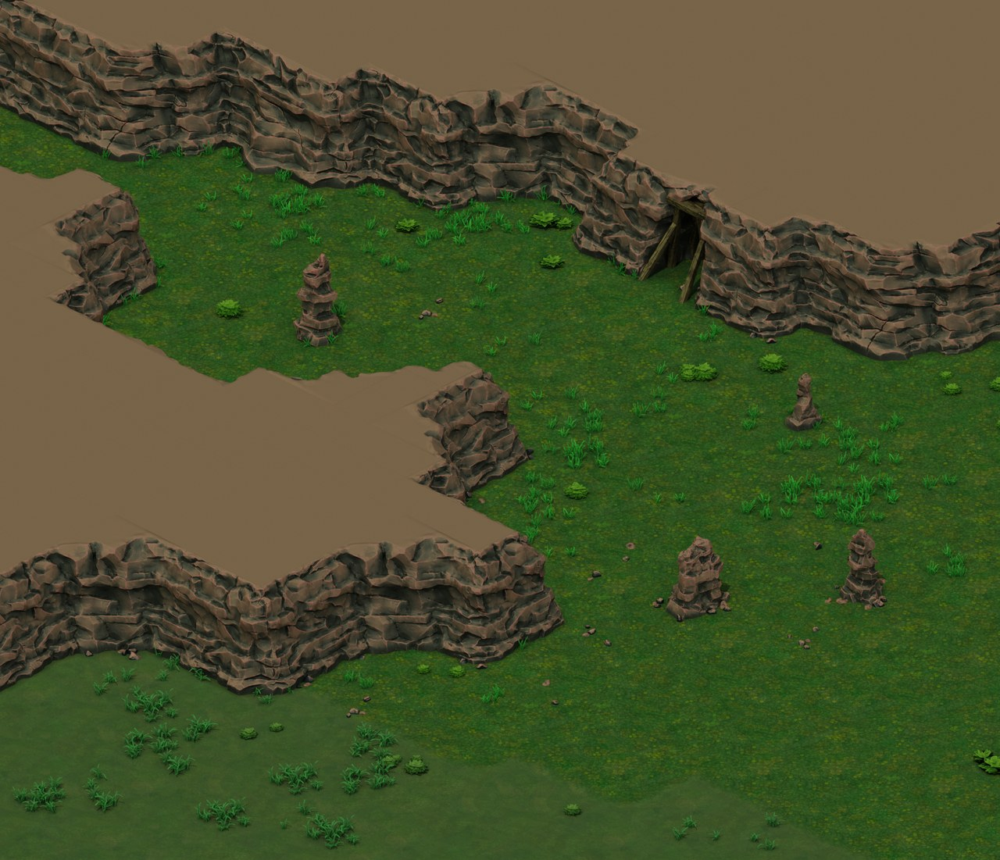
- 파일: `stylized-grassland-tileset.zip` — 릴리스 v6.6 첨부, 178.8MB plain split 12조각
- 제작: rubberduck / 라이선스: CC0 / 원본: https://opengameart.org/content/stylized-grassland-tileset

### Teleporter Effect
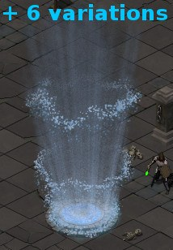
- 파일: `teleporter-effect.zip` — 릴리스 v6.6 첨부, 135.0MB plain split 9조각
- 제작: rubberduck / 라이선스: CC0 / 원본: https://opengameart.org/content/teleporter-effect

### Updated Grassland Tileset (Stylized)
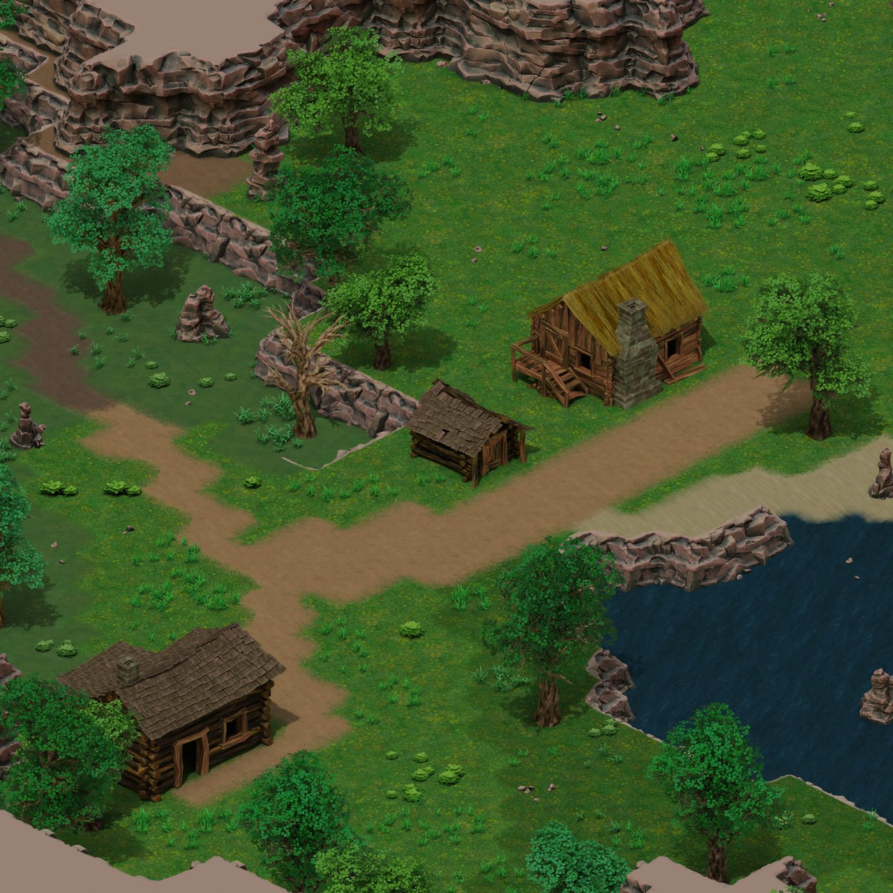
- 파일: `updated-grassland-tileset-stylized.zip` — 릴리스 v6.6 첨부, 123.2MB plain split 8조각
- 제작: rubberduck / 라이선스: CC0 / 원본: https://opengameart.org/content/updated-grassland-tileset-stylized
