> 현재 총 618팩 (catalog.csv 기준 assets-2d-pixel 저장소 팩 수, 천하삼분 1팩 포함; A8~A13 신규 팩 18개 추가 시점에는 551팩). A24: AlotofImpacts 이펙트 4팩 추가(589팩). A25: AlotofImpacts 5 Frame 14~17of20 이펙트 4팩 추가(594팩). A26: AlotofImpacts 9of20·18~20of20 이펙트 4팩 추가(598팩). A27: AlotofImpacts quick-hit/muzzle flash(impacts005-008·009-011·013-015·016-019) 이펙트 4팩 추가(602팩). A28: AlotofImpacts quick 4 frame(impacts001-004)·Spell Effects by StarsteelGaming·Fireball Effect - 2·Explosion Sheet 이펙트 4팩 추가(606팩). A30: 3 Lasers·Lightning Shock Spell 이펙트 2팩 추가(608팩). A31: Shield Aura Effect·Pixel art sword slash effect 이펙트 2팩 추가(610팩). A33: Heal effect·Lightning effect·High resolution slash effects 이펙트 3팩 추가(613팩). A39: Gun Muzzle Flash Effects (Fire and Ion and Melee) 이펙트 1팩 추가(614팩). A40: Explosions (chabull) 이펙트 1팩 추가(615팩). A42: Fire Aura (Compatible with FLARE) 이펙트 1팩 추가(616팩). A43: Blue projectile 이펙트 1팩 추가(617팩). A44: Magic sprite effects (Ardentryst) 이펙트 1팩 추가(618팩). 전체 목록·라이선스·귀속: [game-asset-catalog](https://github.com/sigco3111/game-asset-catalog/blob/main/catalog.csv)

# assets-2d-pixel

2D 픽셀 스프라이트·타일셋·텍스처. RPG·로그라이크·플랫포머·타워디펜스·슈팅에 바로 쓸 수 있는 CC0·CC-BY 팩. CC-BY 팩은 사용 시 저작자 표기 필요 (각 팩 LICENSE-SOURCE.txt에 원본 저작자·정확한 CC 버전·출처·변경 내역 기록).

## 수록 팩

### Micro Roguelike 1.2
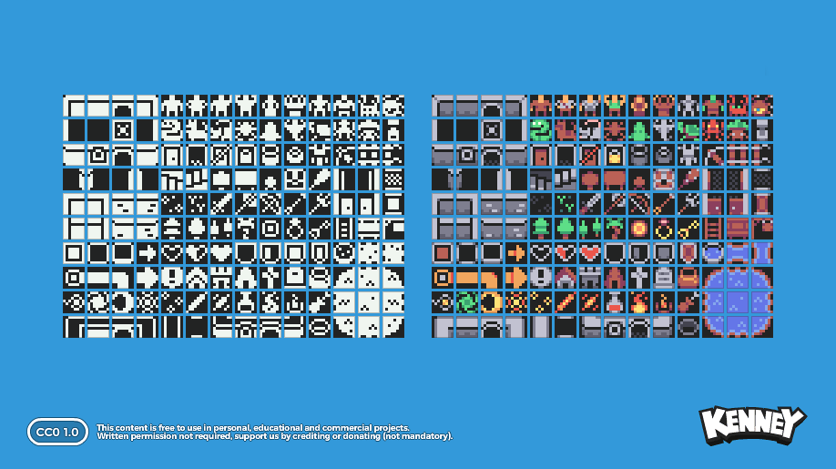
- 파일: `kenney_microroguelike_1.2.zip` (PNG 286개: 타일·몬스터·아이템)
- 제작: Kenney / 라이선스: CC0 / 원본: https://kenney.nl/assets/micro-roguelike

### 1-Bit Platformer Pack
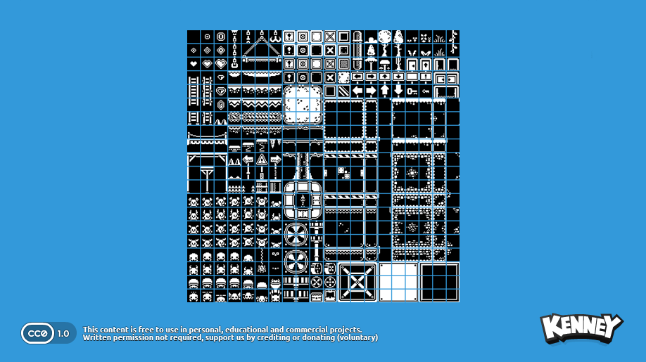
- 파일: `1bitplatformerpack.zip` (PNG 806개: 타일·캐릭터·적·UI)
- 제작: Kenney / 라이선스: CC0 / 원본: https://kenney.nl/assets/1-bit-platformer-pack

### Tower Defense (Top-Down)
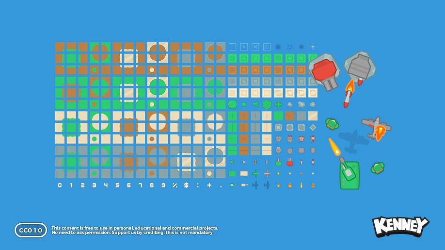
- 파일: [릴리스 v1.0 첨부 다운로드](https://github.com/sigco3111/assets-2d-pixel/releases/download/v1.0/tower-defense-top-down.zip) (3.3MB, GitHub 웹 제한으로 릴리스로 배포) (PNG 603개: 타일·지형·타워·유닛·UI + SVG 원본)
- 제작: Kenney / 라이선스: CC0 / 원본: https://kenney.nl/assets/tower-defense-top-down

### Alien UFO Pack
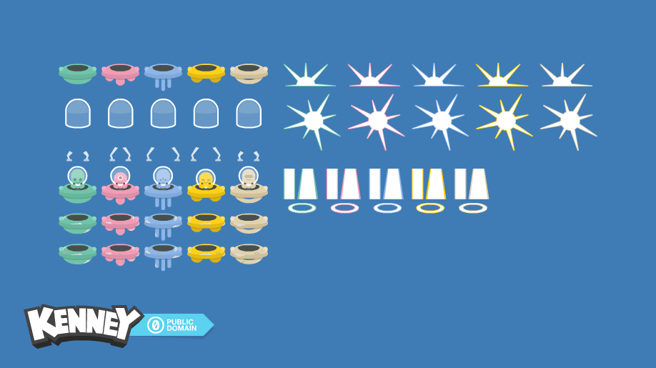
- 파일: `alien-ufo-pack.zip` (PNG 50개: UFO·빔·폭발 이펙트 + 스프라이트시트)
- 제작: Kenney / 라이선스: CC0 / 원본: https://kenney.nl/assets/alien-ufo-pack

### Zelda-like tilesets and sprites
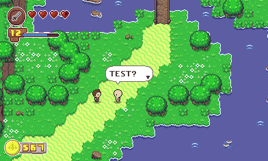
- 파일: [릴리스  첨부 다운로드](https://github.com/sigco3111/assets-2d-pixel/releases/download//zelda-like-tilesets-and-sprites.zip) (368KB, png 11개)
- 제작: SdiviHall / 라이선스: CC0 / 원본: https://opengameart.org/content/zelda-like-tilesets-and-sprites

### A platformer in the forest
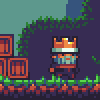
- 파일: [릴리스  첨부 다운로드](https://github.com/sigco3111/assets-2d-pixel/releases/download//a-platformer-in-the-forest.zip) (72KB, png 8개)
- 제작: Jerom / 라이선스: CC0 / 원본: https://opengameart.org/content/a-platformer-in-the-forest

### Dungeon Crawl 32x32 tiles
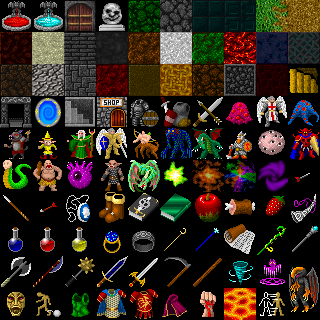
- 파일: [릴리스  첨부 다운로드](https://github.com/sigco3111/assets-2d-pixel/releases/download//dungeon-crawl-32x32-tiles.zip) (16.3MB, png 9074개 · txt 9개)
- 제작: bart / 라이선스: CC0 / 원본: https://opengameart.org/content/dungeon-crawl-32x32-tiles

### Dungeon tileset
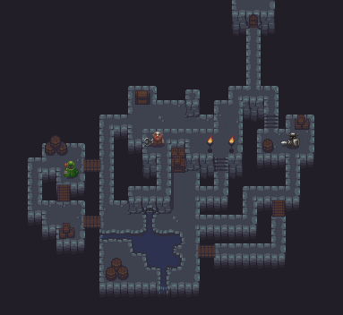
- 파일: [릴리스  첨부 다운로드](https://github.com/sigco3111/assets-2d-pixel/releases/download//dungeon-tileset.zip) (57KB, png 3개)
- 제작: FuzzyWuzzie / 라이선스: CC0 / 원본: https://opengameart.org/content/dungeon-tileset

### A blocky dungeon
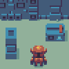
- 파일: [릴리스  첨부 다운로드](https://github.com/sigco3111/assets-2d-pixel/releases/download//a-blocky-dungeon.zip) (135KB, png 3개)
- 제작: ILIKESCIFI / 라이선스: CC0 / 원본: https://opengameart.org/content/a-blocky-dungeon

### The Field of the Floating Islands
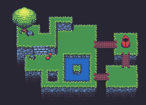
- 파일: [릴리스  첨부 다운로드](https://github.com/sigco3111/assets-2d-pixel/releases/download//the-field-of-the-floating-islands.zip) (150KB, png 6개)
- 제작: devurandom / 라이선스: CC0 / 원본: https://opengameart.org/content/the-field-of-the-floating-islands

### Mage City Arcanos
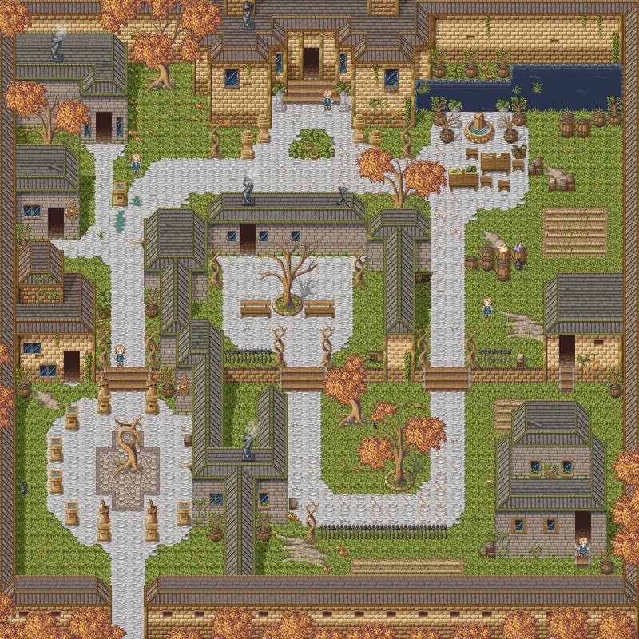
- 파일: [릴리스  첨부 다운로드](https://github.com/sigco3111/assets-2d-pixel/releases/download//mage-city-arcanos.zip) (1.2MB, png 2개)
- 제작: Myckel / 라이선스: CC0 / 원본: https://opengameart.org/content/mage-city-arcanos

### Platformer Art Complete Pack (often updated)
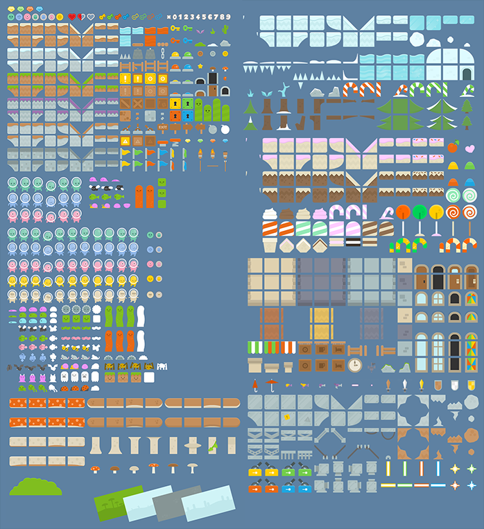
- 파일: [릴리스  첨부 다운로드](https://github.com/sigco3111/assets-2d-pixel/releases/download//platformer-art-complete-pack-often-updated.zip) (7.5MB, png 975개 · svg 10개 · txt 5개 · json 3개)
- 제작: russpuppy / 라이선스: CC0 / 원본: https://opengameart.org/content/platformer-art-complete-pack-often-updated

### Mobile Controls
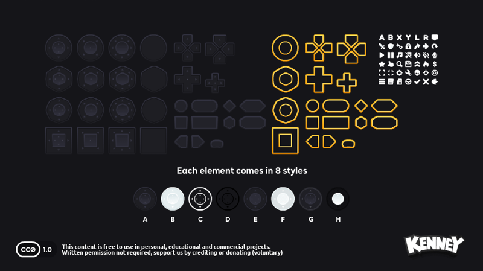
- 파일: [릴리스  첨부 다운로드](https://github.com/sigco3111/assets-2d-pixel/releases/download//mobile-controls.zip) (3.2MB, png 950개 · svg 462개 · txt 1개)
- 제작: Kaemalux / 라이선스: CC0 / 원본: https://opengameart.org/content/mobile-controls

### Platformer Art Deluxe
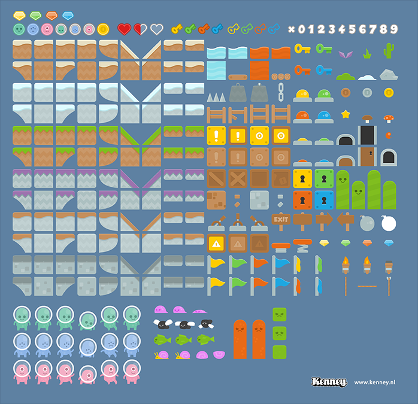
- 파일: [릴리스  첨부 다운로드](https://github.com/sigco3111/assets-2d-pixel/releases/download//platformer-art-deluxe.zip) (3.0MB, png 346개 · txt 5개 · svg 3개 · json 3개)
- 제작: JustinAnyhowStep / 라이선스: CC0 / 원본: https://opengameart.org/content/platformer-art-deluxe

### Mountain at Dusk Background
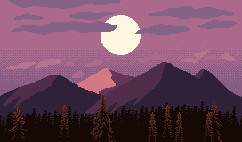
- 파일: [릴리스  첨부 다운로드](https://github.com/sigco3111/assets-2d-pixel/releases/download//mountain-at-dusk-background.zip) (176KB, png 5개 · txt 1개)
- 제작: ILIKESCIFI / 라이선스: CC0 / 원본: https://opengameart.org/content/mountain-at-dusk-background

### castle platformer
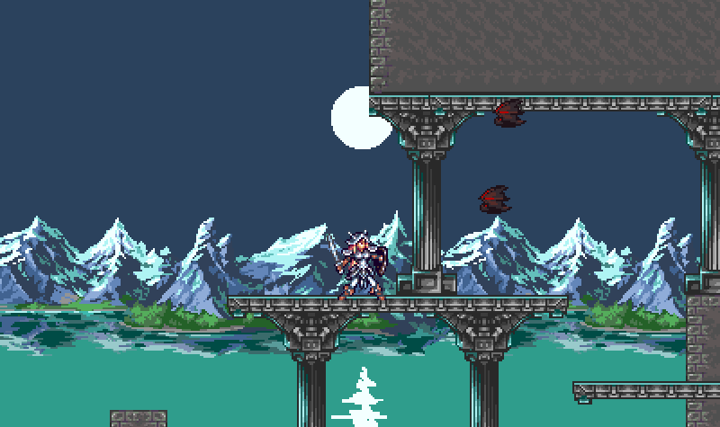
- 파일: [릴리스  첨부 다운로드](https://github.com/sigco3111/assets-2d-pixel/releases/download//castle-platformer.zip) (76KB, png 9개)
- 제작: TinyWorlds / 라이선스: CC0 / 원본: https://opengameart.org/content/castle-platformer

### Dungeon Crawl 32x32 tiles supplemental
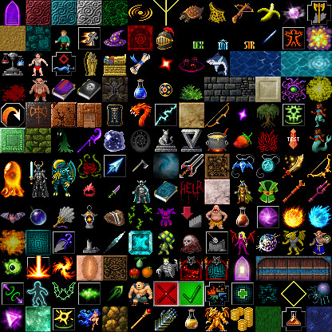
- 파일: [릴리스  첨부 다운로드](https://github.com/sigco3111/assets-2d-pixel/releases/download//dungeon-crawl-32x32-tiles-supplemental.zip) (18.7MB, png 9050개 · txt 4개 · jpg 1개)
- 제작: vlzvl / 라이선스: CC0 / 원본: https://opengameart.org/content/dungeon-crawl-32x32-tiles-supplemental

### Generic Platformer Tiles
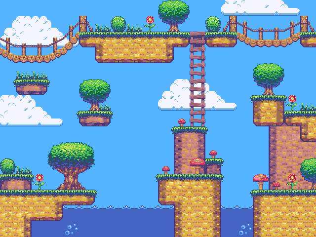
- 파일: [릴리스  첨부 다운로드](https://github.com/sigco3111/assets-2d-pixel/releases/download//generic-platformer-tiles.zip) (66KB, png 2개)
- 제작: manwesulimo2004 / 라이선스: CC0 / 원본: https://opengameart.org/content/generic-platformer-tiles

### Lasers and beams
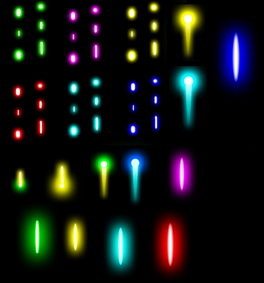
- 파일: [릴리스  첨부 다운로드](https://github.com/sigco3111/assets-2d-pixel/releases/download//lasers-and-beams.zip) (118KB, png 2개)
- 제작: Napoleon / 라이선스: CC0 / 원본: https://opengameart.org/content/lasers-and-beams

### Forest Background
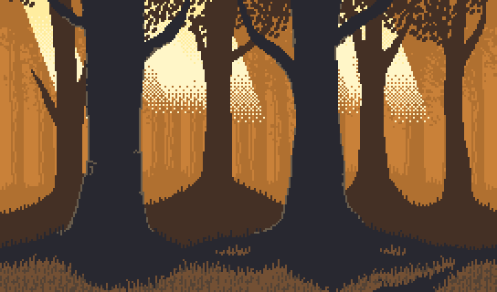
- 파일: [릴리스  첨부 다운로드](https://github.com/sigco3111/assets-2d-pixel/releases/download//forest-background.zip) (203KB, png 5개 · txt 1개)
- 제작: Warspawn / 라이선스: CC0 / 원본: https://opengameart.org/content/forest-background

### 100 Seamless Textures
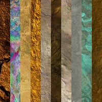
- 파일: [릴리스  첨부 다운로드](https://github.com/sigco3111/assets-2d-pixel/releases/download//100-seamless-textures.zip) (15.6MB, jpg 101개)
- 제작: Grandmaster B / 라이선스: CC0 / 원본: https://opengameart.org/content/100-seamless-textures

### Wall, grass, rock, stone, wood and dirt (480)
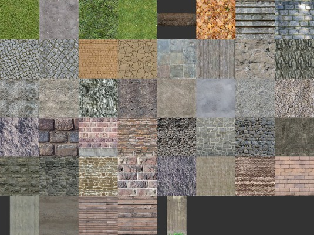
- 파일: [릴리스  첨부 다운로드](https://github.com/sigco3111/assets-2d-pixel/releases/download//wall-grass-rock-stone-wood-and-dirt-480.zip) (21.3MB, png 45개 · jpg 1개)
- 제작: lattice / 라이선스: CC0 / 원본: https://opengameart.org/content/wall-grass-rock-stone-wood-and-dirt-480

### paramecij's vegetation base texture pack
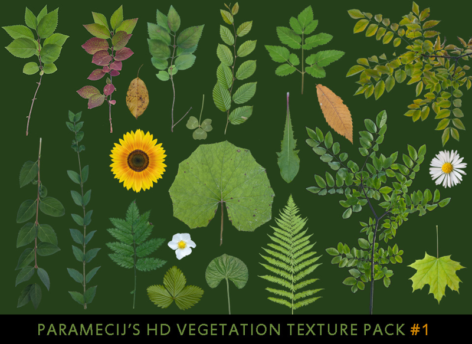
- 파일: [릴리스  첨부 다운로드](https://github.com/sigco3111/assets-2d-pixel/releases/download//paramecijs-vegetation-base-texture-pack.zip) (27.3MB, png 21개 · jpg 1개)
- 제작: Atmostatic / 라이선스: CC0 / 원본: https://opengameart.org/content/paramecijs-vegetation-base-texture-pack

### Tileable Grass Textures - Set 1
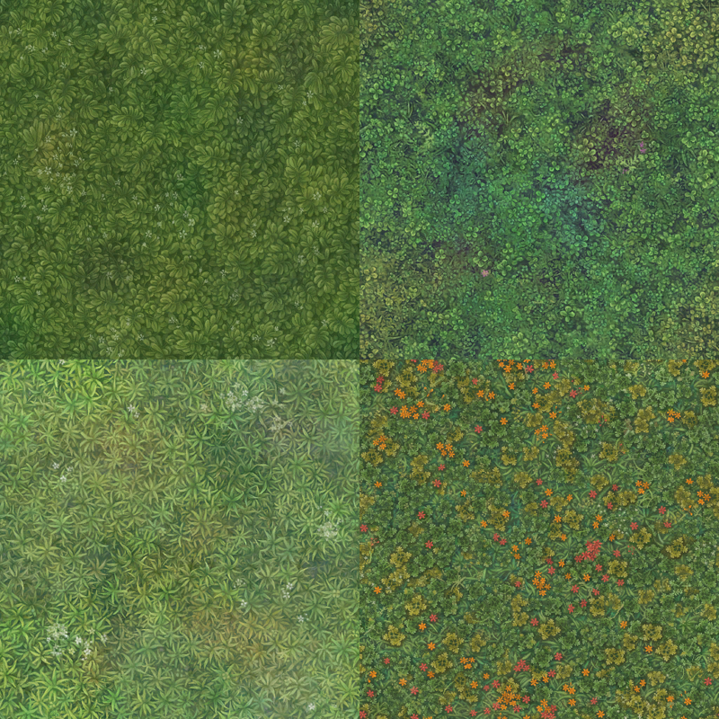
- 파일: [릴리스  첨부 다운로드](https://github.com/sigco3111/assets-2d-pixel/releases/download//tileable-grass-textures-set-1.zip) (6.9MB, png 9개)
- 제작: Drummyfish / 라이선스: CC0 / 원본: https://opengameart.org/content/tileable-grass-textures-set-1

### Industrial Parallax Background
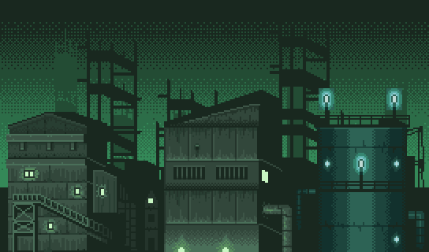
- 파일: [릴리스  첨부 다운로드](https://github.com/sigco3111/assets-2d-pixel/releases/download//industrial-parallax-background.zip) (534KB, png 4개 · txt 1개)
- 제작: LunaVR / 라이선스: CC0 / 원본: https://opengameart.org/content/industrial-parallax-background

### Flare Item Variation (60x60 Only)
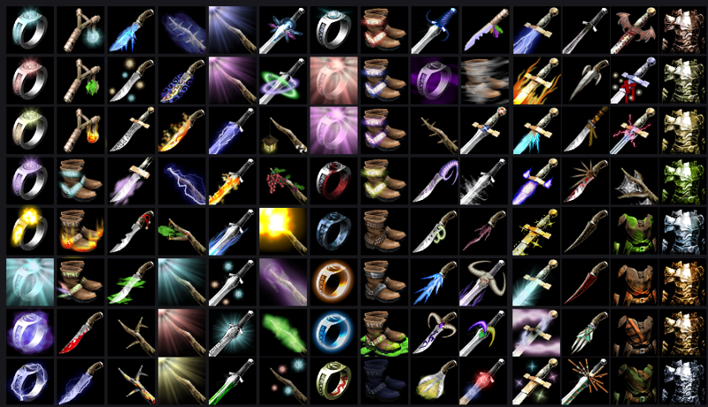
- 파일: [릴리스  첨부 다운로드](https://github.com/sigco3111/assets-2d-pixel/releases/download//flare-item-variation-60x60-only.zip) (1.6MB, png 10개)
- 제작: bart / 라이선스: CC0 / 원본: https://opengameart.org/content/flare-item-variation-60x60-only

### Blowhard 2: Blow Harder
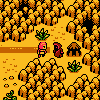
- 파일: [릴리스  첨부 다운로드](https://github.com/sigco3111/assets-2d-pixel/releases/download//blowhard-2-blow-harder.zip) (220KB, png 6개)
- 제작: cdoty / 라이선스: CC0 / 원본: https://opengameart.org/content/blowhard-2-blow-harder

### Trees & Bushes
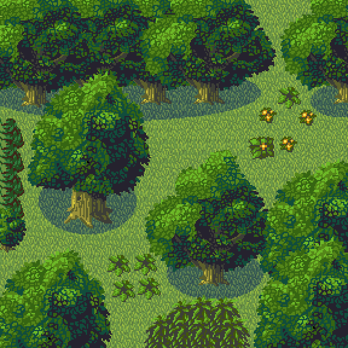
- 파일: [릴리스  첨부 다운로드](https://github.com/sigco3111/assets-2d-pixel/releases/download//trees-bushes.zip) (167KB, png 2개 · txt 1개)
- 제작: Arachnibot / 라이선스: CC0 / 원본: https://opengameart.org/content/trees-bushes

### Colony sim assets
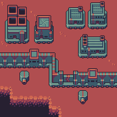
- 파일: [릴리스  첨부 다운로드](https://github.com/sigco3111/assets-2d-pixel/releases/download//colony-sim-assets.zip) (100KB, png 5개)
- 제작: Julius / 라이선스: CC0 / 원본: https://opengameart.org/content/colony-sim-assets

### Space Shooter Redux
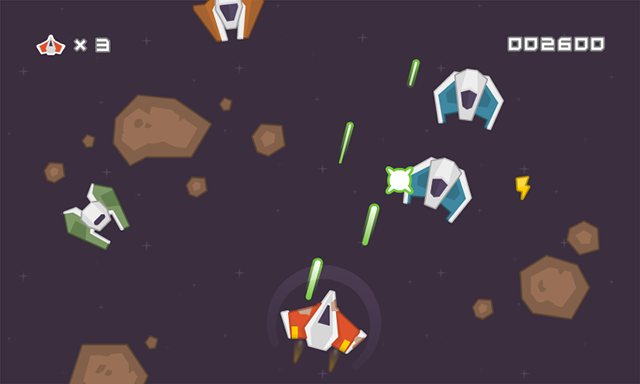
- 파일: [릴리스  첨부 다운로드](https://github.com/sigco3111/assets-2d-pixel/releases/download//space-shooter-redux.zip) (1.4MB, png 303개 · ogg 7개 · txt 1개 · svg 1개)
- 제작: Moviemake / 라이선스: CC0 / 원본: https://opengameart.org/content/space-shooter-redux

### 190+ Pixel Art Assets (Sci-fi & Forest)
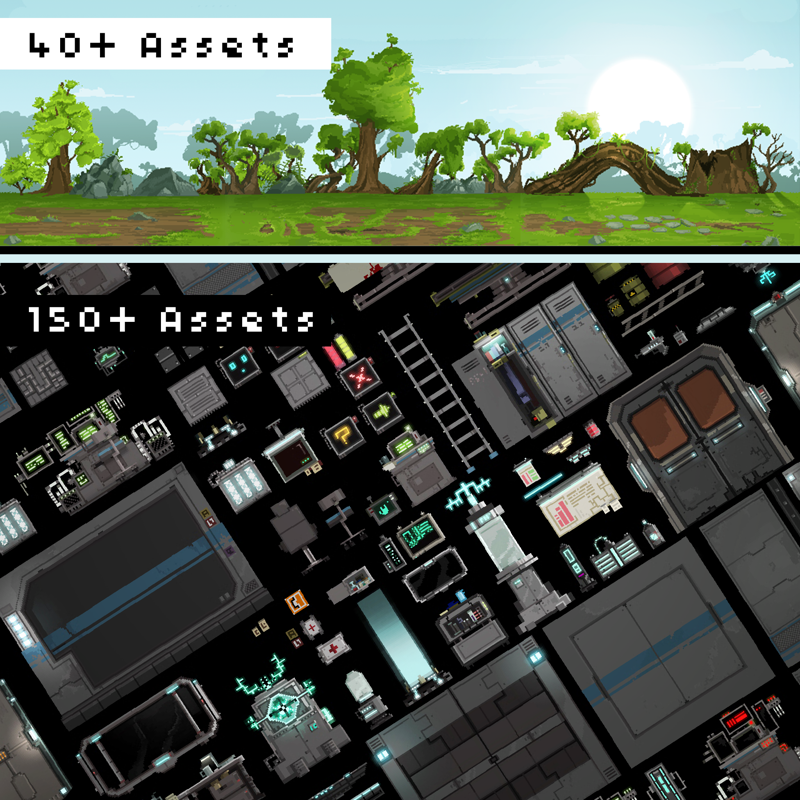
- 파일: [릴리스  첨부 다운로드](https://github.com/sigco3111/assets-2d-pixel/releases/download//190-pixel-art-assets-sci-fi-forest.zip) (9.3MB, png 194개)
- 제작: vlandemart / 라이선스: CC0 / 원본: https://opengameart.org/content/190-pixel-art-assets-sci-fi-forest

### FREE Keyboard and controllers prompts pack

- 파일: [릴리스  첨부 다운로드](https://github.com/sigco3111/assets-2d-pixel/releases/download//free-keyboard-and-controllers-prompts-pack.zip) (4.8MB, png 583개 · txt 1개)
- 제작: zerohero / 라이선스: CC0 / 원본: https://opengameart.org/content/free-keyboard-and-controllers-prompts-pack

### Seasonal Platformer Tiles
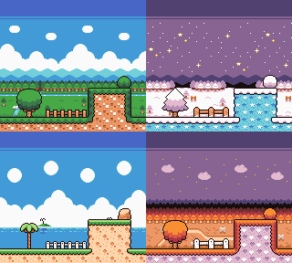
- 파일: [릴리스  첨부 다운로드](https://github.com/sigco3111/assets-2d-pixel/releases/download//seasonal-platformer-tiles.zip) (23KB, png 2개)
- 제작: Demetrius / 라이선스: CC0 / 원본: https://opengameart.org/content/seasonal-platformer-tiles

### HD multi-layer Parallex background samples of Glitch game assets.
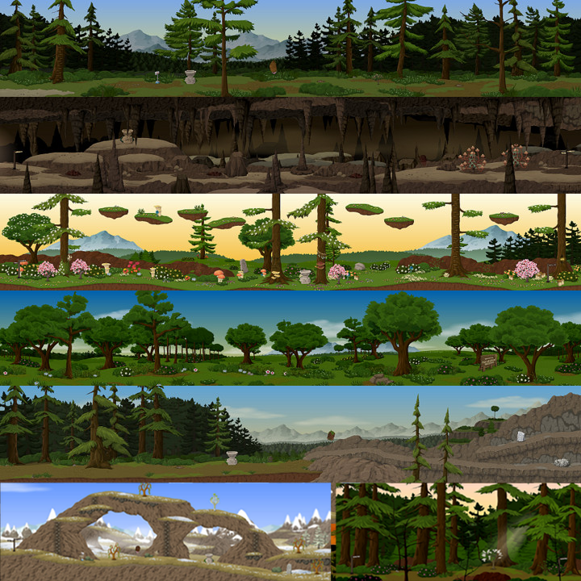
- 파일: [릴리스  첨부 다운로드](https://github.com/sigco3111/assets-2d-pixel/releases/download//hd-multi-layer-parallex-background-samples-of-glitch-game-assets.zip) (44.5MB, png 66개 · jpg 10개)
- 제작: Saltflower / 라이선스: CC0 / 원본: https://opengameart.org/content/hd-multi-layer-parallex-background-samples-of-glitch-game-assets

### Orthographic outdoor tiles
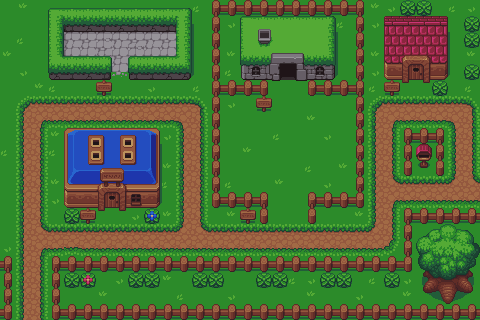
- 파일: [릴리스  첨부 다운로드](https://github.com/sigco3111/assets-2d-pixel/releases/download//orthographic-outdoor-tiles.zip) (62KB, png 3개)
- 제작: russpuppy / 라이선스: CC0 / 원본: https://opengameart.org/content/orthographic-outdoor-tiles

### Country Side Platform Tiles
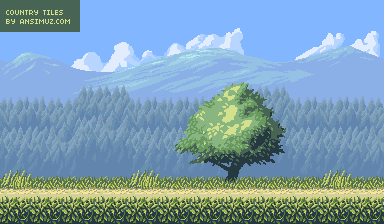
- 파일: [릴리스  첨부 다운로드](https://github.com/sigco3111/assets-2d-pixel/releases/download//country-side-platform-tiles.zip) (132KB, png 6개 · txt 1개)
- 제작: looneybits / 라이선스: CC0 / 원본: https://opengameart.org/content/country-side-platform-tiles

### Magic Cliffs Environment
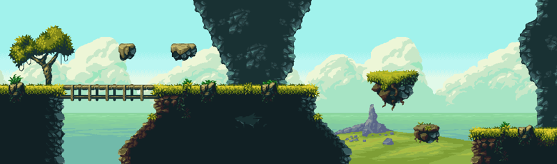
- 파일: [릴리스  첨부 다운로드](https://github.com/sigco3111/assets-2d-pixel/releases/download//magic-cliffs-environment.zip) (583KB, png 8개 · txt 1개)
- 제작: DezrasDragons / 라이선스: CC0 / 원본: https://opengameart.org/content/magic-cliffs-environment

### 16x16 RPG items
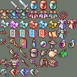
- 파일: [릴리스  첨부 다운로드](https://github.com/sigco3111/assets-2d-pixel/releases/download//16x16-rpg-items.zip) (25KB, png 1개 · jpg 1개)
- 제작: Clint Bellanger / 라이선스: CC0 / 원본: https://opengameart.org/content/16x16-rpg-items

### Sci-fi platform tiles
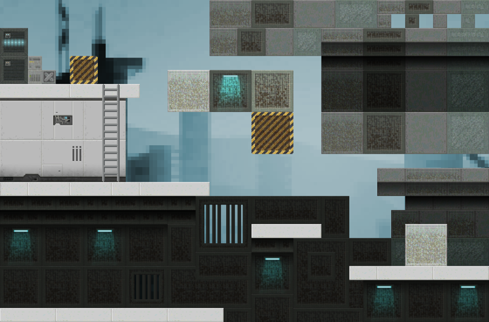
- 파일: [릴리스  첨부 다운로드](https://github.com/sigco3111/assets-2d-pixel/releases/download//sci-fi-platform-tiles.zip) (600KB, png 3개 · jpg 1개)
- 제작: rubberduck / 라이선스: CC0 / 원본: https://opengameart.org/content/sci-fi-platform-tiles

### Superpowers assets various 2d
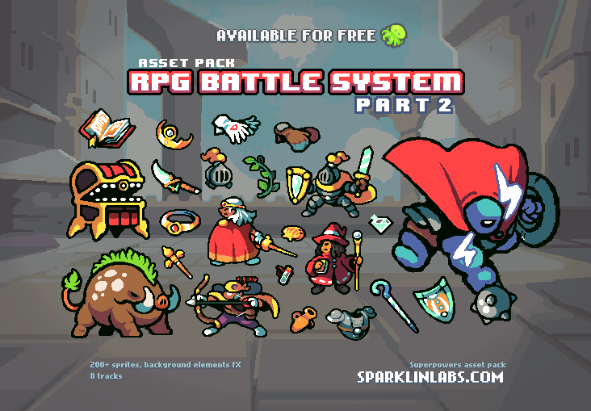
- 파일: [릴리스  첨부 다운로드](https://github.com/sigco3111/assets-2d-pixel/releases/download//superpowers-assets-various-2d.zip) (4.0MB, png 792개 · txt 4개)
- 제작: ToDaDev / 라이선스: CC0 / 원본: https://opengameart.org/content/superpowers-assets-various-2d

### Simple broad-purpose tileset
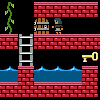
- 파일: [릴리스  첨부 다운로드](https://github.com/sigco3111/assets-2d-pixel/releases/download//simple-broad-purpose-tileset.zip) (66KB, png 3개)
- 제작: cdoty / 라이선스: CC0 / 원본: https://opengameart.org/content/simple-broad-purpose-tileset

### Sci-fi Interior tiles
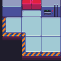
- 파일: [릴리스  첨부 다운로드](https://github.com/sigco3111/assets-2d-pixel/releases/download//sci-fi-interior-tiles.zip) (39KB, png 4개)
- 제작: MDK / 라이선스: CC0 / 원본: https://opengameart.org/content/sci-fi-interior-tiles

### 2D Shooter Effects (Alpha version)
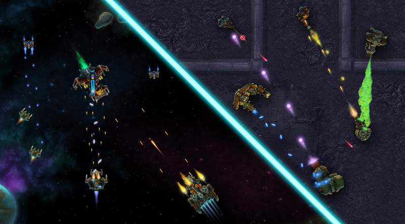
- 파일: [릴리스  첨부 다운로드](https://github.com/sigco3111/assets-2d-pixel/releases/download//2d-shooter-effects-alpha-version.zip) (1.6MB, png 2개)
- 제작: dilock / 라이선스: CC0 / 원본: https://opengameart.org/content/2d-shooter-effects-alpha-version

### Arcade Platformer Assets
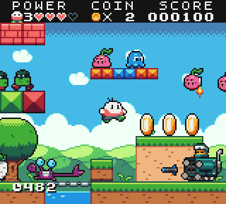
- 파일: [릴리스  첨부 다운로드](https://github.com/sigco3111/assets-2d-pixel/releases/download//arcade-platformer-assets.zip) (19KB, png 2개)
- 제작: Snabisch / 라이선스: CC0 / 원본: https://opengameart.org/content/arcade-platformer-assets

### Cat sprites
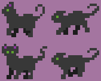
- 파일: [릴리스  첨부 다운로드](https://github.com/sigco3111/assets-2d-pixel/releases/download//cat-sprites.zip) (21KB, )
- 제작: Mihail121 / 라이선스: CC0 / 원본: https://opengameart.org/content/cat-sprites

### Town Tiles
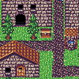
- 파일: [릴리스  첨부 다운로드](https://github.com/sigco3111/assets-2d-pixel/releases/download//town-tiles.zip) (5KB, png 2개)
- 제작: bart / 라이선스: CC0 / 원본: https://opengameart.org/content/town-tiles

### Modular Ships
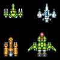
- 파일: [릴리스  첨부 다운로드](https://github.com/sigco3111/assets-2d-pixel/releases/download//modular-ships.zip) (28KB, png 3개)
- 제작: Firefly in the Dusk / 라이선스: CC0 / 원본: https://opengameart.org/content/modular-ships

### old frogatto tile art
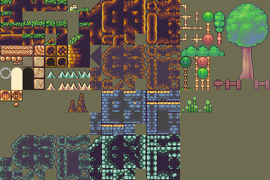
- 파일: [릴리스  첨부 다운로드](https://github.com/sigco3111/assets-2d-pixel/releases/download//old-frogatto-tile-art.zip) (43KB, png 2개)
- 제작: mirex / 라이선스: CC0 / 원본: https://opengameart.org/content/old-frogatto-tile-art

### Animated Explosions
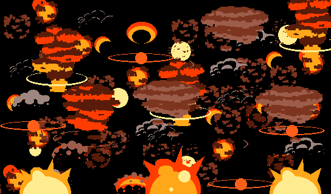
- 파일: [릴리스  첨부 다운로드](https://github.com/sigco3111/assets-2d-pixel/releases/download//animated-explosions.zip) (78KB, png 6개 · txt 1개)
- 제작: Nikita_Sadkov / 라이선스: CC0 / 원본: https://opengameart.org/content/animated-explosions

### RPG Town Pixel Art Assets
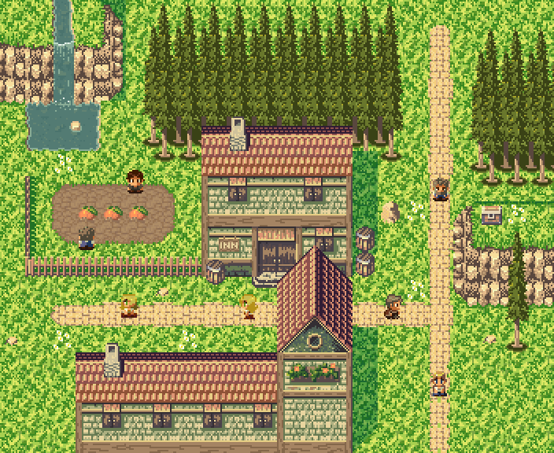
- 파일: [릴리스  첨부 다운로드](https://github.com/sigco3111/assets-2d-pixel/releases/download//rpg-town-pixel-art-assets.zip) (305KB, png 8개 · txt 1개)
- 제작: Reemax / 라이선스: CC0 / 원본: https://opengameart.org/content/rpg-town-pixel-art-assets

### Misc. Dark Fantasy Scenery Sprites
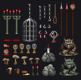
- 파일: [릴리스  첨부 다운로드](https://github.com/sigco3111/assets-2d-pixel/releases/download//misc-dark-fantasy-scenery-sprites.zip) (7KB, png 1개)
- 제작: Delirius / 라이선스: CC0 / 원본: https://opengameart.org/content/misc-dark-fantasy-scenery-sprites

### Classical Ruin Tiles

- 파일: [릴리스  첨부 다운로드](https://github.com/sigco3111/assets-2d-pixel/releases/download//classical-ruin-tiles.zip) (31KB, png 2개)
- 제작: Anonymous (not verified) / 라이선스: CC0 / 원본: https://opengameart.org/content/classical-ruin-tiles

### Platform Pixel Art Assets

- 파일: [릴리스  첨부 다운로드](https://github.com/sigco3111/assets-2d-pixel/releases/download//platform-pixel-art-assets.zip) (78KB, png 6개 · wav 3개 · txt 1개)
- 제작: Mophs / 라이선스: CC0 / 원본: https://opengameart.org/content/platform-pixel-art-assets

### Animated particle effects #2

- 파일: [릴리스  첨부 다운로드](https://github.com/sigco3111/assets-2d-pixel/releases/download//animated-particle-effects-2.zip) (7.3MB, png 17개 · jpg 1개)
- 제작: Trollypolly / 라이선스: CC0 / 원본: https://opengameart.org/content/animated-particle-effects-2

### Classic Hero

- 파일: [릴리스  첨부 다운로드](https://github.com/sigco3111/assets-2d-pixel/releases/download//classic-hero.zip) (3KB, png 2개)
- 제작: StormtrooperJon / 라이선스: CC0 / 원본: https://opengameart.org/content/classic-hero

### Gothicvania Town

- 파일: [릴리스  첨부 다운로드](https://github.com/sigco3111/assets-2d-pixel/releases/download//gothicvania-town.zip) (8.9MB, png 131개 · ogg 3개 · json 3개 · txt 2개 · mp3 2개)
- 제작: HR78 / 라이선스: CC0 / 원본: https://opengameart.org/content/gothicvania-town

### MV Platformer Male (32x64)

- 파일: [릴리스  첨부 다운로드](https://github.com/sigco3111/assets-2d-pixel/releases/download//mv-platformer-male-32x64.zip) (351KB, png 20개)
- 제작: Curt / 라이선스: CC0 / 원본: https://opengameart.org/content/mv-platformer-male-32x64

### Bullet Collection 1 (M484)

- 파일: [릴리스  첨부 다운로드](https://github.com/sigco3111/assets-2d-pixel/releases/download//bullet-collection-1-m484.zip) (28KB, png 3개)
- 제작: davexunit / 라이선스: CC0 / 원본: https://opengameart.org/content/bullet-collection-1-m484

### Tiny Characters Set

- 파일: [릴리스  첨부 다운로드](https://github.com/sigco3111/assets-2d-pixel/releases/download//tiny-characters-set.zip) (65KB, png 29개)
- 제작: SdiviHall / 라이선스: CC0 / 원본: https://opengameart.org/content/tiny-characters-set

### Backgrounds

- 파일: [릴리스  첨부 다운로드](https://github.com/sigco3111/assets-2d-pixel/releases/download//backgrounds-3.zip) (18.7MB, png 39개)
- 제작: AntumDeluge / 라이선스: CC0 / 원본: https://opengameart.org/content/backgrounds-3

### Forest Tiles

- 파일: [릴리스  첨부 다운로드](https://github.com/sigco3111/assets-2d-pixel/releases/download//forest-tiles.zip) (6KB, png 2개)
- 제작: Syrsly / 라이선스: CC0 / 원본: https://opengameart.org/content/forest-tiles

### Winter Birds

- 파일: [릴리스  첨부 다운로드](https://github.com/sigco3111/assets-2d-pixel/releases/download//winter-birds.zip) (10KB, png 2개)
- 제작: KnoblePersona / 라이선스: CC0 / 원본: https://opengameart.org/content/winter-birds

### DB32 Cave tileset

- 파일: [릴리스  첨부 다운로드](https://github.com/sigco3111/assets-2d-pixel/releases/download//db32-cave-tileset.zip) (32KB, png 3개)
- 제작: Sam / 라이선스: CC0 / 원본: https://opengameart.org/content/db32-cave-tileset

### City Mega Pack

- 파일: [릴리스  첨부 다운로드](https://github.com/sigco3111/assets-2d-pixel/releases/download//city-mega-pack.zip) (258KB, png 3개)
- 제작: greenfield / 라이선스: CC0 / 원본: https://opengameart.org/content/city-mega-pack

### Underwater Diving Pack

- 파일: [릴리스  첨부 다운로드](https://github.com/sigco3111/assets-2d-pixel/releases/download//underwater-diving-pack.zip) (8.3MB, png 42개 · txt 4개 · ogg 2개 · mp3 1개)
- 제작: surt / 라이선스: CC0 / 원본: https://opengameart.org/content/underwater-diving-pack

### Ruined City Background

- 파일: [릴리스  첨부 다운로드](https://github.com/sigco3111/assets-2d-pixel/releases/download//ruined-city-background.zip) (194KB, png 5개)
- 제작: SquareFox / 라이선스: CC0 / 원본: https://opengameart.org/content/ruined-city-background

### Roguelike Modern City pack

- 파일: [릴리스  첨부 다운로드](https://github.com/sigco3111/assets-2d-pixel/releases/download//roguelike-modern-city-pack.zip) (940KB, png 6개 · txt 2개)
- 제작: LittleSadNerd / 라이선스: CC0 / 원본: https://opengameart.org/content/roguelike-modern-city-pack

### Abandonauts 8x8 tile assets

- 파일: [릴리스  첨부 다운로드](https://github.com/sigco3111/assets-2d-pixel/releases/download//abandonauts-8x8-tile-assets.zip) (47KB, png 31개)
- 제작: bart / 라이선스: CC0 / 원본: https://opengameart.org/content/abandonauts-8x8-tile-assets

### Pixel land 1.5

- 파일: [릴리스  첨부 다운로드](https://github.com/sigco3111/assets-2d-pixel/releases/download//pixel-land-15.zip) (54KB, png 2개)
- 제작: smonos / 라이선스: CC0 / 원본: https://opengameart.org/content/pixel-land-15

### Outdoor 32x32 tileset

- 파일: [릴리스  첨부 다운로드](https://github.com/sigco3111/assets-2d-pixel/releases/download//outdoor-32x32-tileset.zip) (128KB, png 3개)
- 제작: Snabisch / 라이선스: CC0 / 원본: https://opengameart.org/content/outdoor-32x32-tileset

### Hexagon Tiles

- 파일: [릴리스  첨부 다운로드](https://github.com/sigco3111/assets-2d-pixel/releases/download//hexagon-tiles-0.zip) (851KB, png 103개 · txt 1개 · svg 1개)
- 제작: Danimal / 라이선스: CC0 / 원본: https://opengameart.org/content/hexagon-tiles-0

### Puzzle game art

- 파일: [릴리스  첨부 다운로드](https://github.com/sigco3111/assets-2d-pixel/releases/download//puzzle-game-art.zip) (725KB, png 78개 · jpg 3개 · svg 1개 · txt 1개)
- 제작: cemkalyoncu / 라이선스: CC0 / 원본: https://opengameart.org/content/puzzle-game-art

### Square Block Textures

- 파일: [릴리스  첨부 다운로드](https://github.com/sigco3111/assets-2d-pixel/releases/download//square-block-textures.zip) (36KB, png 3개)
- 제작: DarkUranium / 라이선스: CC0 / 원본: https://opengameart.org/content/square-block-textures

### Explosion Set 1 (M484 Games)

- 파일: [릴리스  첨부 다운로드](https://github.com/sigco3111/assets-2d-pixel/releases/download//explosion-set-1-m484-games.zip) (29KB, png 3개)
- 제작: Amon / 라이선스: CC0 / 원본: https://opengameart.org/content/explosion-set-1-m484-games

### Plums

- 파일: [릴리스  첨부 다운로드](https://github.com/sigco3111/assets-2d-pixel/releases/download//plums.zip) (30KB, png 3개)
- 제작: Redshrike / 라이선스: CC0 / 원본: https://opengameart.org/content/plums

### Overworld - Grass Biome

- 파일: [릴리스  첨부 다운로드](https://github.com/sigco3111/assets-2d-pixel/releases/download//overworld-grass-biome.zip) (384KB, png 8개 · tmx 2개 · tsx 1개)
- 제작: Red_Voxel / 라이선스: CC0 / 원본: https://opengameart.org/content/overworld-grass-biome

### Bullet Collection 2 (M484 Games)

- 파일: [릴리스  첨부 다운로드](https://github.com/sigco3111/assets-2d-pixel/releases/download//bullet-collection-2-m484-games.zip) (83KB, png 4개)
- 제작: mengtest / 라이선스: CC0 / 원본: https://opengameart.org/content/bullet-collection-2-m484-games

### Platformer tiles

- 파일: [릴리스  첨부 다운로드](https://github.com/sigco3111/assets-2d-pixel/releases/download//platformer-tiles.zip) (724KB, png 67개 · jpg 2개 · svg 1개 · txt 1개)
- 제작: fir3st0rm9 / 라이선스: CC0 / 원본: https://opengameart.org/content/platformer-tiles

### DENZI's public domain art

- 파일: [릴리스  첨부 다운로드](https://github.com/sigco3111/assets-2d-pixel/releases/download//denzis-public-domain-art.zip) (4.2MB, png 1379개 · jpg 5개 · txt 2개)
- 제작: bbulle / 라이선스: CC0 / 원본: https://opengameart.org/content/denzis-public-domain-art

### Spooky Castle Tileset

- 파일: [릴리스  첨부 다운로드](https://github.com/sigco3111/assets-2d-pixel/releases/download//spooky-castle-tileset.zip) (97KB, png 6개)
- 제작: cemkalyoncu / 라이선스: CC0 / 원본: https://opengameart.org/content/spooky-castle-tileset

### explosion animations

- 파일: [릴리스  첨부 다운로드](https://github.com/sigco3111/assets-2d-pixel/releases/download//explosion-animations.zip) (17KB, png 1개)
- 제작: Anonymous (not verified) / 라이선스: CC0 / 원본: https://opengameart.org/content/explosion-animations

### 2D Explosion Animations

- 파일: [릴리스  첨부 다운로드](https://github.com/sigco3111/assets-2d-pixel/releases/download//2d-explosion-animations-frame-by-frame.zip) (16.0MB, png 9개)
- 제작: Lhawika / 라이선스: CC0 / 원본: https://opengameart.org/content/2d-explosion-animations-frame-by-frame

### Fumiko Complete Charset

- 파일: [릴리스  첨부 다운로드](https://github.com/sigco3111/assets-2d-pixel/releases/download//fumiko-complete-charset.zip) (139KB, png 3개)
- 제작: ILIKESCIFI / 라이선스: CC0 / 원본: https://opengameart.org/content/fumiko-complete-charset

### More NES-like Tiles

- 파일: [릴리스  첨부 다운로드](https://github.com/sigco3111/assets-2d-pixel/releases/download//more-nes-like-tiles.zip) (111KB, png 3개)
- 제작: ILIKESCIFI / 라이선스: CC0 / 원본: https://opengameart.org/content/more-nes-like-tiles

### Particle Pack (80+ sprites)

- 파일: [릴리스  첨부 다운로드](https://github.com/sigco3111/assets-2d-pixel/releases/download//particle-pack-80-sprites.zip) (9.9MB, png 98개 · txt 1개)
- 제작: Prime_8 / 라이선스: CC0 / 원본: https://opengameart.org/content/particle-pack-80-sprites

### Sunny Land 2D Pixel Art Pack

- 파일: [릴리스  첨부 다운로드](https://github.com/sigco3111/assets-2d-pixel/releases/download//sunny-land-2d-pixel-art-pack.zip) (7.1MB, png 109개 · json 3개 · ogg 2개 · txt 1개 · mp3 1개)
- 제작: aleksander / 라이선스: CC0 / 원본: https://opengameart.org/content/sunny-land-2d-pixel-art-pack

### Space Background

- 파일: [릴리스  첨부 다운로드](https://github.com/sigco3111/assets-2d-pixel/releases/download//space-background-3.zip) (196KB, png 5개 · txt 1개)
- 제작: Boogle / 라이선스: CC0 / 원본: https://opengameart.org/content/space-background-3

### Platformer Art: Pixel edition

- 파일: [릴리스  첨부 다운로드](https://github.com/sigco3111/assets-2d-pixel/releases/download//platformer-art-pixel-edition.zip) (72KB, png 5개 · txt 1개)
- 제작: cdoty / 라이선스: CC0 / 원본: https://opengameart.org/content/platformer-art-pixel-edition

### Platformer sprites

- 파일: [릴리스  첨부 다운로드](https://github.com/sigco3111/assets-2d-pixel/releases/download//platformer-sprites.zip) (7.4MB, png 42개 · ogg 12개 · svg 6개 · blend 3개)
- 제작: cemkalyoncu / 라이선스: CC0 / 원본: https://opengameart.org/content/platformer-sprites

### Items and elements

- 파일: [릴리스  첨부 다운로드](https://github.com/sigco3111/assets-2d-pixel/releases/download//items-and-elements.zip) (6KB, png 2개)
- 제작: balmut / 라이선스: CC0 / 원본: https://opengameart.org/content/items-and-elements

### Smoke particle assets

- 파일: [릴리스  첨부 다운로드](https://github.com/sigco3111/assets-2d-pixel/releases/download//smoke-particle-assets.zip) (13.6MB, png 81개 · txt 1개)
- 제작: RaoulWB / 라이선스: CC0 / 원본: https://opengameart.org/content/smoke-particle-assets

### Hero spritesheets (Ars Notoria)

- 파일: [릴리스  첨부 다운로드](https://github.com/sigco3111/assets-2d-pixel/releases/download//hero-spritesheets-ars-notoria.zip) (202KB, png 164개)
- 제작: ILIKESCIFI / 라이선스: CC0 / 원본: https://opengameart.org/content/hero-spritesheets-ars-notoria

### Flowers

- 파일: [릴리스  첨부 다운로드](https://github.com/sigco3111/assets-2d-pixel/releases/download//flowers.zip) (13KB, png 3개)
- 제작: withthelove / 라이선스: CC0 / 원본: https://opengameart.org/content/flowers

### Free Pixel Effects Pack

- 파일: [릴리스  첨부 다운로드](https://github.com/sigco3111/assets-2d-pixel/releases/download//free-pixel-effects-pack.zip) (2.8MB, png 22개 · txt 1개)
- 제작: ChoclateGod / 라이선스: CC0 / 원본: https://opengameart.org/content/free-pixel-effects-pack

### Superpowers assets background elements

- 파일: [릴리스  첨부 다운로드](https://github.com/sigco3111/assets-2d-pixel/releases/download//superpowers-assets-background-elements.zip) (4.4MB, png 291개 · blend 5개 · txt 2개)
- 제작: -Shade- / 라이선스: CC0 / 원본: https://opengameart.org/content/superpowers-assets-background-elements

### Classic hero and baddies pack

- 파일: [릴리스  첨부 다운로드](https://github.com/sigco3111/assets-2d-pixel/releases/download//classic-hero-and-baddies-pack.zip) (10KB, png 2개)
- 제작: salty-piggy / 라이선스: CC0 / 원본: https://opengameart.org/content/classic-hero-and-baddies-pack

### GothicVania Cemetery Pack

- 파일: [릴리스  첨부 다운로드](https://github.com/sigco3111/assets-2d-pixel/releases/download//gothicvania-cemetery-pack.zip) (3.6MB, png 98개 · ogg 6개 · json 3개 · txt 1개)
- 제작: withthelove / 라이선스: CC0 / 원본: https://opengameart.org/content/gothicvania-cemetery-pack

### Seamless HD landscape in parts

- 파일: [릴리스  첨부 다운로드](https://github.com/sigco3111/assets-2d-pixel/releases/download//seamless-hd-landscape-in-parts.zip) (1.1MB, png 9개)
- 제작: aleksander / 라이선스: CC0 / 원본: https://opengameart.org/content/seamless-hd-landscape-in-parts

### Weapon Slash - Effect

- 파일: [릴리스  첨부 다운로드](https://github.com/sigco3111/assets-2d-pixel/releases/download//weapon-slash-effect.zip) (2.7MB, png 129개)
- 제작: knik1985 / 라이선스: CC0 / 원본: https://opengameart.org/content/weapon-slash-effect

### Happyland tileset

- 파일: [릴리스  첨부 다운로드](https://github.com/sigco3111/assets-2d-pixel/releases/download//happyland-tileset.zip) (37KB, png 3개)
- 제작: Eiyeron / 라이선스: CC0 / 원본: https://opengameart.org/content/happyland-tileset

### Omega Team

- 파일: [릴리스  첨부 다운로드](https://github.com/sigco3111/assets-2d-pixel/releases/download//omega-team.zip) (85KB, png 3개)
- 제작: ILIKESCIFI / 라이선스: CC0 / 원본: https://opengameart.org/content/omega-team

### Simple duotone tileset

- 파일: [릴리스  첨부 다운로드](https://github.com/sigco3111/assets-2d-pixel/releases/download//simple-duotone-tileset.zip) (18KB, png 4개)
- 제작: Amir027 / 라이선스: CC0 / 원본: https://opengameart.org/content/simple-duotone-tileset

### Platformer Art: Pixel Redux

- 파일: [릴리스  첨부 다운로드](https://github.com/sigco3111/assets-2d-pixel/releases/download//platformer-art-pixel-redux.zip) (460KB, png 5개 · txt 1개)
- 제작: Kaemalux / 라이선스: CC0 / 원본: https://opengameart.org/content/platformer-art-pixel-redux

### Big Space Gun: Free pixel-art graphics for your game

- 파일: [릴리스  첨부 다운로드](https://github.com/sigco3111/assets-2d-pixel/releases/download//big-space-gun-free-pixel-art-graphics-for-your-game-0.zip) (739KB, png 1개)
- 제작: bart / 라이선스: CC0 / 원본: https://opengameart.org/content/big-space-gun-free-pixel-art-graphics-for-your-game-0

### Minimal Industrial Tiles

- 파일: [릴리스  첨부 다운로드](https://github.com/sigco3111/assets-2d-pixel/releases/download//minimal-industrial-tiles.zip) (17KB, png 3개)
- 제작: Blarget2 / 라이선스: CC0 / 원본: https://opengameart.org/content/minimal-industrial-tiles

### Free Desert Platformer Tileset

- 파일: [릴리스  첨부 다운로드](https://github.com/sigco3111/assets-2d-pixel/releases/download//free-desert-platformer-tileset.zip) (4.8MB, png 31개 · jpg 4개 · svg 2개)
- 제작: dannorder / 라이선스: CC0 / 원본: https://opengameart.org/content/free-desert-platformer-tileset

### 64 crosshairs pack

- 파일: [릴리스  첨부 다운로드](https://github.com/sigco3111/assets-2d-pixel/releases/download//64-crosshairs-pack.zip) (108KB, png 1개 · txt 1개 · jpg 1개)
- 제작: Vladiedoo / 라이선스: CC0 / 원본: https://opengameart.org/content/64-crosshairs-pack

### Bulkhead Walls Hangar

- 파일: [릴리스  첨부 다운로드](https://github.com/sigco3111/assets-2d-pixel/releases/download//bulkhead-walls-hangar.zip) (102KB, png 7개 · txt 1개)
- 제작: Snabisch / 라이선스: CC0 / 원본: https://opengameart.org/content/bulkhead-walls-hangar

### Urban Landscape

- 파일: [릴리스  첨부 다운로드](https://github.com/sigco3111/assets-2d-pixel/releases/download//urban-landscape.zip) (70KB, png 4개 · txt 1개)
- 제작: rubberduck / 라이선스: CC0 / 원본: https://opengameart.org/content/urban-landscape

### Medals

- 파일: [릴리스  첨부 다운로드](https://github.com/sigco3111/assets-2d-pixel/releases/download//medals-2.zip) (258KB, png 32개 · txt 1개)
- 제작: cemkalyoncu / 라이선스: CC0 / 원본: https://opengameart.org/content/medals-2

### Dawn of the Gods

- 파일: [릴리스  첨부 다운로드](https://github.com/sigco3111/assets-2d-pixel/releases/download//dawn-of-the-gods.zip) (165KB, png 3개)
- 제작: vk / 라이선스: CC0 / 원본: https://opengameart.org/content/dawn-of-the-gods

### Super Seasonal Platformer Tiles

- 파일: [릴리스  첨부 다운로드](https://github.com/sigco3111/assets-2d-pixel/releases/download//super-seasonal-platformer-tiles.zip) (70KB, png 2개)
- 제작: looneybits / 라이선스: CC0 / 원본: https://opengameart.org/content/super-seasonal-platformer-tiles

### Platformer Art: More animations and enemies

- 파일: [릴리스  첨부 다운로드](https://github.com/sigco3111/assets-2d-pixel/releases/download//platformer-art-more-animations-and-enemies.zip) (1.4MB, png 176개 · svg 2개 · txt 1개)
- 제작: Arsonide / 라이선스: CC0 / 원본: https://opengameart.org/content/platformer-art-more-animations-and-enemies

### Space Backgrounds

- 파일: [릴리스  첨부 다운로드](https://github.com/sigco3111/assets-2d-pixel/releases/download//space-backgrounds-3.zip) (14.6MB, png 4개 · jpg 4개)
- 제작: Duion2 / 라이선스: CC0 / 원본: https://opengameart.org/content/space-backgrounds-3

### Cute characters, monsters, and game assets

- 파일: [릴리스  첨부 다운로드](https://github.com/sigco3111/assets-2d-pixel/releases/download//cute-characters-monsters-and-game-assets.zip) (15.4MB, png 5개)
- 제작: Acorn / 라이선스: CC0 / 원본: https://opengameart.org/content/cute-characters-monsters-and-game-assets

### Fantasy Book

- 파일: [릴리스  첨부 다운로드](https://github.com/sigco3111/assets-2d-pixel/releases/download//fantasy-book.zip) (1.3MB, png 1개)
- 제작: Charlie / 라이선스: CC0 / 원본: https://opengameart.org/content/fantasy-book

### Zombies & Skeletons

- 파일: [릴리스  첨부 다운로드](https://github.com/sigco3111/assets-2d-pixel/releases/download//zombies-skeletons.zip) (16KB, png 2개)
- 제작: bart / 라이선스: CC0 / 원본: https://opengameart.org/content/zombies-skeletons

### 64 16x16 food sprites

- 파일: [릴리스  첨부 다운로드](https://github.com/sigco3111/assets-2d-pixel/releases/download//64-16x16-food-sprites.zip) (45KB, png 2개)
- 제작: mold / 라이선스: CC0 / 원본: https://opengameart.org/content/64-16x16-food-sprites

### Animated particle effects #1

- 파일: [릴리스  첨부 다운로드](https://github.com/sigco3111/assets-2d-pixel/releases/download//animated-particle-effects-1.zip) (16.1MB, png 14개 · jpg 1개)
- 제작: yd / 라이선스: CC0 / 원본: https://opengameart.org/content/animated-particle-effects-1

### Gameboy Tileset

- 파일: [릴리스  첨부 다운로드](https://github.com/sigco3111/assets-2d-pixel/releases/download//gameboy-tileset.zip) (56KB, png 2개)
- 제작: SdiviHall / 라이선스: CC0 / 원본: https://opengameart.org/content/gameboy-tileset

### Sci-fi platformer tileset

- 파일: [릴리스  첨부 다운로드](https://github.com/sigco3111/assets-2d-pixel/releases/download//sci-fi-platformer-tileset.zip) (132KB, png 7개)
- 제작: Snabisch / 라이선스: CC0 / 원본: https://opengameart.org/content/sci-fi-platformer-tileset

### Superpowers assets characters

- 파일: [릴리스  첨부 다운로드](https://github.com/sigco3111/assets-2d-pixel/releases/download//superpowers-assets-characters.zip) (4.3MB, png 279개 · txt 4개 · jpg 1개 · aseprite 1개)
- 제작: Snabisch / 라이선스: CC0 / 원본: https://opengameart.org/content/superpowers-assets-characters

### RPG pack: base set

- 파일: [릴리스  첨부 다운로드](https://github.com/sigco3111/assets-2d-pixel/releases/download//rpg-pack-base-set.zip) (1.9MB, png 235개 · txt 1개 · svg 1개)
- 제작: TangZero / 라이선스: CC0 / 원본: https://opengameart.org/content/rpg-pack-base-set

### Treasure chests, 32x32 and 16x16

- 파일: [릴리스  첨부 다운로드](https://github.com/sigco3111/assets-2d-pixel/releases/download//treasure-chests-32x32-and-16x16.zip) (32KB, png 5개)
- 제작: Gaurav / 라이선스: CC0 / 원본: https://opengameart.org/content/treasure-chests-32x32-and-16x16

### explosion

- 파일: [릴리스  첨부 다운로드](https://github.com/sigco3111/assets-2d-pixel/releases/download//explosion.zip) (256KB, jpg 4개 · png 2개)
- 제작: Charlie / 라이선스: CC0 / 원본: https://opengameart.org/content/explosion

### Roguelike Character pack

- 파일: [릴리스  첨부 다운로드](https://github.com/sigco3111/assets-2d-pixel/releases/download//roguelike-character-pack.zip) (233KB, png 6개 · txt 2개)
- 제작: Sogomn / 라이선스: CC0 / 원본: https://opengameart.org/content/roguelike-character-pack

### candy pack 1

- 파일: [릴리스  첨부 다운로드](https://github.com/sigco3111/assets-2d-pixel/releases/download//candy-pack-1.zip) (5.0MB, png 341개 · svg 1개)
- 제작: Jan125 / 라이선스: CC0 / 원본: https://opengameart.org/content/candy-pack-1

### Glitch Ilmenskie underground/cave terrain (SVG)

- 파일: [릴리스  첨부 다운로드](https://github.com/sigco3111/assets-2d-pixel/releases/download//glitch-ilmenskie-undergroundcave-terrain-svg.zip) (6.7MB, svg 408개 · jpg 2개 · png 1개)
- 제작: Moviemake / 라이선스: CC0 / 원본: https://opengameart.org/content/glitch-ilmenskie-undergroundcave-terrain-svg

### Classical Temple Tiles

- 파일: [릴리스  첨부 다운로드](https://github.com/sigco3111/assets-2d-pixel/releases/download//classical-temple-tiles.zip) (42KB, png 2개)
- 제작: CruzR / 라이선스: CC0 / 원본: https://opengameart.org/content/classical-temple-tiles

### Breakout set

- 파일: [릴리스  첨부 다운로드](https://github.com/sigco3111/assets-2d-pixel/releases/download//breakout-set.zip) (141KB, png 7개)
- 제작: surt / 라이선스: CC0 / 원본: https://opengameart.org/content/breakout-set

### Bat (32x32)

- 파일: [릴리스  첨부 다운로드](https://github.com/sigco3111/assets-2d-pixel/releases/download//bat-32x32.zip) (3KB, )
- 제작: Anonymous (not verified) / 라이선스: CC0 / 원본: https://opengameart.org/content/bat-32x32

### Generic Platformer Tileset (16x16) + Background

- 파일: [릴리스  첨부 다운로드](https://github.com/sigco3111/assets-2d-pixel/releases/download//generic-platformer-tileset-16x16-background.zip) (20KB, png 4개)
- 제작: smoke_th / 라이선스: CC0 / 원본: https://opengameart.org/content/generic-platformer-tileset-16x16-background

### top-down RPG mockup scene

- 파일: [릴리스  첨부 다운로드](https://github.com/sigco3111/assets-2d-pixel/releases/download//top-down-rpg-mockup-scene.zip) (491KB, png 14개)
- 제작: kicknbrit / 라이선스: CC0 / 원본: https://opengameart.org/content/top-down-rpg-mockup-scene

### 2D Explosion Animations #2

- 파일: [릴리스  첨부 다운로드](https://github.com/sigco3111/assets-2d-pixel/releases/download//2d-explosion-animations-2-frame-by-frame.zip) (19.4MB, png 9개)
- 제작: Razzved4ik / 라이선스: CC0 / 원본: https://opengameart.org/content/2d-explosion-animations-2-frame-by-frame

### Unfinished user interfaces

- 파일: [릴리스  첨부 다운로드](https://github.com/sigco3111/assets-2d-pixel/releases/download//unfinished-user-interfaces.zip) (25KB, png 1개)
- 제작: absinthe / 라이선스: CC0 / 원본: https://opengameart.org/content/unfinished-user-interfaces

### Pixel world hex tileset

- 파일: [릴리스  첨부 다운로드](https://github.com/sigco3111/assets-2d-pixel/releases/download//pixel-world-hex-tileset.zip) (132KB, png 4개)
- 제작: bart / 라이선스: CC0 / 원본: https://opengameart.org/content/pixel-world-hex-tileset

### simple map tiles

- 파일: [릴리스  첨부 다운로드](https://github.com/sigco3111/assets-2d-pixel/releases/download//simple-map-tiles.zip) (7.6MB, png 6개)
- 제작: Chestera / 라이선스: CC0 / 원본: https://opengameart.org/content/simple-map-tiles

### Isometric Buildings #1

- 파일: [릴리스  첨부 다운로드](https://github.com/sigco3111/assets-2d-pixel/releases/download//isometric-buildings-1.zip) (2.0MB, png 134개 · txt 1개)
- 제작: Supergeek / 라이선스: CC0 / 원본: https://opengameart.org/content/isometric-buildings-1

### Oil painting landscapes

- 파일: [릴리스  첨부 다운로드](https://github.com/sigco3111/assets-2d-pixel/releases/download//oil-painting-landscapes.zip) (2.9MB, png 4개)
- 제작: Pompei2 / 라이선스: CC0 / 원본: https://opengameart.org/content/oil-painting-landscapes

### Boxes and crates - svg and pngs

- 파일: [릴리스  첨부 다운로드](https://github.com/sigco3111/assets-2d-pixel/releases/download//boxes-and-crates-svg-and-pngs.zip) (126KB, png 11개 · svg 1개)
- 제작: Delirius / 라이선스: CC0 / 원본: https://opengameart.org/content/boxes-and-crates-svg-and-pngs

### Space Ship Shooter Pixel Art Assets

- 파일: [릴리스  첨부 다운로드](https://github.com/sigco3111/assets-2d-pixel/releases/download//space-ship-shooter-pixel-art-assets.zip) (168KB, png 12개 · txt 1개)
- 제작: NiceVibe / 라이선스: CC0 / 원본: https://opengameart.org/content/space-ship-shooter-pixel-art-assets

### Mnimap

- 파일: [릴리스  첨부 다운로드](https://github.com/sigco3111/assets-2d-pixel/releases/download//mnimap.zip) (3.6MB, png 1개)
- 제작: Buch / 라이선스: CC0 / 원본: https://opengameart.org/content/mnimap

### Blowhard Chronicles

- 파일: [릴리스  첨부 다운로드](https://github.com/sigco3111/assets-2d-pixel/releases/download//blowhard-chronicles.zip) (4KB, png 2개)
- 제작: Sharm / 라이선스: CC0 / 원본: https://opengameart.org/content/blowhard-chronicles

### Space Shooter Extension (250+)

- 파일: [릴리스  첨부 다운로드](https://github.com/sigco3111/assets-2d-pixel/releases/download//space-shooter-extension-250.zip) (3.3MB, png 563개 · txt 1개 · svg 1개)
- 제작: KASTLE Knight / 라이선스: CC0 / 원본: https://opengameart.org/content/space-shooter-extension-250

### Platformer Baddies

- 파일: [릴리스  첨부 다운로드](https://github.com/sigco3111/assets-2d-pixel/releases/download//platformer-baddies.zip) (4KB, png 2개)
- 제작: surt / 라이선스: CC0 / 원본: https://opengameart.org/content/platformer-baddies

### Isometric road tiles (Nova)

- 파일: [릴리스  첨부 다운로드](https://github.com/sigco3111/assets-2d-pixel/releases/download//isometric-road-tiles-nova.zip) (979KB, png 96개 · jpg 2개 · svg 1개 · txt 1개)
- 제작: Jattenalle / 라이선스: CC0 / 원본: https://opengameart.org/content/isometric-road-tiles-nova

### Warped Caves Pixel Art Pack

- 파일: [릴리스  첨부 다운로드](https://github.com/sigco3111/assets-2d-pixel/releases/download//warped-caves-pixel-art-pack.zip) (5.9MB, png 120개 · json 3개 · ogg 2개 · txt 1개 · mp3 1개)
- 제작: surt / 라이선스: CC0 / 원본: https://opengameart.org/content/warped-caves-pixel-art-pack

### Forest Tiles

- 파일: [릴리스  첨부 다운로드](https://github.com/sigco3111/assets-2d-pixel/releases/download//forest-tiles-0.zip) (2.6MB, png 2개)
- 제작: qubodup / 라이선스: CC0 / 원본: https://opengameart.org/content/forest-tiles-0

### Outside tileset

- 파일: [릴리스  첨부 다운로드](https://github.com/sigco3111/assets-2d-pixel/releases/download//outside-tileset.zip) (71KB, png 3개)
- 제작: cbritez / 라이선스: CC0 / 원본: https://opengameart.org/content/outside-tileset

### Modified 32x32 Treasure chest

- 파일: [릴리스  첨부 다운로드](https://github.com/sigco3111/assets-2d-pixel/releases/download//modified-32x32-treasure-chest.zip) (3KB, png 1개 · jpg 1개)
- 제작: HaelDB / 라이선스: CC0 / 원본: https://opengameart.org/content/modified-32x32-treasure-chest

### Several scrolling backgrounds and layerable "runners"

- 파일: [릴리스  첨부 다운로드](https://github.com/sigco3111/assets-2d-pixel/releases/download//several-scrolling-backgrounds-and-layerable-runners.zip) (488KB, png 58개)
- 제작: CruzR / 라이선스: CC0 / 원본: https://opengameart.org/content/several-scrolling-backgrounds-and-layerable-runners

### Match 3

- 파일: [릴리스  첨부 다운로드](https://github.com/sigco3111/assets-2d-pixel/releases/download//match-3.zip) (59KB, png 5개)
- 제작: Sharm / 라이선스: CC0 / 원본: https://opengameart.org/content/match-3

### MV Platformer Skeleton

- 파일: [릴리스  첨부 다운로드](https://github.com/sigco3111/assets-2d-pixel/releases/download//mv-platformer-skeleton.zip) (23KB, png 3개)
- 제작: PixelRyan / 라이선스: CC0 / 원본: https://opengameart.org/content/mv-platformer-skeleton

### Gameboy Platformer Art

- 파일: [릴리스  첨부 다운로드](https://github.com/sigco3111/assets-2d-pixel/releases/download//gameboy-platformer-art.zip) (557KB, png 29개)
- 제작: rubberduck / 라이선스: CC0 / 원본: https://opengameart.org/content/gameboy-platformer-art

### Dark Fantasy item sprites

- 파일: [릴리스  첨부 다운로드](https://github.com/sigco3111/assets-2d-pixel/releases/download//dark-fantasy-item-sprites.zip) (54KB, png 2개)
- 제작: manwesulimo2004 / 라이선스: CC0 / 원본: https://opengameart.org/content/dark-fantasy-item-sprites

### Free Platformer Game Tileset

- 파일: [릴리스  첨부 다운로드](https://github.com/sigco3111/assets-2d-pixel/releases/download//free-platformer-game-tileset.zip) (9.2MB, png 33개 · jpg 3개 · svg 2개)
- 제작: Aetherna / 라이선스: CC0 / 원본: https://opengameart.org/content/free-platformer-game-tileset

### Animated Top Down Zombie

- 파일: [릴리스  첨부 다운로드](https://github.com/sigco3111/assets-2d-pixel/releases/download//animated-top-down-zombie.zip) (2.2MB, png 44개)
- 제작: simkis / 라이선스: CC0 / 원본: https://opengameart.org/content/animated-top-down-zombie

### Warped City

- 파일: [릴리스  첨부 다운로드](https://github.com/sigco3111/assets-2d-pixel/releases/download//warped-city.zip) (4.5MB, png 138개 · ogg 4개 · json 2개 · txt 1개 · wav 1개)
- 제작: Snabisch / 라이선스: CC0 / 원본: https://opengameart.org/content/warped-city

### Loveable Rogue

- 파일: [릴리스  첨부 다운로드](https://github.com/sigco3111/assets-2d-pixel/releases/download//loveable-rogue.zip) (38KB, png 3개)
- 제작: mfburn / 라이선스: CC0 / 원본: https://opengameart.org/content/loveable-rogue

### CaverNES

- 파일: [릴리스  첨부 다운로드](https://github.com/sigco3111/assets-2d-pixel/releases/download//cavernes.zip) (26KB, png 2개)
- 제작: dannorder / 라이선스: CC0 / 원본: https://opengameart.org/content/cavernes

### Animations - Blood, Hit and Both :D

- 파일: [릴리스  첨부 다운로드](https://github.com/sigco3111/assets-2d-pixel/releases/download//animations-blood-hit-and-both-d.zip) (2.0MB, png 4개)
- 제작: AntumDeluge / 라이선스: CC0 / 원본: https://opengameart.org/content/animations-blood-hit-and-both-d

### 2D Spell Effects

- 파일: [릴리스  첨부 다운로드](https://github.com/sigco3111/assets-2d-pixel/releases/download//2d-spell-effects.zip) (3.1MB, png 231개 · txt 1개)
- 제작: InanZen / 라이선스: CC0 / 원본: https://opengameart.org/content/2d-spell-effects

### Topdown Shooter

- 파일: [릴리스  첨부 다운로드](https://github.com/sigco3111/assets-2d-pixel/releases/download//topdown-shooter.zip) (3.0MB, png 589개 · svg 2개 · txt 1개)
- 제작: call me / 라이선스: CC0 / 원본: https://opengameart.org/content/topdown-shooter

### Unfinished dungeon tileset

- 파일: [릴리스  첨부 다운로드](https://github.com/sigco3111/assets-2d-pixel/releases/download//unfinished-dungeon-tileset.zip) (30KB, png 2개)
- 제작: pbondoer / 라이선스: CC0 / 원본: https://opengameart.org/content/unfinished-dungeon-tileset

### Gum Bot sprites

- 파일: [릴리스  첨부 다운로드](https://github.com/sigco3111/assets-2d-pixel/releases/download//gum-bot-sprites.zip) (5KB, png 2개)
- 제작: Snabisch / 라이선스: CC0 / 원본: https://opengameart.org/content/gum-bot-sprites

### Simple NES-like Platformer Tiles

- 파일: [릴리스  첨부 다운로드](https://github.com/sigco3111/assets-2d-pixel/releases/download//simple-nes-like-platformer-tiles.zip) (133KB, png 3개)
- 제작: Buch / 라이선스: CC0 / 원본: https://opengameart.org/content/simple-nes-like-platformer-tiles

### Platformer Art: Request Pack

- 파일: [릴리스  첨부 다운로드](https://github.com/sigco3111/assets-2d-pixel/releases/download//platformer-art-request-pack.zip) (709KB, png 103개 · txt 1개 · svg 1개)
- 제작: russpuppy / 라이선스: CC0 / 원본: https://opengameart.org/content/platformer-art-request-pack

### Zombie and Skeleton 32x48

- 파일: [릴리스  첨부 다운로드](https://github.com/sigco3111/assets-2d-pixel/releases/download//zombie-and-skeleton-32x48.zip) (35KB, png 2개)
- 제작: Redshrike / 라이선스: CC0 / 원본: https://opengameart.org/content/zombie-and-skeleton-32x48

### DarkNES

- 파일: [릴리스  첨부 다운로드](https://github.com/sigco3111/assets-2d-pixel/releases/download//darknes.zip) (28KB, png 2개)
- 제작: cdoty / 라이선스: CC0 / 원본: https://opengameart.org/content/darknes

### 24x32 bases

- 파일: [릴리스  첨부 다운로드](https://github.com/sigco3111/assets-2d-pixel/releases/download//24x32-bases.zip) (16KB, png 4개)
- 제작: AntumDeluge / 라이선스: CC0 / 원본: https://opengameart.org/content/24x32-bases

### Isometric road tiles

- 파일: [릴리스  첨부 다운로드](https://github.com/sigco3111/assets-2d-pixel/releases/download//isometric-road-tiles.zip) (935KB, png 69개 · jpg 2개 · svg 1개 · txt 1개)
- 제작: yd / 라이선스: CC0 / 원본: https://opengameart.org/content/isometric-road-tiles

### Haunted Forest Trees

- 파일: [릴리스  첨부 다운로드](https://github.com/sigco3111/assets-2d-pixel/releases/download//haunted-forest-trees.zip) (13KB, png 2개)
- 제작: cemkalyoncu / 라이선스: CC0 / 원본: https://opengameart.org/content/haunted-forest-trees

### Roguelike Indoor pack

- 파일: [릴리스  첨부 다운로드](https://github.com/sigco3111/assets-2d-pixel/releases/download//roguelike-indoor-pack.zip) (380KB, png 6개 · txt 2개)
- 제작: Riyan010699 / 라이선스: CC0 / 원본: https://opengameart.org/content/roguelike-indoor-pack

### RPG character sprites

- 파일: [릴리스  첨부 다운로드](https://github.com/sigco3111/assets-2d-pixel/releases/download//rpg-character-sprites.zip) (3KB, png 2개)
- 제작: SpiderDave / 라이선스: CC0 / 원본: https://opengameart.org/content/rpg-character-sprites

### Free Top Down Car Sprites by Unlucky Studio

- 파일: [릴리스  첨부 다운로드](https://github.com/sigco3111/assets-2d-pixel/releases/download//free-top-down-car-sprites-by-unlucky-studio.zip) (547KB, png 15개 · jpg 2개 · txt 1개)
- 제작: headsickshawn / 라이선스: CC0 / 원본: https://opengameart.org/content/free-top-down-car-sprites-by-unlucky-studio

### Smoke Aura

- 파일: [릴리스  첨부 다운로드](https://github.com/sigco3111/assets-2d-pixel/releases/download//smoke-aura.zip) (5.6MB, png 95개 · blend 1개)
- 제작: tehwave / 라이선스: CC0 / 원본: https://opengameart.org/content/smoke-aura

### SunnyLand - Forest

- 파일: [릴리스  첨부 다운로드](https://github.com/sigco3111/assets-2d-pixel/releases/download//sunnyland-forest.zip) (5.0MB, png 123개 · mp3 7개 · ogg 7개 · wav 6개 · json 3개)
- 제작: BizmasterStudios / 라이선스: CC0 / 원본: https://opengameart.org/content/sunnyland-forest

### Gun Construction Kit

- 파일: [릴리스  첨부 다운로드](https://github.com/sigco3111/assets-2d-pixel/releases/download//gun-construction-kit.zip) (459KB, jpg 5개 · svg 4개)
- 제작: bart / 라이선스: CC0 / 원본: https://opengameart.org/content/gun-construction-kit

### Home Objects

- 파일: [릴리스  첨부 다운로드](https://github.com/sigco3111/assets-2d-pixel/releases/download//home-objects.zip) (18KB, png 4개)
- 제작: Curt / 라이선스: CC0 / 원본: https://opengameart.org/content/home-objects

### Ninja Girl - Free Sprite

- 파일: [릴리스  첨부 다운로드](https://github.com/sigco3111/assets-2d-pixel/releases/download//ninja-girl-free-sprite.zip) (10.3MB, png 91개 · jpg 1개)
- 제작: psychogirl4life / 라이선스: CC0 / 원본: https://opengameart.org/content/ninja-girl-free-sprite

### Platform tileset nature

- 파일: [릴리스  첨부 다운로드](https://github.com/sigco3111/assets-2d-pixel/releases/download//platform-tileset-nature.zip) (443KB, png 133개)
- 제작: moonshades / 라이선스: CC0 / 원본: https://opengameart.org/content/platform-tileset-nature

### Old Pages/Flip with sound

- 파일: [릴리스  첨부 다운로드](https://github.com/sigco3111/assets-2d-pixel/releases/download//old-pagesflip-with-sound.zip) (3.7MB, ogg 1개 · png 1개)
- 제작: Anonymous (not verified) / 라이선스: CC0 / 원본: https://opengameart.org/content/old-pagesflip-with-sound

### Japanese buildings - isometric strategy game mockup

- 파일: [릴리스  첨부 다운로드](https://github.com/sigco3111/assets-2d-pixel/releases/download//japanese-buildings-isometric-strategy-game-mockup.zip) (18KB, png 1개)
- 제작: undesired / 라이선스: CC0 / 원본: https://opengameart.org/content/japanese-buildings-isometric-strategy-game-mockup

### Lemcraft

- 파일: [릴리스  첨부 다운로드](https://github.com/sigco3111/assets-2d-pixel/releases/download//lemcraft.zip) (336KB, png 44개 · jpg 1개)
- 제작: Clint Bellanger / 라이선스: CC0 / 원본: https://opengameart.org/content/lemcraft

### Simple NES-like Village Tiles

- 파일: [릴리스  첨부 다운로드](https://github.com/sigco3111/assets-2d-pixel/releases/download//simple-nes-like-village-tiles.zip) (38KB, png 3개)
- 제작: ILIKESCIFI / 라이선스: CC0 / 원본: https://opengameart.org/content/simple-nes-like-village-tiles

### 2D Planets

- 파일: [릴리스  첨부 다운로드](https://github.com/sigco3111/assets-2d-pixel/releases/download//2d-planets-0.zip) (45.7MB, png 25개)
- 제작: sionronin / 라이선스: CC0 / 원본: https://opengameart.org/content/2d-planets-0

### NESmup

- 파일: [릴리스  첨부 다운로드](https://github.com/sigco3111/assets-2d-pixel/releases/download//nesmup.zip) (18KB, png 2개)
- 제작: ILIKESCIFI / 라이선스: CC0 / 원본: https://opengameart.org/content/nesmup

### Medals

- 파일: [릴리스  첨부 다운로드](https://github.com/sigco3111/assets-2d-pixel/releases/download//medals-3.zip) (94KB, png 3개)
- 제작: Alucard / 라이선스: CC0 / 원본: https://opengameart.org/content/medals-3

### Mr. Necromancer Man [Animated]
![Mr. Necromancer Man [Animated] 미리보기](previews/mr-necromancer-man-animated.png)
- 파일: [릴리스  첨부 다운로드](https://github.com/sigco3111/assets-2d-pixel/releases/download//mr-necromancer-man-animated.zip) (9KB, png 2개)
- 제작: TheWzzard / 라이선스: CC0 / 원본: https://opengameart.org/content/mr-necromancer-man-animated

### Shining coin Shining Health Shining Power Up Sprite Sheets

- 파일: [릴리스  첨부 다운로드](https://github.com/sigco3111/assets-2d-pixel/releases/download//shining-coin-shining-health-shining-power-up-sprite-sheets.zip) (1.8MB, png 29개)
- 제작: bevouliin.com / 라이선스: CC0 / 원본: https://opengameart.org/content/shining-coin-shining-health-shining-power-up-sprite-sheets

### Pixel city

- 파일: [릴리스  첨부 다운로드](https://github.com/sigco3111/assets-2d-pixel/releases/download//pixel-city.zip) (50KB, png 2개)
- 제작: VividReality / 라이선스: CC0 / 원본: https://opengameart.org/content/pixel-city

### RogueDB32

- 파일: [릴리스  첨부 다운로드](https://github.com/sigco3111/assets-2d-pixel/releases/download//roguedb32.zip) (44KB, png 4개)
- 제작: PreciousRoy / 라이선스: CC0 / 원본: https://opengameart.org/content/roguedb32

### Lots of game effects

- 파일: [릴리스  첨부 다운로드](https://github.com/sigco3111/assets-2d-pixel/releases/download//lots-of-game-effects.zip) (1.8MB, png 5개)
- 제작: Snabisch / 라이선스: CC0 / 원본: https://opengameart.org/content/lots-of-game-effects

### Space Scifi Rpg Tiles 48x48

- 파일: [릴리스  첨부 다운로드](https://github.com/sigco3111/assets-2d-pixel/releases/download//space-scifi-rpg-tiles-48x48.zip) (833KB, png 2개)
- 제작: Baŝto / 라이선스: CC0 / 원본: https://opengameart.org/content/space-scifi-rpg-tiles-48x48

### Various Creatures

- 파일: [릴리스  첨부 다운로드](https://github.com/sigco3111/assets-2d-pixel/releases/download//various-creatures.zip) (9KB, png 2개)
- 제작: Boom Shaka / 라이선스: CC0 / 원본: https://opengameart.org/content/various-creatures

### Health Orb 1.1

- 파일: [릴리스  첨부 다운로드](https://github.com/sigco3111/assets-2d-pixel/releases/download//health-orb-11.zip) (1.1MB, png 12개 · jpg 3개)
- 제작: foz / 라이선스: CC0 / 원본: https://opengameart.org/content/health-orb-11

### Tower Defense

- 파일: [릴리스  첨부 다운로드](https://github.com/sigco3111/assets-2d-pixel/releases/download//tower-defense-2.zip) (1.8MB, png 237개 · txt 1개)
- 제작: Justin Nichol / 라이선스: CC0 / 원본: https://opengameart.org/content/tower-defense-2

### Modular character pack

- 파일: [릴리스  첨부 다운로드](https://github.com/sigco3111/assets-2d-pixel/releases/download//modular-character-pack.zip) (2.0MB, png 439개 · svg 6개 · txt 1개)
- 제작: 1001com / 라이선스: CC0 / 원본: https://opengameart.org/content/modular-character-pack

### Farming crops 16x16

- 파일: [릴리스  첨부 다운로드](https://github.com/sigco3111/assets-2d-pixel/releases/download//farming-crops-16x16.zip) (151KB, png 3개 · txt 1개)
- 제작: MedicineStorm / 라이선스: CC0 / 원본: https://opengameart.org/content/farming-crops-16x16

### Pixel village

- 파일: [릴리스  첨부 다운로드](https://github.com/sigco3111/assets-2d-pixel/releases/download//pixel-village.zip) (39KB, png 2개)
- 제작: makrohn / 라이선스: CC0 / 원본: https://opengameart.org/content/pixel-village

### Pixel Planets

- 파일: [릴리스  첨부 다운로드](https://github.com/sigco3111/assets-2d-pixel/releases/download//pixel-planets.zip) (43KB, png 3개)
- 제작: Snabisch / 라이선스: CC0 / 원본: https://opengameart.org/content/pixel-planets

### Info-box

- 파일: [릴리스  첨부 다운로드](https://github.com/sigco3111/assets-2d-pixel/releases/download//info-box.zip) (1.2MB, png 2개)
- 제작: Bonsaiheldin / 라이선스: CC0 / 원본: https://opengameart.org/content/info-box

### Chicken Sprites

- 파일: [릴리스  첨부 다운로드](https://github.com/sigco3111/assets-2d-pixel/releases/download//chicken-sprites.zip) (36KB, )
- 제작: AntumDeluge / 라이선스: CC0 / 원본: https://opengameart.org/content/chicken-sprites

### RPG item set

- 파일: [릴리스  첨부 다운로드](https://github.com/sigco3111/assets-2d-pixel/releases/download//rpg-item-set.zip) (13KB, png 1개)
- 제작: Jorge Avila / 라이선스: CC0 / 원본: https://opengameart.org/content/rpg-item-set

### Monsterboy in Wonder World mockup assets

- 파일: [릴리스  첨부 다운로드](https://github.com/sigco3111/assets-2d-pixel/releases/download//monsterboy-in-wonder-world-mockup-assets.zip) (251KB, png 3개)
- 제작: Redshrike / 라이선스: CC0 / 원본: https://opengameart.org/content/monsterboy-in-wonder-world-mockup-assets

### Medieval RTS (120+)

- 파일: [릴리스  첨부 다운로드](https://github.com/sigco3111/assets-2d-pixel/releases/download//medieval-rts-120.zip) (2.2MB, png 261개 · txt 2개 · svg 1개)
- 제작: Denislav / 라이선스: CC0 / 원본: https://opengameart.org/content/medieval-rts-120

### Winter Platformer Game Tileset

- 파일: [릴리스  첨부 다운로드](https://github.com/sigco3111/assets-2d-pixel/releases/download//winter-platformer-game-tileset.zip) (5.4MB, png 29개 · jpg 4개 · svg 2개)
- 제작: Wixo / 라이선스: CC0 / 원본: https://opengameart.org/content/winter-platformer-game-tileset

### Login Box

- 파일: [릴리스  첨부 다운로드](https://github.com/sigco3111/assets-2d-pixel/releases/download//login-box.zip) (1.1MB, png 2개)
- 제작: JaidynReiman / 라이선스: CC0 / 원본: https://opengameart.org/content/login-box

### Old Parchment Paper

- 파일: [릴리스  첨부 다운로드](https://github.com/sigco3111/assets-2d-pixel/releases/download//old-parchment-paper.zip) (838KB, png 2개 · jpg 1개)
- 제작: Downdate / 라이선스: CC0 / 원본: https://opengameart.org/content/old-parchment-paper

### 16x16 Tiles

- 파일: [릴리스  첨부 다운로드](https://github.com/sigco3111/assets-2d-pixel/releases/download//16x16-tiles.zip) (19KB, png 2개)
- 제작: Jorge Avila / 라이선스: CC0 / 원본: https://opengameart.org/content/16x16-tiles

### [M13] Cave Tileset
![[M13] Cave Tileset 미리보기](previews/m13-cave-tileset.png)
- 파일: [릴리스  첨부 다운로드](https://github.com/sigco3111/assets-2d-pixel/releases/download//m13-cave-tileset.zip) (265KB, png 5개)
- 제작: Scrittl / 라이선스: CC0 / 원본: https://opengameart.org/content/m13-cave-tileset

### Ninja Adventure - Free Sprite

- 파일: [릴리스  첨부 다운로드](https://github.com/sigco3111/assets-2d-pixel/releases/download//ninja-adventure-free-sprite.zip) (7.1MB, png 91개 · jpg 1개)
- 제작: BBG / 라이선스: CC0 / 원본: https://opengameart.org/content/ninja-adventure-free-sprite

### Good Fruits (M484 Games)

- 파일: [릴리스  첨부 다운로드](https://github.com/sigco3111/assets-2d-pixel/releases/download//good-fruits-m484-games.zip) (19KB, png 3개)
- 제작: Bonsaiheldin / 라이선스: CC0 / 원본: https://opengameart.org/content/good-fruits-m484-games

### Water Magic Effect

- 파일: [릴리스  첨부 다운로드](https://github.com/sigco3111/assets-2d-pixel/releases/download//water-magic-effect.zip) (564KB, png 26개)
- 제작: Snabisch / 라이선스: CC0 / 원본: https://opengameart.org/content/water-magic-effect

### Dawnblocker Ortho

- 파일: [릴리스  첨부 다운로드](https://github.com/sigco3111/assets-2d-pixel/releases/download//dawnblocker-ortho.zip) (51KB, png 3개)
- 제작: surt / 라이선스: CC0 / 원본: https://opengameart.org/content/dawnblocker-ortho

### Free Graveyard Platformer Tileset

- 파일: [릴리스  첨부 다운로드](https://github.com/sigco3111/assets-2d-pixel/releases/download//free-graveyard-platformer-tileset.zip) (3.1MB, png 31개 · jpg 4개 · svg 1개)
- 제작: Snabisch / 라이선스: CC0 / 원본: https://opengameart.org/content/free-graveyard-platformer-tileset

### RPG Item/Terrain/Character Sprites -- Ice Insignia

- 파일: [릴리스  첨부 다운로드](https://github.com/sigco3111/assets-2d-pixel/releases/download//rpg-itemterraincharacter-sprites-ice-insignia.zip) (51KB, png 8개)
- 제작: DezrasDragons / 라이선스: CC0 / 원본: https://opengameart.org/content/rpg-itemterraincharacter-sprites-ice-insignia

### Cavern Tile Set

- 파일: [릴리스  첨부 다운로드](https://github.com/sigco3111/assets-2d-pixel/releases/download//cavern-tile-set.zip) (152KB, png 4개 · jpg 2개 · txt 1개)
- 제작: AR / 라이선스: CC0 / 원본: https://opengameart.org/content/cavern-tile-set

### Horror Tile Set

- 파일: [릴리스  첨부 다운로드](https://github.com/sigco3111/assets-2d-pixel/releases/download//horror-tile-set.zip) (68KB, png 2개 · txt 1개)
- 제작: ILIKESCIFI / 라이선스: CC0 / 원본: https://opengameart.org/content/horror-tile-set

### DawnBlocker

- 파일: [릴리스  첨부 다운로드](https://github.com/sigco3111/assets-2d-pixel/releases/download//dawnblocker.zip) (343KB, png 3개)
- 제작: Mumu / 라이선스: CC0 / 원본: https://opengameart.org/content/dawnblocker

### Cosmic Time - Magic Effect

- 파일: [릴리스  첨부 다운로드](https://github.com/sigco3111/assets-2d-pixel/releases/download//cosmic-time-magic-effect.zip) (640KB, png 27개)
- 제작: Perfect Morty / 라이선스: CC0 / 원본: https://opengameart.org/content/cosmic-time-magic-effect

### Another NES-like Village

- 파일: [릴리스  첨부 다운로드](https://github.com/sigco3111/assets-2d-pixel/releases/download//another-nes-like-village.zip) (19KB, png 2개)
- 제작: protomank / 라이선스: CC0 / 원본: https://opengameart.org/content/another-nes-like-village

### Fantasy Tiles

- 파일: [릴리스  첨부 다운로드](https://github.com/sigco3111/assets-2d-pixel/releases/download//fantasy-tiles.zip) (15KB, png 2개)
- 제작: prozi / 라이선스: CC0 / 원본: https://opengameart.org/content/fantasy-tiles

### 16*16 Ship Collection

- 파일: [릴리스  첨부 다운로드](https://github.com/sigco3111/assets-2d-pixel/releases/download//1616-ship-collection.zip) (70KB, png 3개)
- 제작: refreshgames / 라이선스: CC0 / 원본: https://opengameart.org/content/1616-ship-collection

### Isometric Landscape

- 파일: [릴리스  첨부 다운로드](https://github.com/sigco3111/assets-2d-pixel/releases/download//isometric-landscape.zip) (1.3MB, png 131개 · txt 1개)
- 제작: Shmoji / 라이선스: CC0 / 원본: https://opengameart.org/content/isometric-landscape

### Frogatto & Friends - NPC Pack

- 파일: [릴리스  첨부 다운로드](https://github.com/sigco3111/assets-2d-pixel/releases/download//frogatto-friends-npc-pack.zip) (24KB, png 9개)
- 제작: Andrettin / 라이선스: CC0 / 원본: https://opengameart.org/content/frogatto-friends-npc-pack

### Bushly and Princess Sera

- 파일: [릴리스  첨부 다운로드](https://github.com/sigco3111/assets-2d-pixel/releases/download//bushly-and-princess-sera.zip) (7KB, png 2개)
- 제작: aquinn / 라이선스: CC0 / 원본: https://opengameart.org/content/bushly-and-princess-sera

### PlatToon

- 파일: [릴리스  첨부 다운로드](https://github.com/sigco3111/assets-2d-pixel/releases/download//plattoon.zip) (38KB, png 2개)
- 제작: Sharm / 라이선스: CC0 / 원본: https://opengameart.org/content/plattoon

### Gothicvania Patreon's Collection

- 파일: [릴리스  첨부 다운로드](https://github.com/sigco3111/assets-2d-pixel/releases/download//gothicvania-patreons-collection.zip) (3.0MB, png 81개 · jpg 2개 · txt 1개)
- 제작: looneybits / 라이선스: CC0 / 원본: https://opengameart.org/content/gothicvania-patreons-collection

### MiniWorld Sprites

- 파일: [릴리스  첨부 다운로드](https://github.com/sigco3111/assets-2d-pixel/releases/download//miniworld-sprites.zip) (2.8MB, png 201개)
- 제작: Ragnar Random / 라이선스: CC0 / 원본: https://opengameart.org/content/miniworld-sprites

### Sci-Fi Object Set

- 파일: [릴리스  첨부 다운로드](https://github.com/sigco3111/assets-2d-pixel/releases/download//sci-fi-object-set.zip) (6KB, png 2개)
- 제작: ILIKESCIFI / 라이선스: CC0 / 원본: https://opengameart.org/content/sci-fi-object-set

### Western-European Castle (Isometric 2.5D)

- 파일: [릴리스  첨부 다운로드](https://github.com/sigco3111/assets-2d-pixel/releases/download//western-european-castle-isometric-25d.zip) (772KB, png 2개)
- 제작: Andrettin / 라이선스: CC0 / 원본: https://opengameart.org/content/western-european-castle-isometric-25d

### Pixel FX Pack

- 파일: [릴리스  첨부 다운로드](https://github.com/sigco3111/assets-2d-pixel/releases/download//pixel-fx-pack.zip) (1.0MB, png 11개)
- 제작: Boom Shaka / 라이선스: CC0 / 원본: https://opengameart.org/content/pixel-fx-pack

### Simple Character Base [16x16]
![Simple Character Base [16x16] 미리보기](previews/simple-character-base-16x16.png)
- 파일: [릴리스  첨부 다운로드](https://github.com/sigco3111/assets-2d-pixel/releases/download//simple-character-base-16x16.zip) (2KB, png 2개)
- 제작: AntumDeluge / 라이선스: CC0 / 원본: https://opengameart.org/content/simple-character-base-16x16

### Bevouliin Free Game Sprites - Crocodile Mascot Running and Jumping Boy Game Character

- 파일: [릴리스  첨부 다운로드](https://github.com/sigco3111/assets-2d-pixel/releases/download//bevouliin-free-game-sprites-crocodile-mascot-running-and-jumping-boy-game-character.zip) (839KB, png 14개 · txt 1개 · jpg 1개)
- 제작: asepafandi89 / 라이선스: CC0 / 원본: https://opengameart.org/content/bevouliin-free-game-sprites-crocodile-mascot-running-and-jumping-boy-game-character

## 사용 방법

1. 원하는 zip을 내려받아 프로젝트에 압축 해제 (Code 탭 → 파일 클릭 → Download)
2. CC0이므로 귀속 표기 없이 사용 가능 (표기 시 "Kenney (kenney.nl)")

## 출처와 라이선스 기록

- 원본 라이선스 전문: 각 zip 안에 제작자가 배포한 License.txt 원본이 그대로 보존되어 있습니다 (법적 효력은 이 원본 기준).
- 이 저장소 루트의 LICENSE.md는 원본을 대체하지 않는 수집자 요약본입니다.
- 원본 배포 페이지의 라이선스 조건(CC0)과 동봉된 License.txt를 확인했습니다.
- 파일 바이트는 Kenney 공식 미러 github.com/ETdoFresh/kenney.nl 에서 확보했으며, 공식 사이트 원본과 바이트 대조는 하지 않았습니다.

전체 인덱스와 장르 태그: [game-asset-catalog](https://github.com/sigco3111/game-asset-catalog)

## 2026-10-28 추가 팩 (릴리스 v2.0)

### Background Elements

- 파일: [릴리스 v2.0 첨부 다운로드](https://github.com/sigco3111/assets-2d-pixel/releases/download/v2.0/background-elements.zip) (1MB, PNG 125개: 스크롤 배경 레이어)
- 제작: Kenney / 라이선스: CC0 / 원본: https://kenney.nl/assets/background-elements
### Roguelike Modern City

- 파일: [릴리스 v2.0 첨부 다운로드](https://github.com/sigco3111/assets-2d-pixel/releases/download/v2.0/roguelike-modern-city.zip) (0.5MB, 현대 도시 로그라이크 타일셋)
- 제작: Kenney / 라이선스: CC0 / 원본: https://kenney.nl/assets/roguelike-modern-city
### Animal Pack

- 파일: [릴리스 v2.0 첨부 다운로드](https://github.com/sigco3111/assets-2d-pixel/releases/download/v2.0/animal-pack.zip) (2.5MB, PNG 89개: 동물 캐릭터 스프라이트)
- 제작: Kenney / 라이선스: CC0 / 원본: https://kenney.nl/assets/animal-pack
### Particle Pack

- 파일: [릴리스 v2.0 첨부 다운로드](https://github.com/sigco3111/assets-2d-pixel/releases/download/v2.0/particle-pack.zip) (15MB, PNG 193개: 불·연기·폭발 파티클)
- 제작: Kenney / 라이선스: CC0 / 원본: https://kenney.nl/assets/particle-pack
### Smoke Particles

- 파일: [릴리스 v2.0 첨부 다운로드](https://github.com/sigco3111/assets-2d-pixel/releases/download/v2.0/smoke-particles.zip) (13MB, PNG 79개: 연기 이펙트)
- 제작: Kenney / 라이선스: CC0 / 원본: https://kenney.nl/assets/smoke-particles

## 2026-10-28 추가 팩 (릴리스 v3.0)

### Top-down Shooter

- 파일: [릴리스 v3.0 첨부 다운로드](https://github.com/sigco3111/assets-2d-pixel/releases/download/v3.0/top-down-shooter.zip) (2.8MB, 파일 602개)
- 제작: Kenney / 라이선스: CC0 / 원본: https://kenney.nl/assets/top-down-shooter
### Roguelike/RPG Pack

- 파일: [릴리스 v3.0 첨부 다운로드](https://github.com/sigco3111/assets-2d-pixel/releases/download/v3.0/roguelike-rpg-pack.zip) (0.7MB, 타일시트·맵)
- 제작: Kenney / 라이선스: CC0 / 원본: https://kenney.nl/assets/roguelike-rpg-pack
### Roguelike Caves & Dungeons

- 파일: [릴리스 v3.0 첨부 다운로드](https://github.com/sigco3111/assets-2d-pixel/releases/download/v3.0/roguelike-caves-dungeons.zip) (0.2MB, 스프라이트시트)
- 제작: Kenney / 라이선스: CC0 / 원본: https://kenney.nl/assets/roguelike-caves-dungeons
### Roguelike Indoors

- 파일: [릴리스 v3.0 첨부 다운로드](https://github.com/sigco3111/assets-2d-pixel/releases/download/v3.0/roguelike-indoors.zip) (0.2MB, 타일시트)
- 제작: Kenney / 라이선스: CC0 / 원본: https://kenney.nl/assets/roguelike-indoors
### Jumper Pack

- 파일: [릴리스 v3.0 첨부 다운로드](https://github.com/sigco3111/assets-2d-pixel/releases/download/v3.0/jumper-pack.zip) (1.5MB, 파일 133개)
- 제작: Kenney / 라이선스: CC0 / 원본: https://kenney.nl/assets/jumper-pack
### Platformer Art Pixel

- 파일: [릴리스 v3.0 첨부 다운로드](https://github.com/sigco3111/assets-2d-pixel/releases/download/v3.0/platformer-art-pixel.zip) (0.3MB, 파일 908개)
- 제작: Kenney / 라이선스: CC0 / 원본: https://kenney.nl/assets/platformer-art-pixel
### Sokoban

- 파일: [릴리스 v3.0 첨부 다운로드](https://github.com/sigco3111/assets-2d-pixel/releases/download/v3.0/sokoban.zip) (1.6MB, 파일 216개)
- 제작: Kenney / 라이선스: CC0 / 원본: https://kenney.nl/assets/sokoban
### Puzzle Pack 2

- 파일: [릴리스 v3.0 첨부 다운로드](https://github.com/sigco3111/assets-2d-pixel/releases/download/v3.0/puzzle-pack-2.zip) (3.9MB, 파일 861개)
- 제작: Kenney / 라이선스: CC0 / 원본: https://kenney.nl/assets/puzzle-pack-2
### Physics Assets

- 파일: [릴리스 v3.0 첨부 다운로드](https://github.com/sigco3111/assets-2d-pixel/releases/download/v3.0/physics-assets.zip) (2.6MB, 파일 369개)
- 제작: Kenney / 라이선스: CC0 / 원본: https://kenney.nl/assets/physics-assets
### Board Game Pack

- 파일: [릴리스 v3.0 첨부 다운로드](https://github.com/sigco3111/assets-2d-pixel/releases/download/v3.0/boardgame-pack.zip) (2.2MB, 파일 583개)
- 제작: Kenney / 라이선스: CC0 / 원본: https://kenney.nl/assets/boardgame-pack
### Hexagon Pack

- 파일: [릴리스 v3.0 첨부 다운로드](https://github.com/sigco3111/assets-2d-pixel/releases/download/v3.0/hexagon-pack.zip) (4.4MB, 파일 330개)
- 제작: Kenney / 라이선스: CC0 / 원본: https://kenney.nl/assets/hexagon-pack
### Map Pack

- 파일: [릴리스 v3.0 첨부 다운로드](https://github.com/sigco3111/assets-2d-pixel/releases/download/v3.0/map-pack.zip) (2.3MB, 파일 198개)
- 제작: Kenney / 라이선스: CC0 / 원본: https://kenney.nl/assets/map-pack
### Tappy Plane

- 파일: [릴리스 v3.0 첨부 다운로드](https://github.com/sigco3111/assets-2d-pixel/releases/download/v3.0/tappy-plane.zip) (1MB, 파일 90개)
- 제작: Kenney / 라이선스: CC0 / 원본: https://kenney.nl/assets/tappy-plane
### Abstract Platformer

- 파일: [릴리스 v3.0 첨부 다운로드](https://github.com/sigco3111/assets-2d-pixel/releases/download/v3.0/abstract-platformer.zip) (2.5MB, 파일 401개)
- 제작: Kenney / 라이선스: CC0 / 원본: https://kenney.nl/assets/abstract-platformer
### Fish Pack

- 파일: [릴리스 v3.0 첨부 다운로드](https://github.com/sigco3111/assets-2d-pixel/releases/download/v3.0/fish-pack.zip) (1.4MB, 파일 263개)
- 제작: Kenney / 라이선스: CC0 / 원본: https://kenney.nl/assets/fish-pack
### Shooting Gallery

- 파일: [릴리스 v3.0 첨부 다운로드](https://github.com/sigco3111/assets-2d-pixel/releases/download/v3.0/shooting-gallery.zip) (0.8MB, 파일 124개)
- 제작: Kenney / 라이선스: CC0 / 원본: https://kenney.nl/assets/shooting-gallery
### Letter Tiles

- 파일: [릴리스 v3.0 첨부 다운로드](https://github.com/sigco3111/assets-2d-pixel/releases/download/v3.0/letter-tiles.zip) (15.5MB, 파일 240개)
- 제작: Kenney / 라이선스: CC0 / 원본: https://kenney.nl/assets/letter-tiles
### Space Shooter Extension

- 파일: [릴리스 v3.0 첨부 다운로드](https://github.com/sigco3111/assets-2d-pixel/releases/download/v3.0/space-shooter-extension.zip) (2.8MB, 파일 566개; 확장팩(기본 Space Shooter Redux 미포함·공식 페이지 폐지로 기본팩 미수록))
- 제작: Kenney / 라이선스: CC0 / 원본: https://kenney.nl/assets/space-shooter-extension
### Pirate Pack

- 파일: [릴리스 v3.0 첨부 다운로드](https://github.com/sigco3111/assets-2d-pixel/releases/download/v3.0/pirate-pack.zip) (2.6MB, 파일 411개)
- 제작: Kenney / 라이선스: CC0 / 원본: https://kenney.nl/assets/pirate-pack
### Medieval RTS

- 파일: [릴리스 v3.0 첨부 다운로드](https://github.com/sigco3111/assets-2d-pixel/releases/download/v3.0/medieval-rts.zip) (1.8MB, 파일 270개)
- 제작: Kenney / 라이선스: CC0 / 원본: https://kenney.nl/assets/medieval-rts
### Sports Pack

- 파일: [릴리스 v3.0 첨부 다운로드](https://github.com/sigco3111/assets-2d-pixel/releases/download/v3.0/sports-pack.zip) (1.3MB, 파일 238개)
- 제작: Kenney / 라이선스: CC0 / 원본: https://kenney.nl/assets/sports-pack
### Foliage Sprites

- 파일: [릴리스 v3.0 첨부 다운로드](https://github.com/sigco3111/assets-2d-pixel/releases/download/v3.0/foliage-sprites.zip) (2.4MB, 파일 107개)
- 제작: Kenney / 라이선스: CC0 / 원본: https://kenney.nl/assets/foliage-sprites
### Platformer Characters

- 파일: [릴리스 v3.0 첨부 다운로드](https://github.com/sigco3111/assets-2d-pixel/releases/download/v3.0/platformer-characters.zip) (1.4MB, 파일 178개)
- 제작: Kenney / 라이선스: CC0 / 원본: https://kenney.nl/assets/platformer-characters

## 2026-10-28 추가 팩 (릴리스 v4.0)

### 1-Bit Pack

- 파일: [릴리스 v4.0 첨부 다운로드](https://github.com/sigco3111/assets-2d-pixel/releases/download/v4.0/1-bit-pack.zip) (684K, 파일 24개)
- 제작: Kenney / 라이선스: CC0 / 원본: https://kenney.nl/assets/1-bit-pack
### Foliage Pack

- 파일: [릴리스 v4.0 첨부 다운로드](https://github.com/sigco3111/assets-2d-pixel/releases/download/v4.0/foliage-pack.zip) (2.2M, 파일 238개)
- 제작: Kenney / 라이선스: CC0 / 원본: https://kenney.nl/assets/foliage-pack
### Hexagon Buildings

- 파일: [릴리스 v4.0 첨부 다운로드](https://github.com/sigco3111/assets-2d-pixel/releases/download/v4.0/hexagon-buildings.zip) (344K, 파일 94개)
- 제작: Kenney / 라이선스: CC0 / 원본: https://kenney.nl/assets/hexagon-buildings
### Hexagon Tiles

- 파일: [릴리스 v4.0 첨부 다운로드](https://github.com/sigco3111/assets-2d-pixel/releases/download/v4.0/hexagon-tiles.zip) (540K, 파일 113개)
- 제작: Kenney / 라이선스: CC0 / 원본: https://kenney.nl/assets/hexagon-tiles
### Isometric Blocks

- 파일: [릴리스 v4.0 첨부 다운로드](https://github.com/sigco3111/assets-2d-pixel/releases/download/v4.0/isometric-blocks.zip) (7.0M, 파일 163개)
- 제작: Kenney / 라이선스: CC0 / 원본: https://kenney.nl/assets/isometric-blocks
### Isometric Tiles Buildings

- 파일: [릴리스 v4.0 첨부 다운로드](https://github.com/sigco3111/assets-2d-pixel/releases/download/v4.0/isometric-tiles-buildings.zip) (1.7M, 파일 138개)
- 제작: Kenney / 라이선스: CC0 / 원본: https://kenney.nl/assets/isometric-tiles-buildings
### Isometric Tiles City

- 파일: [릴리스 v4.0 첨부 다운로드](https://github.com/sigco3111/assets-2d-pixel/releases/download/v4.0/isometric-tiles-city.zip) (972K, 파일 150개)
- 제작: Kenney / 라이선스: CC0 / 원본: https://kenney.nl/assets/isometric-tiles-city
### Isometric Tiles Landscape

- 파일: [릴리스 v4.0 첨부 다운로드](https://github.com/sigco3111/assets-2d-pixel/releases/download/v4.0/isometric-tiles-landscape.zip) (1.1M, 파일 136개)
- 제작: Kenney / 라이선스: CC0 / 원본: https://kenney.nl/assets/isometric-tiles-landscape
### Isometric Tiles Vehicles

- 파일: [릴리스 v4.0 첨부 다운로드](https://github.com/sigco3111/assets-2d-pixel/releases/download/v4.0/isometric-tiles-vehicles.zip) (2.2M, 파일 605개)
- 제작: Kenney / 라이선스: CC0 / 원본: https://kenney.nl/assets/isometric-tiles-vehicles
### Pixel Vehicle Pack

- 파일: [릴리스 v4.0 첨부 다운로드](https://github.com/sigco3111/assets-2d-pixel/releases/download/v4.0/pixel-vehicle-pack.zip) (64K, 파일 92개)
- 제작: Kenney / 라이선스: CC0 / 원본: https://kenney.nl/assets/pixel-vehicle-pack
### Platformer Art Buildings

- 파일: [릴리스 v4.0 첨부 다운로드](https://github.com/sigco3111/assets-2d-pixel/releases/download/v4.0/platformer-art-buildings.zip) (412K, 파일 106개)
- 제작: Kenney / 라이선스: CC0 / 원본: https://kenney.nl/assets/platformer-art-buildings
### Platformer Art Candy

- 파일: [릴리스 v4.0 첨부 다운로드](https://github.com/sigco3111/assets-2d-pixel/releases/download/v4.0/platformer-art-candy.zip) (580K, 파일 103개)
- 제작: Kenney / 라이선스: CC0 / 원본: https://kenney.nl/assets/platformer-art-candy
### Platformer Art Deluxe

- 파일: [릴리스 v4.0 첨부 다운로드](https://github.com/sigco3111/assets-2d-pixel/releases/download/v4.0/platformer-art-deluxe.zip) (6.4M, 파일 1055개)
- 제작: Kenney / 라이선스: CC0 / 원본: https://kenney.nl/assets/platformer-art-deluxe
### Platformer Art Extended Tileset

- 파일: [릴리스 v4.0 첨부 다운로드](https://github.com/sigco3111/assets-2d-pixel/releases/download/v4.0/platformer-art-extended-tileset.zip) (1012K, 파일 411개)
- 제작: Kenney / 라이선스: CC0 / 원본: https://kenney.nl/assets/platformer-art-extended-tileset
### Platformer Art Mushrooms

- 파일: [릴리스 v4.0 첨부 다운로드](https://github.com/sigco3111/assets-2d-pixel/releases/download/v4.0/platformer-art-mushrooms.zip) (420K, 파일 62개)
- 제작: Kenney / 라이선스: CC0 / 원본: https://kenney.nl/assets/platformer-art-mushrooms
### Platformer Art Requests

- 파일: [릴리스 v4.0 첨부 다운로드](https://github.com/sigco3111/assets-2d-pixel/releases/download/v4.0/platformer-art-requests.zip) (488K, 파일 106개)
- 제작: Kenney / 라이선스: CC0 / 원본: https://kenney.nl/assets/platformer-art-requests
### Platformer Art Winter

- 파일: [릴리스 v4.0 첨부 다운로드](https://github.com/sigco3111/assets-2d-pixel/releases/download/v4.0/platformer-art-winter.zip) (500K, 파일 104개)
- 제작: Kenney / 라이선스: CC0 / 원본: https://kenney.nl/assets/platformer-art-winter
### Platformer Bricks

- 파일: [릴리스 v4.0 첨부 다운로드](https://github.com/sigco3111/assets-2d-pixel/releases/download/v4.0/platformer-bricks.zip) (240K, 파일 163개)
- 제작: Kenney / 라이선스: CC0 / 원본: https://kenney.nl/assets/platformer-bricks
### Platformer Pack Industrial

- 파일: [릴리스 v4.0 첨부 다운로드](https://github.com/sigco3111/assets-2d-pixel/releases/download/v4.0/platformer-pack-industrial.zip) (1.5M, 파일 246개)
- 제작: Kenney / 라이선스: CC0 / 원본: https://kenney.nl/assets/platformer-pack-industrial
### Platformer Pack Medieval

- 파일: [릴리스 v4.0 첨부 다운로드](https://github.com/sigco3111/assets-2d-pixel/releases/download/v4.0/platformer-pack-medieval.zip) (1.8M, 파일 285개)
- 제작: Kenney / 라이선스: CC0 / 원본: https://kenney.nl/assets/platformer-pack-medieval
### Puzzle Pack 1

- 파일: [릴리스 v4.0 첨부 다운로드](https://github.com/sigco3111/assets-2d-pixel/releases/download/v4.0/puzzle-pack-1.zip) (564K, 파일 85개)
- 제작: Kenney / 라이선스: CC0 / 원본: https://kenney.nl/assets/puzzle-pack-1
### Road Textures

- 파일: [릴리스 v4.0 첨부 다운로드](https://github.com/sigco3111/assets-2d-pixel/releases/download/v4.0/road-textures.zip) (508K, 파일 288개)
- 제작: Kenney / 라이선스: CC0 / 원본: https://kenney.nl/assets/road-textures
### RPG Urban Pack

- 파일: [릴리스 v4.0 첨부 다운로드](https://github.com/sigco3111/assets-2d-pixel/releases/download/v4.0/rpg-urban-pack.zip) (308K, 파일 497개)
- 제작: Kenney / 라이선스: CC0 / 원본: https://kenney.nl/assets/rpg-urban-pack
### Sci-fi RTS

- 파일: [릴리스 v4.0 첨부 다운로드](https://github.com/sigco3111/assets-2d-pixel/releases/download/v4.0/sci-fi-rts.zip) (2.0M, 파일 279개)
- 제작: Kenney / 라이선스: CC0 / 원본: https://kenney.nl/assets/sci-fi-rts
### Scribble Platformer

- 파일: [릴리스 v4.0 첨부 다운로드](https://github.com/sigco3111/assets-2d-pixel/releases/download/v4.0/scribble-platformer.zip) (916K, 파일 226개)
- 제작: Kenney / 라이선스: CC0 / 원본: https://kenney.nl/assets/scribble-platformer
### Simplified Platformer Pack

- 파일: [릴리스 v4.0 첨부 다운로드](https://github.com/sigco3111/assets-2d-pixel/releases/download/v4.0/simplified-platformer-pack.zip) (676K, 파일 107개)
- 제작: Kenney / 라이선스: CC0 / 원본: https://kenney.nl/assets/simplified-platformer-pack
### Tanks

- 파일: [릴리스 v4.0 첨부 다운로드](https://github.com/sigco3111/assets-2d-pixel/releases/download/v4.0/tanks.zip) (1.1M, 파일 191개)
- 제작: Kenney / 라이선스: CC0 / 원본: https://kenney.nl/assets/tanks
### Top-down Tanks

- 파일: [릴리스 v4.0 첨부 다운로드](https://github.com/sigco3111/assets-2d-pixel/releases/download/v4.0/top-down-tanks.zip) (356K, 파일 101개)
- 제작: Kenney / 라이선스: CC0 / 원본: https://kenney.nl/assets/top-down-tanks
### Tower Defense

- 파일: [릴리스 v4.0 첨부 다운로드](https://github.com/sigco3111/assets-2d-pixel/releases/download/v4.0/tower-defense.zip) (1.5M, 파일 249개)
- 제작: Kenney / 라이선스: CC0 / 원본: https://kenney.nl/assets/tower-defense

## 2026-10-28 분류 정정 (릴리스 v5.0)

3D 저장소에 잘못 들어가 있던 2D 스프라이트·타일 6팩과 이미지 텍스처 1팩을 옮겼습니다. 팩 안에 3D 모델 파일(GLB·OBJ·FBX 등)이 없는 것을 확인했습니다. 파일은 원본과 동일합니다(SHA-256 대조).
### Brick Pack

- 파일: [릴리스 v5.0 첨부 다운로드](https://github.com/sigco3111/assets-2d-pixel/releases/download/v5.0/brick-pack.zip) (PNG 109개: 색상별 벽돌 스프라이트와 스프라이트시트)
- 제작: Kenney / 라이선스: CC0 / 원본: https://kenney.nl/assets/brick-pack
### Modular Characters

- 파일: [릴리스 v5.0 첨부 다운로드](https://github.com/sigco3111/assets-2d-pixel/releases/download/v5.0/modular-characters.zip) (PNG 437개: 얼굴·옷·신발 등 조합형 캐릭터 파츠와 스프라이트시트)
- 제작: Kenney / 라이선스: CC0 / 원본: https://kenney.nl/assets/modular-characters
### Prototype Textures

- 파일: [릴리스 v5.0 첨부 다운로드](https://github.com/sigco3111/assets-2d-pixel/releases/download/v5.0/prototype-textures.zip) (PNG 80개: 1024x1024 그리드 프로토타입 텍스처 (3D 모델 없음))
- 제작: Kenney / 라이선스: CC0 / 원본: https://kenney.nl/assets/prototype-textures
### Racing Pack

- 파일: [릴리스 v5.0 첨부 다운로드](https://github.com/sigco3111/assets-2d-pixel/releases/download/v5.0/racing-pack.zip) (PNG 429개: 탑다운 레이싱 도로 타일·차량·오브젝트와 스프라이트시트)
- 제작: Kenney / 라이선스: CC0 / 원본: https://kenney.nl/assets/racing-pack
### Robot Pack

- 파일: [릴리스 v5.0 첨부 다운로드](https://github.com/sigco3111/assets-2d-pixel/releases/download/v5.0/robot-pack.zip) (PNG 56개: 측면·탑뷰 로봇 스프라이트와 스프라이트시트)
- 제작: Kenney / 라이선스: CC0 / 원본: https://kenney.nl/assets/robot-pack
### Toon Characters

- 파일: [릴리스 v5.0 첨부 다운로드](https://github.com/sigco3111/assets-2d-pixel/releases/download/v5.0/toon-characters.zip) (PNG 677개: 캐릭터별 포즈·애니메이션 프레임과 타일시트)
- 제작: Kenney / 라이선스: CC0 / 원본: https://kenney.nl/assets/toon-characters
### Voxel Pack

- 파일: [릴리스 v5.0 첨부 다운로드](https://github.com/sigco3111/assets-2d-pixel/releases/download/v5.0/voxel-pack.zip) (PNG 197개: 복셀풍 타일·캐릭터·아이템 스프라이트시트)
- 제작: Kenney / 라이선스: CC0 / 원본: https://kenney.nl/assets/voxel-pack
### Sci-Fi Essentials Kit - 4K Textures

- 파일: [릴리스 v6.0 첨부 다운로드](https://github.com/sigco3111/assets-2d-pixel/releases/download/v6.0/sci-fi-essentials-kit-textures.zip) (4K PBR 텍스처 PNG 36개: BaseColor/Emissive/Normal/ORM) — 11MB 분할 7조각(.z01~.z06 + .zip)
- 제작: Quaternius / 라이선스: CC0 / 원본: https://opengameart.org/content/sci-fi-essentials-kit
- 3D 저장소에서 재분류(2026-10-28): 모델 파일 없는 이미지 전용 팩. 대응 모델은 assets-3d-lowpoly의 Sci-Fi Essentials Kit에 있습니다. assets-3d-lowpoly v6.0 릴리스에도 동일 바이트 사본이 남아 있습니다.
- 분할 zip은 모두 받은 뒤 같은 폴더에서 `zip -s 0 sci-fi-essentials-kit-textures.zip --out sci-fi-essentials-kit-textures-full.zip`으로 합친 뒤 압축 해제(Windows는 7-Zip으로 .zip을 바로 열면 됩니다).

## 2026-10-28 추가 팩 6차 (릴리스 v6.1)

모두 rubberduck (OpenGameArt) CC0 2D 팩. 원본 배포본에 라이선스 파일이 없어 수집자 작성 LICENSE-SOURCE.txt를 동봉했습니다. 분할 팩 재결합: `cat <팩명>.zip.part* > <팩명>.zip` (Windows: `copy /b part01+part02+... <팩명>.zip`).

### 10 free isometric graphics from 3D Models

- 파일: `10-free-isometric-graphics-from-3d-models.zip` — 릴리스 v6.1 첨부, 단일
- 제작: rubberduck / 라이선스: CC0 / 원본: https://opengameart.org/content/10-free-isometric-graphics-from-3d-models

### 100 glitch icons

- 파일: `100-glitch-icons.zip` — 릴리스 v6.1 첨부, 단일
- 제작: rubberduck / 라이선스: CC0 / 원본: https://opengameart.org/content/100-glitch-icons

### 25 special effects rendered with blender

- 파일: `25-special-effects-rendered-with-blender.zip` — 릴리스 v6.1 첨부, 24.7MB plain split 2조각
- 제작: rubberduck / 라이선스: CC0 / 원본: https://opengameart.org/content/25-special-effects-rendered-with-blender

### 40 game backgrounds #1 - painted style and photorealistic

- 파일: `40-game-backgrounds-1-painted-style-and-photorealistic.zip` — 릴리스 v6.1 첨부, 49.6MB plain split 4조각
- 제작: rubberduck / 라이선스: CC0 / 원본: https://opengameart.org/content/40-game-backgrounds-1-painted-style-and-photorealistic

### 5x special effects - 2D

- 파일: `5x-special-effects-2d.zip` — 릴리스 v6.1 첨부, 단일
- 제작: rubberduck / 라이선스: CC0 / 원본: https://opengameart.org/content/5x-special-effects-2d

### animated fountain (isometric)

- 파일: `animated-fountain-isometric.zip` — 릴리스 v6.1 첨부, 19.8MB plain split 2조각
- 제작: rubberduck / 라이선스: CC0 / 원본: https://opengameart.org/content/animated-fountain-isometric

### blender colored gui theme

- 파일: `blender-colored-gui-theme.zip` — 릴리스 v6.1 첨부, 단일
- 제작: rubberduck / 라이선스: CC0 / 원본: https://opengameart.org/content/blender-colored-gui-theme

### Colony Sim Extended Version

- 파일: `colony-sim-extended-version.zip` (원본 3개 아카이브 병합) — 릴리스 v6.1 첨부, 단일
- 제작: rubberduck / 라이선스: CC0 / 원본: https://opengameart.org/content/colony-sim-extended-version

## 2026-10-28 추가 팩 7차 (릴리스 v6.2)

모두 rubberduck (OpenGameArt) CC0 2D 팩. 원본 배포본에 라이선스 파일이 없어 수집자 작성 LICENSE-SOURCE.txt를 동봉했습니다. 분할 팩 재결합: `cat <팩명>.zip.part* > <팩명>.zip` (Windows: `copy /b part01+part02+... <팩명>.zip`).

### Customizable Character Pack

- 파일: `customizable-character-pack.zip` — 릴리스 v6.2 첨부, 단일
- 제작: rubberduck / 라이선스: CC0 / 원본: https://opengameart.org/content/customizable-character-pack

### Dungeon Tileset with Walls and Floors

- 파일: `dungeon-tileset-with-walls-and-floors.zip` — 릴리스 v6.2 첨부, 단일
- 제작: rubberduck / 라이선스: CC0 / 원본: https://opengameart.org/content/dungeon-tileset-with-walls-and-floors

### Free Isometric Cave-Extras

- 파일: `free-isometric-cave-extras.zip` — 릴리스 v6.2 첨부, 단일
- 제작: rubberduck / 라이선스: CC0 / 원본: https://opengameart.org/content/free-isometric-cave-extras

### Free Isometric Plants-Pack

- 파일: `free-isometric-plants-pack.zip` — 릴리스 v6.2 첨부, 24.5MB plain split 2조각
- 제작: rubberduck / 라이선스: CC0 / 원본: https://opengameart.org/content/free-isometric-plants-pack

### Free Isometric Ruins

- 파일: `free-isometric-ruins.zip` — 릴리스 v6.2 첨부, 단일
- 제작: rubberduck / 라이선스: CC0 / 원본: https://opengameart.org/content/free-isometric-ruins

### Grassland Tileset

- 파일: `grassland-tileset-1.zip` — 릴리스 v6.2 첨부, 61.7MB plain split 4조각
- 제작: rubberduck / 라이선스: CC0 / 원본: https://opengameart.org/content/grassland-tileset-1

### Isometric Crystals

- 파일: `isometric-crystals.zip` — 릴리스 v6.2 첨부, 45.4MB plain split 3조각
- 제작: rubberduck / 라이선스: CC0 / 원본: https://opengameart.org/content/isometric-crystals

### Isometric Ground Tiles

- 파일: `isometric-ground-tiles.zip` — 릴리스 v6.2 첨부, 162MB plain split 11조각
- 제작: rubberduck / 라이선스: CC0 / 원본: https://opengameart.org/content/isometric-ground-tiles

## 2026-10-28 추가 팩 8차 (릴리스 v6.3)

모두 rubberduck (OpenGameArt) CC0 2D 팩. 원본 배포본에 라이선스 파일이 없어 수집자 작성 LICENSE-SOURCE.txt를 동봉했습니다. 분할 팩 재결합: `cat <팩명>.zip.part* > <팩명>.zip` (Windows: `copy /b part01+part02+... <팩명>.zip`).

### Isometric Log Cabins

- 파일: `isometric-log-cabins.zip` — 릴리스 v6.3 첨부, 41.3MB plain split 3조각
- 제작: rubberduck / 라이선스: CC0 / 원본: https://opengameart.org/content/isometric-log-cabins

### Isometric Medieval Buildings

- 파일: `isometric-medieval-buildings.zip` — 릴리스 v6.3 첨부, 102.2MB plain split 7조각
- 제작: rubberduck / 라이선스: CC0 / 원본: https://opengameart.org/content/isometric-medieval-buildings

### Isometric Medieval Buildings #2

- 파일: `isometric-medieval-buildings-2.zip` — 릴리스 v6.3 첨부, 170.5MB plain split 11조각
- 제작: rubberduck / 라이선스: CC0 / 원본: https://opengameart.org/content/isometric-medieval-buildings-2

### Isometric Medieval Props

- 파일: `isometric-medieval-props.zip` — 릴리스 v6.3 첨부, 92.4MB plain split 6조각
- 제작: rubberduck / 라이선스: CC0 / 원본: https://opengameart.org/content/isometric-medieval-props

### Isometric Mug and Torch Pack (Flare)

- 파일: `isometric-mug-and-torch-pack-flare.zip` — 릴리스 v6.3 첨부, 20.3MB plain split 2조각
- 제작: rubberduck / 라이선스: CC0 / 원본: https://opengameart.org/content/isometric-mug-and-torch-pack-flare

### Isometric Props and Tents

- 파일: `isometric-props-and-tents.zip` — 릴리스 v6.3 첨부, 56.5MB plain split 4조각
- 제작: rubberduck / 라이선스: CC0 / 원본: https://opengameart.org/content/isometric-props-and-tents

### Isometric Spikes

- 파일: `isometric-spikes.zip` — 릴리스 v6.3 첨부, 단일
- 제작: rubberduck / 라이선스: CC0 / 원본: https://opengameart.org/content/isometric-spikes

### Isometric Trees

- 파일: `isometric-trees-1.zip` — 릴리스 v6.3 첨부, 27.5MB plain split 2조각
- 제작: rubberduck / 라이선스: CC0 / 원본: https://opengameart.org/content/isometric-trees-1

## 2026-10-28 추가 팩 9차 (릴리스 v6.4)

모두 rubberduck (OpenGameArt) CC0 2D 팩. 원본 배포본에 라이선스 파일이 없어 수집자 작성 LICENSE-SOURCE.txt를 동봉했습니다. 분할 팩 재결합: `cat <팩명>.zip.part* > <팩명>.zip` (Windows: `copy /b part01+part02+... <팩명>.zip`).

### Alien-Planet-Platformer-Tileset

- 파일: `alien-planet-platformer-tileset.zip` — 릴리스 v6.4 첨부, 단일
- 제작: rubberduck / 라이선스: CC0 / 원본: https://opengameart.org/content/alien-planet-platformer-tileset

### Another Background made from Glitch-Assets

- 파일: `another-background-made-from-glitch-assets.zip` — 릴리스 v6.4 첨부, 20.8MB plain split 2조각
- 제작: rubberduck / 라이선스: CC0 / 원본: https://opengameart.org/content/another-background-made-from-glitch-assets

### Background from Glitch-Assets

- 파일: `background-from-glitch-assets.zip` — 릴리스 v6.4 첨부, 단일
- 제작: rubberduck / 라이선스: CC0 / 원본: https://opengameart.org/content/background-from-glitch-assets

### Factory Tileset

- 파일: `factory-tileset.zip` — 릴리스 v6.4 첨부, 단일
- 제작: rubberduck / 라이선스: CC0 / 원본: https://opengameart.org/content/factory-tileset

### Modern City Extension

- 파일: `modern-city-extension.zip` — 릴리스 v6.4 첨부, 단일
- 제작: rubberduck / 라이선스: CC0 / 원본: https://opengameart.org/content/modern-city-extension

### Pixel Art Castle Tileset

- 파일: `pixel-art-castle-tileset.zip` — 릴리스 v6.4 첨부, 단일
- 제작: rubberduck / 라이선스: CC0 / 원본: https://opengameart.org/content/pixel-art-castle-tileset

### Simple Glitch-Tileset

- 파일: `simple-glitch-tileset.zip` — 릴리스 v6.4 첨부, 단일
- 제작: rubberduck / 라이선스: CC0 / 원본: https://opengameart.org/content/simple-glitch-tileset

### Two Dungeon Wall Tilesets

- 파일: `two-dungeon-wall-tilesets.zip` — 릴리스 v6.4 첨부, 단일
- 제작: rubberduck / 라이선스: CC0 / 원본: https://opengameart.org/content/two-dungeon-wall-tilesets

## 2026-10-28 추가 팩 10차 (릴리스 v6.5)

모두 rubberduck (OpenGameArt) CC0 2D 팩. 원본 배포본에 라이선스 파일이 없어 수집자 작성 LICENSE-SOURCE.txt를 동봉했습니다. 분할 팩 재결합: `cat <팩명>.zip.part* > <팩명>.zip` (Windows: `copy /b part01+part02+... <팩명>.zip`).

### Extension for DawnBlocker Ortho

- 파일: `extension-for-dawnblocker-ortho.zip` — 릴리스 v6.5 첨부, 단일
- 제작: rubberduck / 라이선스: CC0 / 원본: https://opengameart.org/content/extension-for-dawnblocker-ortho

### Extension for Sci-fi Platformer Tiles (32x32)

- 파일: `extension-for-sci-fi-platformer-tiles-32x32.zip` — 릴리스 v6.5 첨부, 단일
- 제작: rubberduck / 라이선스: CC0 / 원본: https://opengameart.org/content/extension-for-sci-fi-platformer-tiles-32x32

### Magic Flame

- 파일: `magic-flame.zip` — 릴리스 v6.5 첨부, 단일
- 제작: rubberduck / 라이선스: CC0 / 원본: https://opengameart.org/content/magic-flame

### More Isometric Parts

- 파일: `more-isometric-parts.zip` — 릴리스 v6.5 첨부, 21.7MB plain split 2조각
- 제작: rubberduck / 라이선스: CC0 / 원본: https://opengameart.org/content/more-isometric-parts

### RPG Icon Base Pack

- 파일: `rpg-icon-base-pack.zip` — 릴리스 v6.5 첨부, 단일
- 제작: rubberduck / 라이선스: CC0 / 원본: https://opengameart.org/content/rpg-icon-base-pack

### Sparkling Fireball Effect

- 파일: `sparkling-fireball-effect.zip` — 릴리스 v6.5 첨부, 35.6MB plain split 3조각
- 제작: rubberduck / 라이선스: CC0 / 원본: https://opengameart.org/content/sparkling-fireball-effect

### Platformer-Tileset-Template

- 파일: `platformer-tileset-template.zip` — 릴리스 v6.5 첨부, 단일
- 제작: rubberduck / 라이선스: CC0 / 원본: https://opengameart.org/content/platformer-tileset-template

## 2026-10-28 추가 팩 11차 (릴리스 v6.6)

모두 rubberduck (OpenGameArt) CC0 2D 팩. 원본 배포본에 라이선스 파일이 없어 수집자 작성 LICENSE-SOURCE.txt를 동봉했습니다. 분할 팩 재결합: `cat <팩명>.zip.part* > <팩명>.zip` (Windows: `copy /b part01+part02+... <팩명>.zip`). Stylized Grassland Tileset과 Updated Grassland Tileset (Stylized)은 이름상 버전 관계로 보이며, 바이트 해시 기준 중복 파일은 0건입니다(재인코딩된 동일 그림 가능성까지는 배제하지 않음).

### Stylized Grassland Tileset

- 파일: `stylized-grassland-tileset.zip` — 릴리스 v6.6 첨부, 178.8MB plain split 12조각
- 제작: rubberduck / 라이선스: CC0 / 원본: https://opengameart.org/content/stylized-grassland-tileset

### Teleporter Effect

- 파일: `teleporter-effect.zip` — 릴리스 v6.6 첨부, 135.0MB plain split 9조각
- 제작: rubberduck / 라이선스: CC0 / 원본: https://opengameart.org/content/teleporter-effect

### Updated Grassland Tileset (Stylized)

- 파일: `updated-grassland-tileset-stylized.zip` — 릴리스 v6.6 첨부, 123.2MB plain split 8조각
- 제작: rubberduck / 라이선스: CC0 / 원본: https://opengameart.org/content/updated-grassland-tileset-stylized

## 2026-10-28 추가 팩 12차 (릴리스 v6.7)

모두 rubberduck (OpenGameArt) CC0 텍스처 팩. 원본 배포본에 라이선스 파일이 없어 수집자 작성 LICENSE-SOURCE.txt를 동봉했습니다. 분할 팩 재결합: `cat <팩명>.zip.part* > <팩명>.zip` (Windows: `copy /b part01+part02+... <팩명>.zip`).

### 20 Textures for Metal-Texture-Creation-Sets

- 파일: `20-textures-for-metal-texture-creation-sets.zip` — 릴리스 v6.7 첨부, 35.6MB plain split 3조각
- 제작: rubberduck / 라이선스: CC0 / 원본: https://opengameart.org/content/20-textures-for-metal-texture-creation-sets

### 2K handpainted style textures

- 파일: `2k-handpainted-style-textures.zip` — 릴리스 v6.7 첨부, 31.2MB plain split 3조각
- 제작: rubberduck / 라이선스: CC0 / 원본: https://opengameart.org/content/2k-handpainted-style-textures

### 40 free Metal textures from MTC-Sets

- 파일: `40-free-metal-textures-from-mtc-sets.zip` — 릴리스 v6.7 첨부, 45.4MB plain split 4조각
- 제작: rubberduck / 라이선스: CC0 / 원본: https://opengameart.org/content/40-free-metal-textures-from-mtc-sets

### 50 2k metal textures

- 파일: `50-2k-metal-textures.zip` — 릴리스 v6.7 첨부, 102.1MB plain split 7조각
- 제작: rubberduck / 라이선스: CC0 / 원본: https://opengameart.org/content/50-2k-metal-textures

### 50 free textures

- 파일: `50-free-textures.zip` — 릴리스 v6.7 첨부, 111.0MB plain split 8조각
- 제작: rubberduck / 라이선스: CC0 / 원본: https://opengameart.org/content/50-free-textures

### 50 free textures-2

- 파일: `50-free-textures-2.zip` — 릴리스 v6.7 첨부, 40.0MB plain split 3조각
- 제작: rubberduck / 라이선스: CC0 / 원본: https://opengameart.org/content/50-free-textures-2

### 50 free textures-3

- 파일: `50-free-textures-3.zip` — 릴리스 v6.7 첨부, 39.6MB plain split 3조각
- 제작: rubberduck / 라이선스: CC0 / 원본: https://opengameart.org/content/50-free-textures-3

### 50 free textures-4 + normalmaps

- 파일: `50-free-textures-4-normalmaps.zip` — 릴리스 v6.7 첨부, 42.7MB plain split 3조각
- 제작: rubberduck / 라이선스: CC0 / 원본: https://opengameart.org/content/50-free-textures-4-normalmaps

### 50 free textures 5 - with normalmaps

- 파일: `50-free-textures-5-with-normalmaps.zip` — 릴리스 v6.7 첨부, 48.6MB plain split 4조각
- 제작: rubberduck / 라이선스: CC0 / 원본: https://opengameart.org/content/50-free-textures-5-with-normalmaps

### 60 CC0 Vegetation textures

- 파일: `60-cc0-vegetation-textures.zip` — 릴리스 v6.7 첨부, 49.2MB plain split 4조각
- 제작: rubberduck / 라이선스: CC0 / 원본: https://opengameart.org/content/60-cc0-vegetation-textures

### 8 handpainted style textures

- 파일: `8-handpainted-style-textures.zip` — 릴리스 v6.7 첨부, 22.6MB plain split 2조각
- 제작: rubberduck / 라이선스: CC0 / 원본: https://opengameart.org/content/8-handpainted-style-textures

### 8 handpainted style textures #2

- 파일: `8-handpainted-style-textures-2.zip` — 릴리스 v6.7 첨부, 24.4MB plain split 2조각
- 제작: rubberduck / 라이선스: CC0 / 원본: https://opengameart.org/content/8-handpainted-style-textures-2

### Big Plant/Fruit/Food Tex-Res pack (over 100 plants)

- 파일: `big-plantfruitfood-tex-res-pack-over-100-plants.zip` — 릴리스 v6.7 첨부, 100.3MB plain split 7조각
- 제작: rubberduck / 라이선스: CC0 / 원본: https://opengameart.org/content/big-plantfruitfood-tex-res-pack-over-100-plants

### cc0 texture resources 1 - metal

- 파일: `cc0-texture-resources-1-metal.zip` — 릴리스 v6.7 첨부, 167.9MB plain split 12조각
- 제작: rubberduck / 라이선스: CC0 / 원본: https://opengameart.org/content/cc0-texture-resources-1-metal

### cc0 texture resources 2 - nature

- 파일: `cc0-texture-resources-2-nature.zip` — 릴리스 v6.7 첨부, 109.6MB plain split 8조각
- 제작: rubberduck / 라이선스: CC0 / 원본: https://opengameart.org/content/cc0-texture-resources-2-nature

### cc0 texture resources 3 - wood

- 파일: `cc0-texture-resources-3-wood.zip` — 릴리스 v6.7 첨부, 86.0MB plain split 6조각
- 제작: rubberduck / 라이선스: CC0 / 원본: https://opengameart.org/content/cc0-texture-resources-3-wood

### cc0 texture resources 4 - textile

- 파일: `cc0-texture-resources-4-textile.zip` — 릴리스 v6.7 첨부, 106.8MB plain split 8조각
- 제작: rubberduck / 라이선스: CC0 / 원본: https://opengameart.org/content/cc0-texture-resources-4-textile

### cc0 texture resources 5 - pipes and tubes

- 파일: `cc0-texture-resources-5-pipes-and-tubes.zip` — 릴리스 v6.7 첨부, 60.3MB plain split 5조각
- 제작: rubberduck / 라이선스: CC0 / 원본: https://opengameart.org/content/cc0-texture-resources-5-pipes-and-tubes

### cc0 texture resources 6 - bricks and patterns

- 파일: `cc0-texture-resources-6-bricks-and-patterns.zip` — 릴리스 v6.7 첨부, 128.1MB plain split 9조각
- 제작: rubberduck / 라이선스: CC0 / 원본: https://opengameart.org/content/cc0-texture-resources-6-bricks-and-patterns

### Details for damaged and dirty textures

- 파일: `details-for-damaged-and-dirty-textures.zip` — 릴리스 v6.7 첨부, 4.7MB
- 제작: rubberduck / 라이선스: CC0 / 원본: https://opengameart.org/content/details-for-damaged-and-dirty-textures

### Details for Metal-texture-creation-sets

- 파일: `details-for-metal-texture-creation-sets.zip` — 릴리스 v6.7 첨부, 5.3MB
- 제작: rubberduck / 라이선스: CC0 / 원본: https://opengameart.org/content/details-for-metal-texture-creation-sets

### Free Metal-Texture-Creation-Set 01

- 파일: `free-metal-texture-creation-set-01.zip` — 릴리스 v6.7 첨부, 16.0MB plain split 2조각
- 제작: rubberduck / 라이선스: CC0 / 원본: https://opengameart.org/content/free-metal-texture-creation-set-01

### Free Metal-Texture-Creation-Set 02

- 파일: `free-metal-texture-creation-set-02.zip` — 릴리스 v6.7 첨부, 13.2MB
- 제작: rubberduck / 라이선스: CC0 / 원본: https://opengameart.org/content/free-metal-texture-creation-set-02

### Free Metal-Texture-Creation-Set 03

- 파일: `free-metal-texture-creation-set-03.zip` — 릴리스 v6.7 첨부, 20.5MB plain split 2조각
- 제작: rubberduck / 라이선스: CC0 / 원본: https://opengameart.org/content/free-metal-texture-creation-set-03

### Free Metal-Texture-Creation-Set 04

- 파일: `free-metal-texture-creation-set-04.zip` — 릴리스 v6.7 첨부, 17.8MB plain split 2조각
- 제작: rubberduck / 라이선스: CC0 / 원본: https://opengameart.org/content/free-metal-texture-creation-set-04

### Free Metal-Texture-Creation-Set 05

- 파일: `free-metal-texture-creation-set-05.zip` — 릴리스 v6.7 첨부, 21.0MB plain split 2조각
- 제작: rubberduck / 라이선스: CC0 / 원본: https://opengameart.org/content/free-metal-texture-creation-set-05

## 2026-10-28 추가 팩 13차 (릴리스 v6.8)

모두 rubberduck (OpenGameArt) CC0 텍스처 팩. 원본 배포본에 라이선스 파일이 없어 수집자 작성 LICENSE-SOURCE.txt를 동봉했습니다. 분할 팩 재결합: `cat <팩명>.zip.part* > <팩명>.zip` (Windows: `copy /b part01+part02+... <팩명>.zip`). parts-from-set1-to-10은 이름상 metal-texture-creation-set-01~10 관련이나 바이트 해시 기준 중복 파일 0건으로 별도 수록.

### Free Metal-Texture-Creation-Set 06

- 파일: `free-metal-texture-creation-set-06.zip` — 릴리스 v6.8 첨부, 45.6MB plain split 4조각
- 제작: rubberduck / 라이선스: CC0 / 원본: https://opengameart.org/content/free-metal-texture-creation-set-06

### Free Metal-Texture-Creation-Set 07

- 파일: `free-metal-texture-creation-set-07.zip` — 릴리스 v6.8 첨부, 5.1MB
- 제작: rubberduck / 라이선스: CC0 / 원본: https://opengameart.org/content/free-metal-texture-creation-set-07

### Free Metal-Texture-Creation-Set 08

- 파일: `free-metal-texture-creation-set-08.zip` — 릴리스 v6.8 첨부, 41.0MB plain split 3조각
- 제작: rubberduck / 라이선스: CC0 / 원본: https://opengameart.org/content/free-metal-texture-creation-set-08

### Free Metal-Texture-Creation-Set 09

- 파일: `free-metal-texture-creation-set-09.zip` — 릴리스 v6.8 첨부, 45.5MB plain split 4조각
- 제작: rubberduck / 라이선스: CC0 / 원본: https://opengameart.org/content/free-metal-texture-creation-set-09

### Free Metal-Texture-Creation-Set 10

- 파일: `free-metal-texture-creation-set-10.zip` — 릴리스 v6.8 첨부, 10.7MB
- 제작: rubberduck / 라이선스: CC0 / 원본: https://opengameart.org/content/free-metal-texture-creation-set-10

### Free texture resource pack: metal and other

- 파일: `free-texture-resource-pack-metal-and-other.zip` — 릴리스 v6.8 첨부, 294.0MB plain split 20조각
- 제작: rubberduck / 라이선스: CC0 / 원본: https://opengameart.org/content/free-texture-resource-pack-metal-and-other

### Free texture resource pack: metal, nature, wood and structures

- 파일: `free-texture-resource-pack-metal-nature-wood-and-structures.zip` — 릴리스 v6.8 첨부, 238.5MB plain split 16조각
- 제작: rubberduck / 라이선스: CC0 / 원본: https://opengameart.org/content/free-texture-resource-pack-metal-nature-wood-and-structures

### Free texture resource pack: moss, rock, patterns and misc

- 파일: `free-texture-resource-pack-moss-rock-patterns-and-misc.zip` — 릴리스 v6.8 첨부, 160.6MB plain split 11조각
- 제작: rubberduck / 라이선스: CC0 / 원본: https://opengameart.org/content/free-texture-resource-pack-moss-rock-patterns-and-misc

### Free texture resource pack: nature, patterns, various other

- 파일: `free-texture-resource-pack-nature-patterns-various-other.zip` — 릴리스 v6.8 첨부, 304.3MB plain split 21조각
- 제작: rubberduck / 라이선스: CC0 / 원본: https://opengameart.org/content/free-texture-resource-pack-nature-patterns-various-other

### Free texture resource pack: walls, windows, doors and textile

- 파일: `free-texture-resource-pack-walls-windows-doors-and-textile.zip` — 릴리스 v6.8 첨부, 87.4MB plain split 6조각
- 제작: rubberduck / 라이선스: CC0 / 원본: https://opengameart.org/content/free-texture-resource-pack-walls-windows-doors-and-textile

### Free texture resource pack: wood, structure, walls and textile

- 파일: `free-texture-resource-pack-wood-structure-walls-and-textile.zip` — 릴리스 v6.8 첨부, 318.9MB plain split 22조각
- 제작: rubberduck / 라이선스: CC0 / 원본: https://opengameart.org/content/free-texture-resource-pack-wood-structure-walls-and-textile

### handpainted brick texture pack

- 파일: `handpainted-brick-texture-pack.zip` — 릴리스 v6.8 첨부, 24.5MB plain split 2조각
- 제작: rubberduck / 라이선스: CC0 / 원본: https://opengameart.org/content/handpainted-brick-texture-pack

### handpainted grass texture pack

- 파일: `handpainted-grass-texture-pack.zip` — 릴리스 v6.8 첨부, 19.7MB plain split 2조각
- 제작: rubberduck / 라이선스: CC0 / 원본: https://opengameart.org/content/handpainted-grass-texture-pack

### handpainted rock texture

- 파일: `handpainted-rock-texture.zip` — 릴리스 v6.8 첨부, 38.8MB plain split 3조각
- 제작: rubberduck / 라이선스: CC0 / 원본: https://opengameart.org/content/handpainted-rock-texture

### handpainted rock textures

- 파일: `handpainted-rock-textures.zip` — 릴리스 v6.8 첨부, 61.8MB plain split 5조각
- 제작: rubberduck / 라이선스: CC0 / 원본: https://opengameart.org/content/handpainted-rock-textures

### high-res texture pack 1

- 파일: `high-res-texture-pack-1.zip` — 릴리스 v6.8 첨부, 288.8MB plain split 20조각
- 제작: rubberduck / 라이선스: CC0 / 원본: https://opengameart.org/content/high-res-texture-pack-1

### high-res texture pack 2

- 파일: `high-res-texture-pack-2.zip` — 릴리스 v6.8 첨부, 298.3MB plain split 20조각
- 제작: rubberduck / 라이선스: CC0 / 원본: https://opengameart.org/content/high-res-texture-pack-2

### high-res tree textures

- 파일: `high-res-tree-textures.zip` — 릴리스 v6.8 첨부, 59.1MB plain split 4조각
- 제작: rubberduck / 라이선스: CC0 / 원본: https://opengameart.org/content/high-res-tree-textures

### Huge Texture-Resource-Pack - Part 1

- 파일: `huge-texture-resource-pack-part-1.zip` — 릴리스 v6.8 첨부, 356.3MB plain split 24조각
- 제작: rubberduck / 라이선스: CC0 / 원본: https://opengameart.org/content/huge-texture-resource-pack-part-1

### Huge Texture-Resource-Pack - Part 2

- 파일: `huge-texture-resource-pack-part-2.zip` — 릴리스 v6.8 첨부, 322.5MB plain split 22조각
- 제작: rubberduck / 라이선스: CC0 / 원본: https://opengameart.org/content/huge-texture-resource-pack-part-2

### Huge Texture-Resource-Pack - Part 3

- 파일: `huge-texture-resource-pack-part-3.zip` — 릴리스 v6.8 첨부, 242.4MB plain split 17조각
- 제작: rubberduck / 라이선스: CC0 / 원본: https://opengameart.org/content/huge-texture-resource-pack-part-3

### Huge Texture-Resource-Pack - Part 4

- 파일: `huge-texture-resource-pack-part-4.zip` — 릴리스 v6.8 첨부, 227.0MB plain split 16조각
- 제작: rubberduck / 라이선스: CC0 / 원본: https://opengameart.org/content/huge-texture-resource-pack-part-4

### Metal-Texture-Creation-Extension-Set

- 파일: `metal-texture-creation-extension-set.zip` — 릴리스 v6.8 첨부, 28.1MB plain split 2조각
- 제작: rubberduck / 라이선스: CC0 / 원본: https://opengameart.org/content/metal-texture-creation-extension-set

### Parts from set1 to 10

- 파일: `parts-from-set1-to-10.zip` — 릴리스 v6.8 첨부, 59.7MB plain split 4조각
- 제작: rubberduck / 라이선스: CC0 / 원본: https://opengameart.org/content/parts-from-set1-to-10

### Sci-Fi interface textures

- 파일: `sci-fi-interface-textures.zip` — 릴리스 v6.8 첨부, 109.9MB plain split 8조각
- 제작: rubberduck / 라이선스: CC0 / 원본: https://opengameart.org/content/sci-fi-interface-textures

### weird alien textures

- 파일: `weird-alien-textures.zip` — 릴리스 v6.8 첨부, 21.6MB plain split 2조각
- 제작: rubberduck / 라이선스: CC0 / 원본: https://opengameart.org/content/weird-alien-textures
## 2026-10-29 추가 팩 14차 (릴리스 v6.9)

rubberduck (OpenGameArt) 2D 팩 3개. CC-BY 2건은 사용 시 저작자 표기가 필요합니다. 각 팩의 LICENSE-SOURCE.txt(수집자 작성)에 원본 저작자·정확한 CC 버전·출처·변경 내역과 원본 아카이브/파일 SHA-256이 기록되어 있습니다. 분할 팩 재결합: `cat <팩명>.zip.part* > <팩명>.zip` (Windows: `copy /b part01+part02+... <팩명>.zip`).

### seamless industrial textures

- 파일: `seamless-industrial-textures.zip` — 릴리스 v6.9 첨부, 52.2MB plain split 4조각
- 제작: rubberduck / 라이선스: CC-BY 3.0 (귀속: rubberduck; 원본 ideasman42/Campbell Barton 텍스처 라이브러리) / 원본: https://opengameart.org/content/seamless-industrial-textures
- 내용: 심리스 인더스트리얼/메탈 텍스처 50+종, 노멀맵·스펙맵 대부분 포함, 약 1024px. 이 중 28개 파일은 assets-3d-lowpoly의 Industrial Extension Pack 2 - factory halls에도 바이트 동일하게 포함(원저작자가 동일 텍스처 사용)

### gemmed items

- 파일: `gemmed-items.zip` — 릴리스 v6.9 첨부, 단일
- 제작: rubberduck / 라이선스: CC-BY 4.0 (귀속: rubberduck; 열쇠 모델 Clint Bellanger, 디자인 Justin Nichol; 다이아몬드 Clint Bellanger) / 원본: https://opengameart.org/content/gemmed-items
- 내용: 보석 4종·반지 4종·열쇠 4종·지팡이 4종 렌더 아이콘, 4해상도(256/128/64/32) × 글로우 유무 128 PNG. 소스 모델 gemmed_items_source.blend 동봉(source/)

### fantasy weapon concepts

- 파일: `fantasy-weapon-concepts.zip` — 릴리스 v6.9 첨부, 단일
- 제작: rubberduck / 라이선스: CC0 / 원본: https://opengameart.org/content/fantasy-weapon-concepts
- 내용: 판타지 무기 콘셉트 아트 7종(매지컬 스태프 3, 배틀액스, 목제 스태프, 검, 시미터)

## 2026-10-29 추가 팩 15차 (릴리스 v8.11)

Kenney 공식 사이트 전수 대조로 수집한 신규 2D·텍스처 팩 76종. 전부 CC0, 원본 바이트 그대로(isometric-roads 2종만 zip 내부 readme.txt가 구식 permissive 문구이며 공식 페이지는 CC0 표기 — 내용 참고). 원격 SHA-256 검증 76/76 완료.

### Animal Pack Remastered

- 파일: `animal-pack-remastered.zip` — 릴리스 v8.11 첨부, 단일
- 제작: Kenney / 라이선스: CC0 / 원본: https://kenney.nl/assets/animal-pack-remastered
- 내용: PNG 249개·SVG 8개; zip에 원본 License.txt(CC0) 포함; 원본 바이트 그대로; 구버전의 리마스터 버전, 동명 PNG 픽셀 및 파일 구성 차이 확인

### Background Elements Remastered

- 파일: `background-elements-remastered.zip` — 릴리스 v8.11 첨부, 단일
- 제작: Kenney / 라이선스: CC0 / 원본: https://kenney.nl/assets/background-elements-remastered
- 내용: PNG 162개·SVG 2개; zip에 원본 License.txt(CC0) 포함; 원본 바이트 그대로; 구버전의 리마스터 버전, 동명 PNG 픽셀 및 파일 구성 차이 확인

### Block Pack

- 파일: `block-pack.zip` — 릴리스 v8.11 첨부, 단일
- 제작: Kenney / 라이선스: CC0 / 원본: https://kenney.nl/assets/block-pack
- 내용: PNG 206개·SVG 1개; zip에 원본 License.txt(CC0) 포함; 원본 바이트 그대로

### Board Game Icons

- 파일: `board-game-icons.zip` — 릴리스 v8.11 첨부, 단일
- 제작: Kenney / 라이선스: CC0 / 원본: https://kenney.nl/assets/board-game-icons
- 내용: PNG 513개·SVG 256개; zip에 원본 License.txt(CC0) 포함; 원본 바이트 그대로

### Board Game Info

- 파일: `board-game-info.zip` — 릴리스 v8.11 첨부, 단일
- 제작: Kenney / 라이선스: CC0 / 원본: https://kenney.nl/assets/board-game-info
- 내용: PNG 577개·SVG 288개; zip에 원본 License.txt(CC0) 포함; 원본 바이트 그대로

### Cursor Pack

- 파일: `cursor-pack.zip` — 릴리스 v8.11 첨부, 단일
- 제작: Kenney / 라이선스: CC0 / 원본: https://kenney.nl/assets/cursor-pack
- 내용: PNG 729개·SVG 364개; zip에 원본 License.txt(CC0) 포함; 원본 바이트 그대로

### Cursor Pixel Pack

- 파일: `cursor-pixel-pack.zip` — 릴리스 v8.11 첨부, 단일
- 제작: Kenney / 라이선스: CC0 / 원본: https://kenney.nl/assets/cursor-pixel-pack
- 내용: PNG 223개; zip에 원본 License.txt(CC0) 포함; 원본 바이트 그대로

### Desert Shooter Pack

- 파일: `desert-shooter-pack.zip` — 릴리스 v8.11 첨부, 단일
- 제작: Kenney / 라이선스: CC0 / 원본: https://kenney.nl/assets/desert-shooter-pack
- 내용: PNG 517개; zip에 원본 License.txt(CC0) 포함; 원본 바이트 그대로

### Development Essentials

- 파일: `development-essentials.zip` — 릴리스 v8.11 첨부, 단일
- 제작: Kenney / 라이선스: CC0 / 원본: https://kenney.nl/assets/development-essentials
- 내용: PNG 19개; zip에 원본 License.txt(CC0) 포함; 원본 바이트 그대로

### Domino Pack

- 파일: `domino-pack.zip` — 릴리스 v8.11 첨부, 단일
- 제작: Kenney / 라이선스: CC0 / 원본: https://kenney.nl/assets/domino-pack
- 내용: PNG 151개·SVG 145개; zip에 원본 License.txt(CC0) 포함; 원본 바이트 그대로

### Fantasy UI Borders

- 파일: `fantasy-ui-borders.zip` — 릴리스 v8.11 첨부, 단일
- 제작: Kenney / 라이선스: CC0 / 원본: https://kenney.nl/assets/fantasy-ui-borders
- 내용: PNG 282개·SVG 1개; zip에 원본 License.txt(CC0) 포함; 원본 바이트 그대로

### Flag Pack

- 파일: `flag-pack.zip` — 릴리스 v8.11 첨부, 단일
- 제작: Kenney / 라이선스: CC0 / 원본: https://kenney.nl/assets/flag-pack
- 내용: PNG 465개·SVG 232개; zip에 원본 License.txt(CC0) 포함; 원본 바이트 그대로

### Googly Eyes

- 파일: `googly-eyes.zip` — 릴리스 v8.11 첨부, 단일
- 제작: Kenney / 라이선스: CC0 / 원본: https://kenney.nl/assets/googly-eyes
- 내용: PNG 9개; zip에 원본 License.txt(CC0) 포함; 원본 바이트 그대로

### Holiday Extras

- 파일: `holiday-extras.zip` — 릴리스 v8.11 첨부, 단일
- 제작: Kenney / 라이선스: CC0 / 원본: https://kenney.nl/assets/holiday-extras
- 내용: PNG 257개·SVG 5개; zip에 원본 License.txt(CC0) 포함; 원본 바이트 그대로

### Input Prompts

- 파일: `input-prompts.zip` — 릴리스 v8.11 첨부, 단일
- 제작: Kenney / 라이선스: CC0 / 원본: https://kenney.nl/assets/input-prompts
- 내용: PNG 3056개·SVG 1504개; zip에 원본 License.txt(CC0) 포함; 원본 바이트 그대로

### Input Prompts Pixel

- 파일: `input-prompts-pixel.zip` — 릴리스 v8.11 첨부, 단일
- 제작: Kenney / 라이선스: CC0 / 원본: https://kenney.nl/assets/input-prompts-pixel
- 내용: PNG 819개; zip에 원본 License.txt(CC0) 포함; 원본 바이트 그대로

### Input Prompts Pixel 1-Bit

- 파일: `input-prompts-pixel-1-bit.zip` — 릴리스 v8.11 첨부, 단일
- 제작: Kenney / 라이선스: CC0 / 원본: https://kenney.nl/assets/input-prompts-pixel-1-bit
- 내용: PNG 1637개; zip에 원본 License.txt(CC0) 포함; 원본 바이트 그대로

### Isometric Miniature Bases

- 파일: `isometric-miniature-bases.zip` — 릴리스 v8.11 첨부, 단일
- 제작: Kenney / 라이선스: CC0 / 원본: https://kenney.nl/assets/isometric-miniature-bases
- 내용: PNG 323개; zip에 원본 License.txt(CC0) 포함; 원본 바이트 그대로

### Isometric Miniature Dungeon

- 파일: `isometric-miniature-dungeon.zip` — 릴리스 v8.11 첨부, 단일
- 제작: Kenney / 라이선스: CC0 / 원본: https://kenney.nl/assets/isometric-miniature-dungeon
- 내용: PNG 747개; zip에 원본 License.txt(CC0) 포함; 원본 바이트 그대로

### Isometric Miniature Farm

- 파일: `isometric-miniature-farm.zip` — 릴리스 v8.11 첨부, 단일
- 제작: Kenney / 라이선스: CC0 / 원본: https://kenney.nl/assets/isometric-miniature-farm
- 내용: PNG 459개; zip에 원본 License.txt(CC0) 포함; 원본 바이트 그대로

### Isometric Miniature Library

- 파일: `isometric-miniature-library.zip` — 릴리스 v8.11 첨부, 단일
- 제작: Kenney / 라이선스: CC0 / 원본: https://kenney.nl/assets/isometric-miniature-library
- 내용: PNG 291개; zip에 원본 License.txt(CC0) 포함; 원본 바이트 그대로

### Isometric Miniature Prototype

- 파일: `isometric-miniature-prototype.zip` — 릴리스 v8.11 첨부, 단일
- 제작: Kenney / 라이선스: CC0 / 원본: https://kenney.nl/assets/isometric-miniature-prototype
- 내용: PNG 651개; zip에 원본 License.txt(CC0) 포함; 원본 바이트 그대로

### Isometric Roads

- 파일: `isometric-roads.zip` — 릴리스 v8.11 첨부, 단일
- 제작: Kenney / 라이선스: CC0 / 원본: https://kenney.nl/assets/isometric-roads
- 내용: PNG 96개·JPG 1개·SVG 1개; zip 내부 readme.txt(구식 permissive 문구) + 공식 페이지 CC0 표기; 원본 바이트 그대로

### Isometric Roads Water

- 파일: `isometric-roads-water.zip` — 릴리스 v8.11 첨부, 단일
- 제작: Kenney / 라이선스: CC0 / 원본: https://kenney.nl/assets/isometric-roads-water
- 내용: PNG 42개·JPG 1개·SVG 1개; zip 내부 readme.txt(구식 permissive 문구) + 공식 페이지 CC0 표기; 원본 바이트 그대로

### Light Masks

- 파일: `light-masks.zip` — 릴리스 v8.11 첨부, 단일
- 제작: Kenney / 라이선스: CC0 / 원본: https://kenney.nl/assets/light-masks
- 내용: PNG 457개; zip에 원본 License.txt(CC0) 포함; 원본 바이트 그대로

### Minimap Pack

- 파일: `minimap-pack.zip` — 릴리스 v8.11 첨부, 단일
- 제작: Kenney / 라이선스: CC0 / 원본: https://kenney.nl/assets/minimap-pack
- 내용: PNG 164개; zip에 원본 License.txt(CC0) 포함; 원본 바이트 그대로

### Mobile Controls

- 파일: `mobile-controls.zip` — 릴리스 v8.11 첨부, 단일
- 제작: Kenney / 라이선스: CC0 / 원본: https://kenney.nl/assets/mobile-controls
- 내용: PNG 948개·SVG 462개; zip에 원본 License.txt(CC0) 포함; 원본 바이트 그대로

### Monochrome Pirates

- 파일: `monochrome-pirates.zip` — 릴리스 v8.11 첨부, 단일
- 제작: Kenney / 라이선스: CC0 / 원본: https://kenney.nl/assets/monochrome-pirates
- 내용: PNG 417개; zip에 원본 License.txt(CC0) 포함; 원본 바이트 그대로

### Monochrome RPG

- 파일: `monochrome-rpg.zip` — 릴리스 v8.11 첨부, 단일
- 제작: Kenney / 라이선스: CC0 / 원본: https://kenney.nl/assets/monochrome-rpg
- 내용: PNG 427개; zip에 원본 License.txt(CC0) 포함; 원본 바이트 그대로

### Monster Builder Pack

- 파일: `monster-builder-pack.zip` — 릴리스 v8.11 첨부, 단일
- 제작: Kenney / 라이선스: CC0 / 원본: https://kenney.nl/assets/monster-builder-pack
- 내용: PNG 360개·SVG 1개; zip에 원본 License.txt(CC0) 포함; 원본 바이트 그대로

### New Platformer Pack

- 파일: `new-platformer-pack.zip` — 릴리스 v8.11 첨부, 단일
- 제작: Kenney / 라이선스: CC0 / 원본: https://kenney.nl/assets/new-platformer-pack
- 내용: PNG 879개·SVG 433개; zip에 원본 License.txt(CC0) 포함; 원본 바이트 그대로

### Pattern Pack

- 파일: `pattern-pack.zip` — 릴리스 v8.11 첨부, 단일
- 제작: Kenney / 라이선스: CC0 / 원본: https://kenney.nl/assets/pattern-pack
- 내용: PNG 171개·SVG 84개; zip에 원본 License.txt(CC0) 포함; 원본 바이트 그대로

### Pattern Pack Extra

- 파일: `pattern-pack-extra.zip` — 릴리스 v8.11 첨부, 단일
- 제작: Kenney / 라이선스: CC0 / 원본: https://kenney.nl/assets/pattern-pack-extra
- 내용: PNG 171개·SVG 84개; zip에 원본 License.txt(CC0) 포함; 원본 바이트 그대로

### Pattern Pack Lines

- 파일: `pattern-pack-lines.zip` — 릴리스 v8.11 첨부, 단일
- 제작: Kenney / 라이선스: CC0 / 원본: https://kenney.nl/assets/pattern-pack-lines
- 내용: PNG 125개·SVG 60개; zip에 원본 License.txt(CC0) 포함; 원본 바이트 그대로

### Pattern Pack Pixel

- 파일: `pattern-pack-pixel.zip` — 릴리스 v8.11 첨부, 단일
- 제작: Kenney / 라이선스: CC0 / 원본: https://kenney.nl/assets/pattern-pack-pixel
- 내용: PNG 133개; zip에 원본 License.txt(CC0) 포함; 원본 바이트 그대로

### Pico-8 City

- 파일: `pico-8-city.zip` — 릴리스 v8.11 첨부, 단일
- 제작: Kenney / 라이선스: CC0 / 원본: https://kenney.nl/assets/pico-8-city
- 내용: PNG 364개; zip에 원본 License.txt(CC0) 포함; 원본 바이트 그대로

### Pico-8 Platformer

- 파일: `pico-8-platformer.zip` — 릴리스 v8.11 첨부, 단일
- 제작: Kenney / 라이선스: CC0 / 원본: https://kenney.nl/assets/pico-8-platformer
- 내용: PNG 306개; zip에 원본 License.txt(CC0) 포함; 원본 바이트 그대로

### Pixel Line Platformer

- 파일: `pixel-line-platformer.zip` — 릴리스 v8.11 첨부, 단일
- 제작: Kenney / 라이선스: CC0 / 원본: https://kenney.nl/assets/pixel-line-platformer
- 내용: PNG 64개; zip에 원본 License.txt(CC0) 포함; 원본 바이트 그대로

### Pixel Platformer

- 파일: `pixel-platformer.zip` — 릴리스 v8.11 첨부, 단일
- 제작: Kenney / 라이선스: CC0 / 원본: https://kenney.nl/assets/pixel-platformer
- 내용: PNG 240개; zip에 원본 License.txt(CC0) 포함; 원본 바이트 그대로

### Pixel Platformer Blocks

- 파일: `pixel-platformer-blocks.zip` — 릴리스 v8.11 첨부, 단일
- 제작: Kenney / 라이선스: CC0 / 원본: https://kenney.nl/assets/pixel-platformer-blocks
- 내용: PNG 334개; zip에 원본 License.txt(CC0) 포함; 원본 바이트 그대로

### Pixel Platformer Farm Expansion

- 파일: `pixel-platformer-farm-expansion.zip` — 릴리스 v8.11 첨부, 단일
- 제작: Kenney / 라이선스: CC0 / 원본: https://kenney.nl/assets/pixel-platformer-farm-expansion
- 내용: PNG 116개; zip에 원본 License.txt(CC0) 포함; 원본 바이트 그대로

### Pixel Platformer Food Expansion

- 파일: `pixel-platformer-food-expansion.zip` — 릴리스 v8.11 첨부, 단일
- 제작: Kenney / 라이선스: CC0 / 원본: https://kenney.nl/assets/pixel-platformer-food-expansion
- 내용: PNG 116개; zip에 원본 License.txt(CC0) 포함; 원본 바이트 그대로

### Pixel Platformer Industrial Expansion

- 파일: `pixel-platformer-industrial-expansion.zip` — 릴리스 v8.11 첨부, 단일
- 제작: Kenney / 라이선스: CC0 / 원본: https://kenney.nl/assets/pixel-platformer-industrial-expansion
- 내용: PNG 116개; zip에 원본 License.txt(CC0) 포함; 원본 바이트 그대로

### Pixel Shmup

- 파일: `pixel-shmup.zip` — 릴리스 v8.11 첨부, 단일
- 제작: Kenney / 라이선스: CC0 / 원본: https://kenney.nl/assets/pixel-shmup
- 내용: PNG 150개; zip에 원본 License.txt(CC0) 포함; 원본 바이트 그대로

### Planets

- 파일: `planets.zip` — 릴리스 v8.11 첨부, 단일
- 제작: Kenney / 라이선스: CC0 / 원본: https://kenney.nl/assets/planets
- 내용: PNG 54개; zip에 원본 License.txt(CC0) 포함; 원본 바이트 그대로

### Platformer Art Extended Enemies

- 파일: `platformer-art-extended-enemies.zip` — 릴리스 v8.11 첨부, 단일
- 제작: Kenney / 라이선스: CC0 / 원본: https://kenney.nl/assets/platformer-art-extended-enemies
- 내용: PNG 174개·SVG 2개; zip에 원본 License.txt(CC0) 포함; 원본 바이트 그대로

### Platformer Pack Remastered

- 파일: `platformer-pack-remastered.zip` — 릴리스 v8.11 첨부, 단일
- 제작: Kenney / 라이선스: CC0 / 원본: https://kenney.nl/assets/platformer-pack-remastered
- 내용: PNG 430개·SVG 5개; zip에 원본 License.txt(CC0) 포함; 원본 바이트 그대로

### Playing Cards Pack

- 파일: `playing-cards-pack.zip` — 릴리스 v8.11 첨부, 단일
- 제작: Kenney / 라이선스: CC0 / 원본: https://kenney.nl/assets/playing-cards-pack
- 내용: PNG 285개; zip에 원본 License.txt(CC0) 포함; 원본 바이트 그대로

### Retro Textures Fantasy

- 파일: `retro-textures-fantasy.zip` — 릴리스 v8.11 첨부, 단일
- 제작: Kenney / 라이선스: CC0 / 원본: https://kenney.nl/assets/retro-textures-fantasy
- 내용: PNG 119개; zip에 원본 License.txt(CC0) 포함; 원본 바이트 그대로

### Roguelike Characters

- 파일: `roguelike-characters.zip` — 릴리스 v8.11 첨부, 단일
- 제작: Kenney / 라이선스: CC0 / 원본: https://kenney.nl/assets/roguelike-characters
- 내용: PNG 4개; zip에 원본 License.txt(CC0) 포함; 원본 바이트 그대로

### Rolling Ball Assets

- 파일: `rolling-ball-assets.zip` — 릴리스 v8.11 첨부, 단일
- 제작: Kenney / 라이선스: CC0 / 원본: https://kenney.nl/assets/rolling-ball-assets
- 내용: PNG 122개·SVG 1개; zip에 원본 License.txt(CC0) 포함; 원본 바이트 그대로

### RPG Base

- 파일: `rpg-base.zip` — 릴리스 v8.11 첨부, 단일
- 제작: Kenney / 라이선스: CC0 / 원본: https://kenney.nl/assets/rpg-base
- 내용: PNG 233개·SVG 1개; zip에 원본 License.txt(CC0) 포함; 원본 바이트 그대로

### Scribble Dungeons

- 파일: `scribble-dungeons.zip` — 릴리스 v8.11 첨부, 단일
- 제작: Kenney / 라이선스: CC0 / 원본: https://kenney.nl/assets/scribble-dungeons
- 내용: PNG 276개·SVG 2개; zip에 원본 License.txt(CC0) 포함; 원본 바이트 그대로

### Scribble Platformer Expansion

- 파일: `scribble-platformer-expansion.zip` — 릴리스 v8.11 첨부, 단일
- 제작: Kenney / 라이선스: CC0 / 원본: https://kenney.nl/assets/scribble-platformer-expansion
- 내용: PNG 140개·SVG 68개; zip에 원본 License.txt(CC0) 포함; 원본 바이트 그대로

### Shape Characters

- 파일: `shape-characters.zip` — 릴리스 v8.11 첨부, 단일
- 제작: Kenney / 라이선스: CC0 / 원본: https://kenney.nl/assets/shape-characters
- 내용: PNG 212개·SVG 1개; zip에 원본 License.txt(CC0) 포함; 원본 바이트 그대로

### Simple Space

- 파일: `simple-space.zip` — 릴리스 v8.11 첨부, 단일
- 제작: Kenney / 라이선스: CC0 / 원본: https://kenney.nl/assets/simple-space
- 내용: PNG 102개·SVG 1개; zip에 원본 License.txt(CC0) 포함; 원본 바이트 그대로

### Sketch Desert

- 파일: `sketch-desert.zip` — 릴리스 v8.11 첨부, 단일
- 제작: Kenney / 라이선스: CC0 / 원본: https://kenney.nl/assets/sketch-desert
- 내용: PNG 246개; zip에 원본 License.txt(CC0) 포함; 원본 바이트 그대로

### Sketch Town

- 파일: `sketch-town.zip` — 릴리스 v8.11 첨부, 단일
- 제작: Kenney / 라이선스: CC0 / 원본: https://kenney.nl/assets/sketch-town
- 내용: PNG 350개; zip에 원본 License.txt(CC0) 포함; 원본 바이트 그대로

### Sketch Town Expansion

- 파일: `sketch-town-expansion.zip` — 릴리스 v8.11 첨부, 단일
- 제작: Kenney / 라이선스: CC0 / 원본: https://kenney.nl/assets/sketch-town-expansion
- 내용: PNG 238개; zip에 원본 License.txt(CC0) 포함; 원본 바이트 그대로

### Skyboxes

- 파일: `skyboxes.zip` — 릴리스 v8.11 첨부, 단일
- 제작: Kenney / 라이선스: CC0 / 원본: https://kenney.nl/assets/skyboxes
- 내용: PNG 8개; zip에 원본 License.txt(CC0) 포함; 원본 바이트 그대로

### Skyboxes Space

- 파일: `skyboxes-space.zip` — 릴리스 v8.11 첨부, 단일
- 제작: Kenney / 라이선스: CC0 / 원본: https://kenney.nl/assets/skyboxes-space
- 내용: PNG 8개; zip에 원본 License.txt(CC0) 포함; 원본 바이트 그대로

### Space Shooter Remastered

- 파일: `space-shooter-remastered.zip` — 릴리스 v8.11 첨부, 단일
- 제작: Kenney / 라이선스: CC0 / 원본: https://kenney.nl/assets/space-shooter-remastered
- 내용: PNG 301개·SVG 1개; zip에 원본 License.txt(CC0) 포함; 원본 바이트 그대로

### Splat Pack

- 파일: `splat-pack.zip` — 릴리스 v8.11 첨부, 단일
- 제작: Kenney / 라이선스: CC0 / 원본: https://kenney.nl/assets/splat-pack
- 내용: PNG 73개·SVG 37개; zip에 원본 License.txt(CC0) 포함; 원본 바이트 그대로

### Tiny Battle

- 파일: `tiny-battle.zip` — 릴리스 v8.11 첨부, 단일
- 제작: Kenney / 라이선스: CC0 / 원본: https://kenney.nl/assets/tiny-battle
- 내용: PNG 202개; zip에 원본 License.txt(CC0) 포함; 원본 바이트 그대로

### Tiny City

- 파일: `tiny-city.zip` — 릴리스 v8.11 첨부, 단일
- 제작: Kenney / 라이선스: CC0 / 원본: https://kenney.nl/assets/tiny-city
- 내용: PNG 136개; zip에 원본 License.txt(CC0) 포함; 원본 바이트 그대로

### Tiny Dungeon

- 파일: `tiny-dungeon.zip` — 릴리스 v8.11 첨부, 단일
- 제작: Kenney / 라이선스: CC0 / 원본: https://kenney.nl/assets/tiny-dungeon
- 내용: PNG 136개; zip에 원본 License.txt(CC0) 포함; 원본 바이트 그대로

### Tiny Factory

- 파일: `tiny-factory.zip` — 릴리스 v8.11 첨부, 단일
- 제작: Kenney / 라이선스: CC0 / 원본: https://kenney.nl/assets/tiny-factory
- 내용: PNG 136개; zip에 원본 License.txt(CC0) 포함; 원본 바이트 그대로

### Tiny Farm

- 파일: `tiny-farm.zip` — 릴리스 v8.11 첨부, 단일
- 제작: Kenney / 라이선스: CC0 / 원본: https://kenney.nl/assets/tiny-farm
- 내용: PNG 136개; zip에 원본 License.txt(CC0) 포함; 원본 바이트 그대로

### Tiny Ski

- 파일: `tiny-ski.zip` — 릴리스 v8.11 첨부, 단일
- 제작: Kenney / 라이선스: CC0 / 원본: https://kenney.nl/assets/tiny-ski
- 내용: PNG 136개; zip에 원본 License.txt(CC0) 포함; 원본 바이트 그대로

### Tiny Town

- 파일: `tiny-town.zip` — 릴리스 v8.11 첨부, 단일
- 제작: Kenney / 라이선스: CC0 / 원본: https://kenney.nl/assets/tiny-town
- 내용: PNG 136개; zip에 원본 License.txt(CC0) 포함; 원본 바이트 그대로

### Top-down Tanks Remastered

- 파일: `top-down-tanks-remastered.zip` — 릴리스 v8.11 첨부, 단일
- 제작: Kenney / 라이선스: CC0 / 원본: https://kenney.nl/assets/top-down-tanks-remastered
- 내용: PNG 382개·SVG 1개; zip에 원본 License.txt(CC0) 포함; 원본 바이트 그대로; 구버전의 리마스터 버전, 동명 PNG 픽셀 및 파일 구성 차이 확인

### UI Pack (RPG Expansion)

- 파일: `ui-pack-rpg-expansion.zip` — 릴리스 v8.11 첨부, 단일
- 제작: Kenney / 라이선스: CC0 / 원본: https://kenney.nl/assets/ui-pack-rpg-expansion
- 내용: PNG 90개·SVG 1개; zip에 원본 License.txt(CC0) 포함; 원본 바이트 그대로

### UI Pack - Adventure

- 파일: `ui-pack-adventure.zip` — 릴리스 v8.11 첨부, 단일
- 제작: Kenney / 라이선스: CC0 / 원본: https://kenney.nl/assets/ui-pack-adventure
- 내용: PNG 260개·SVG 128개; zip에 원본 License.txt(CC0) 포함; 원본 바이트 그대로

### UI Pack - Pixel Adventure

- 파일: `ui-pack-pixel-adventure.zip` — 릴리스 v8.11 첨부, 단일
- 제작: Kenney / 라이선스: CC0 / 원본: https://kenney.nl/assets/ui-pack-pixel-adventure
- 내용: PNG 514개; zip에 원본 License.txt(CC0) 포함; 원본 바이트 그대로

### UI Pack - Sci-Fi

- 파일: `ui-pack-sci-fi.zip` — 릴리스 v8.11 첨부, 단일
- 제작: Kenney / 라이선스: CC0 / 원본: https://kenney.nl/assets/ui-pack-sci-fi
- 내용: PNG 742개·SVG 370개; zip에 원본 License.txt(CC0) 포함; 원본 바이트 그대로

### Yellow Paint Pack

- 파일: `yellow-paint-pack.zip` — 릴리스 v8.11 첨부, 단일
- 제작: Kenney / 라이선스: CC0 / 원본: https://kenney.nl/assets/yellow-paint-pack
- 내용: PNG 27개·SVG 13개; zip에 원본 License.txt(CC0) 포함; 원본 바이트 그대로
## v8.15 — OGA CC-BY 2D 팩 5종 (2026-10-29)

OpenGameArt 클래식 CC-BY 2D 팩. 전부 원본 라이선스 파일 미동봉 → 수집자 작성 LICENSE-SOURCE.txt 동봉(제작자·CC 버전·출처 URL·원본 SHA-256 명기). 게임 사용 시 각 팩의 제작자 표기 필요(CC-BY).

### Fantasy Icon Pack by Ravenmore

- 파일: `fantasy-icon-pack-ravenmore.zip` — 릴리스 v8.15 첨부, 단일
- 제작: ravenmore / 라이선스: CC-BY 3.0 / 원본: https://opengameart.org/content/fantasy-icon-pack-by-ravenmore-0
- 내용: 아이콘 126파일 원본 zip 내장

### Bosses and monsters spritesheets (Ars Notoria)

- 파일: `bosses-and-monsters-spritesheets-ars-notoria.zip` — 릴리스 v8.15 첨부, 단일
- 제작: balmer / 라이선스: CC-BY 3.0 / 원본: https://opengameart.org/content/bosses-and-monsters-spritesheets-ars-notoria
- 내용: 보스·몬스터 스프라이트시트 13파일 원본 zip 내장

### Cave tileset

- 파일: `cave-tileset.zip` — 릴리스 v8.15 첨부, 단일
- 제작: beast / 라이선스: CC-BY 3.0 (원본 페이지에 GPL 2.0 병기, CC-BY 3.0 선택) / 원본: https://opengameart.org/content/cave-tileset-0
- 내용: 타일셋 PNG + 예시 맵; 수집자 재포장(내용 바이트 동일)

### Hyptosis tiles and sprites

- 파일: `hyptosis-tiles-and-sprites.zip` — 릴리스 v8.15 첨부, 단일
- 제작: Hyptosis / 라이선스: CC-BY 3.0 / 원본: https://opengameart.org/content/lots-of-free-2d-tiles-and-sprites-by-hyptosis
- 내용: 타일·스프라이트 PNG 6종; 수집자 재포장(내용 바이트 동일)

### LPC style farm animals

- 파일: `lpc-style-farm-animals.zip` — 릴리스 v8.15 첨부, 단일
- 제작: daneeklu / 라이선스: CC-BY 3.0 (원본 페이지에 GPL 2.0 병기, CC-BY 3.0 선택) / 원본: https://opengameart.org/content/lpc-style-farm-animals
- 내용: 동물 스프라이트시트 14종; 수집자 재포장(내용 바이트 동일)

## v8.16 — OGA CC-BY 2D 팩 4종 (2026-10-29)

OpenGameArt CC-BY 2D 팩 추가분. 전부 원본 라이선스 파일 미동봉 → 수집자 작성 LICENSE-SOURCE.txt 동봉(제작자·CC 버전·출처 URL·원본 SHA-256 명기). 게임 사용 시 각 팩의 제작자 표기 필요(CC-BY).

### Dungeon Tileset by calciumtrice

- 파일: `dungeon-tileset-calciumtrice.zip` — 릴리스 v8.16 첨부, 단일
- 제작: calciumtrice / 라이선스: CC-BY 3.0 / 원본: https://opengameart.org/content/dungeon-tileset-1
- 내용: 원본 zip(dungeon tileset by calciumtrice.zip) + 추가 타일·몬스터 PNG 6종

### Sewer tileset

- 파일: `sewer-tileset.zip` — 릴리스 v8.16 첨부, 단일
- 제작: beast / 라이선스: CC-BY 3.0 (원본 페이지에 GPL 2.0 병기, CC-BY 3.0 선택) / 원본: https://opengameart.org/content/sewer-tileset
- 내용: sewer_0·map_1 수록(sewer_1은 sewer_0과 바이트 동일하여 제외)

### Moderna Graphical Interface

- 파일: `moderna-graphical-interface.zip` — 릴리스 v8.16 첨부, 단일
- 제작: jorge-avila / 라이선스: CC-BY 3.0 / 원본: https://opengameart.org/content/moderna-graphical-interface
- 내용: UI PNG 6종(인벤토리·미션·스펠·아이콘·커서) + PSD 소스 포함

### Tiny 16: Basic

- 파일: `tiny-16-basic.zip` — 릴리스 v8.16 첨부, 단일
- 제작: Sharm / 라이선스: CC-BY 4.0 (원본 페이지에 CC-BY 3.0·OGA-BY 3.0 병기, CC-BY 4.0 선택) / 원본: https://opengameart.org/content/tiny-16-basic
- 내용: Tiny16 원본 10파일(타일·캐릭터·폰트); 원본 페이지의 Tiny32 항목은 별개 프로젝트로 제외

## v8.17 — OGA CC-BY 2D 팩 2종 (2026-10-29)

OpenGameArt CC-BY 2D 팩 추가분. 전부 원본 라이선스 파일 미동봉 → 수집자 작성 LICENSE-SOURCE.txt 동봉(제작자·CC 버전·출처 URL·원본 zip SHA-256 명기). 게임 사용 시 각 팩의 제작자 표기 필요(CC-BY).

### Roguelike Tiles (large collection)

- 파일: `roguelike-tiles-large-collection.zip` — 릴리스 v8.17 첨부, 단일
- 제작: bart / 라이선스: CC-BY 3.0 / 원본: https://opengameart.org/content/roguelike-tiles-large-collection
- 내용: AngbandTk·DO(Items/SysPics/Terrain/Monsters/More)·Silmar·Work 원본 zip 8종 내장

### Animated Top Down Survivor Player

- 파일: `animated-top-down-survivor-player.zip` — 릴리스 v8.17 첨부, 단일
- 제작: rileygombart / 라이선스: CC-BY 3.0 / 원본: https://opengameart.org/content/animated-top-down-survivor-player
- 내용: Top_Down_Survivor_2 + Survivor Spine 원본 zip 2종 + 스탠딩 PNG 4종(shotgun/rifle/knife/flashlight)

## v8.18 — ansimuz CC0 2D 팩 36종 (2026-10-30)

OpenGameArt 수집 ansimuz(Luis Zuno) 2D 팩. 전부 OGA 페이지 CC0 표기 확인. 36종 모두 원본 `public-license.txt` 동봉(재배포 허용 명시).

### Dancing Girl Sprites

- 파일: `dancing-girl-sprites.zip` — 릴리스 v8.18 첨부, 단일
- 제작: ansimuz / 라이선스: CC0 / 원본: https://opengameart.org/content/dancing-girl-sprites
- 내용: 파일 58개 (.png 45개, .ase 6개, .gif 6개, .txt 1개); 원본 public-license.txt 동봉(재배포 허용 명시)

### Fort of Illusion

- 파일: `fort-of-illusion.zip` — 릴리스 v8.18 첨부, 단일
- 제작: ansimuz / 라이선스: CC0 / 원본: https://opengameart.org/content/fort-of-illusion
- 내용: 파일 14개 (.png 12개, .txt 1개, .ase 1개); 원본 public-license.txt 동봉(재배포 허용 명시)

### Gothicvania Bridge Expansion Pack 1

- 파일: `gothicvania-bridge-expansion-pack-1.zip` — 릴리스 v8.18 첨부, 단일
- 제작: ansimuz / 라이선스: CC0 / 원본: https://opengameart.org/content/gothicvania-bridge-expansion-pack-1
- 내용: 파일 6개 (.png 4개, .txt 1개, .ase 1개); 원본 public-license.txt 동봉(재배포 허용 명시)

### GothicVania - Church Pack

- 파일: `gothicvania-church-pack.zip` — 릴리스 v8.18 첨부, 단일
- 제작: ansimuz / 라이선스: CC0 / 원본: https://opengameart.org/content/gothicvania-church-pack
- 내용: 파일 137개 (.png 101개, .gif 20개, .json 7개, .ase 6개); 원본 public-license.txt 동봉(재배포 허용 명시)

### Gothicvania Junk Wasteland Environment

- 파일: `gothicvania-junk-wasteland-environment.zip` — 릴리스 v8.18 첨부, 단일
- 제작: ansimuz / 라이선스: CC0 / 원본: https://opengameart.org/content/gothicvania-junk-wasteland-environment
- 내용: 파일 7개 (.png 5개, .txt 1개, .ase 1개); 원본 public-license.txt 동봉(재배포 허용 명시)

### Gothicvania Magic Pack 9

- 파일: `gothicvania-magic-pack-9.zip` — 릴리스 v8.18 첨부, 단일
- 제작: ansimuz / 라이선스: CC0 / 원본: https://opengameart.org/content/gothicvania-magic-pack-9
- 내용: 파일 59개 (.png 50개, .ase 4개, .gif 4개, .txt 1개); 원본 public-license.txt 동봉(재배포 허용 명시)

### Gothicvania Rocky Pass Environment

- 파일: `gothicvania-rocky-pass-environment.zip` — 릴리스 v8.18 첨부, 단일
- 제작: ansimuz / 라이선스: CC0 / 원본: https://opengameart.org/content/gothicvania-rocky-pass-environment
- 내용: 파일 12개 (.png 10개, .txt 1개, .ase 1개); 원본 public-license.txt 동봉(재배포 허용 명시)

### Gotthicvania Swamp

- 파일: `gotthicvania-swamp.zip` — 릴리스 v8.18 첨부, 단일
- 제작: ansimuz / 라이선스: CC0 / 원본: https://opengameart.org/content/gotthicvania-swamp
- 내용: 파일 78개 (.png 63개, .ase 6개, .gif 6개, .psd 2개); 원본 public-license.txt 동봉(재배포 허용 명시)

### Legend of Faune

- 파일: `legend-of-faune.zip` — 릴리스 v8.18 첨부, 단일
- 제작: ansimuz / 라이선스: CC0 / 원본: https://opengameart.org/content/legend-of-faune
- 내용: 파일 125개 (.png 92개, .psd 26개, .gif 6개, .txt 1개); 원본 public-license.txt 동봉(재배포 허용 명시)

### Magical Road Pixel Art Environment

- 파일: `magical-road-pixel-art-environment.zip` — 릴리스 v8.18 첨부, 단일
- 제작: ansimuz / 라이선스: CC0 / 원본: https://opengameart.org/content/magical-road-pixel-art-environment
- 내용: 파일 8개 (.png 6개, .txt 1개, .ase 1개); 원본 public-license.txt 동봉(재배포 허용 명시)

### Mega Bot Assets Pack

- 파일: `mega-bot-assets-pack.zip` — 릴리스 v8.18 첨부, 단일
- 제작: ansimuz / 라이선스: CC0 / 원본: https://opengameart.org/content/mega-bot-assets-pack
- 내용: 파일 24개 (.png 19개, .ase 4개, .txt 1개); 원본 public-license.txt 동봉(재배포 허용 명시)

### MegaBot Areas Pack 1

- 파일: `megabot-areas-pack-1.z01`, `megabot-areas-pack-1.z02`, `megabot-areas-pack-1.zip` — 릴리스 v8.18 첨부, 3분할 (zip -s 15MB, 순서대로 이어붙이면 원본 zip)
- 제작: ansimuz / 라이선스: CC0 / 원본: https://opengameart.org/content/megabot-areas-pack-1
- 내용: 파일 46개 (.png 29개, .ase 7개, .mp3 3개, .wav 3개); 원본 public-license.txt 동봉(재배포 허용 명시); >15MB → 3분할

### Phantasy Dungeon Entrance

- 파일: `phantasy-dungeon-entrance.zip` — 릴리스 v8.18 첨부, 단일
- 제작: ansimuz / 라이선스: CC0 / 원본: https://opengameart.org/content/phantasy-dungeon-entrance
- 내용: 파일 4개 (.png 2개, .txt 1개, .ase 1개); 원본 public-license.txt 동봉(재배포 허용 명시)

### Phantasy Tiny RPG Mobs Pack 2

- 파일: `phantasy-tiny-rpg-mobs-pack-2.zip` — 릴리스 v8.18 첨부, 단일
- 제작: ansimuz / 라이선스: CC0 / 원본: https://opengameart.org/content/phantasy-tiny-rpg-mobs-pack-2
- 내용: 파일 11개 (.png 10개, .txt 1개); 원본 public-license.txt 동봉(재배포 허용 명시)

### Sideview Sci-Fi - Patreon Collection

- 파일: `sideview-sci-fi-patreon-collection.zip` — 릴리스 v8.18 첨부, 단일
- 제작: ansimuz / 라이선스: CC0 / 원본: https://opengameart.org/content/sideview-sci-fi-patreon-collection
- 내용: 파일 187개 (.png 125개, .psd 31개, .gif 27개, .ase 2개); 원본 public-license.txt 동봉(재배포 허용 명시)

### Stomper Platform Assets

- 파일: `stomper-platform-assets.zip` — 릴리스 v8.18 첨부, 단일
- 제작: ansimuz / 라이선스: CC0 / 원본: https://opengameart.org/content/stomper-platform-assets
- 내용: 파일 134개 (.png 98개, .ase 13개, .wav 9개, .aseprite 8개); 원본 public-license.txt 동봉(재배포 허용 명시)

### Streets of Fight

- 파일: `streets-of-fight.zip` — 릴리스 v8.18 첨부, 단일
- 제작: ansimuz / 라이선스: CC0 / 원본: https://opengameart.org/content/streets-of-fight
- 내용: 파일 98개 (.png 81개, .gif 13개, .ase 3개, .txt 1개); 원본 public-license.txt 동봉(재배포 허용 명시)

### SunnyLand Expansion Pack: Trees

- 파일: `sunnyland-expansion-pack-trees.zip` — 릴리스 v8.18 첨부, 단일
- 제작: ansimuz / 라이선스: CC0 / 원본: https://opengameart.org/content/sunnyland-expansion-pack-trees
- 내용: 파일 8개 (.png 6개, .txt 1개, .ase 1개); 원본 public-license.txt 동봉(재배포 허용 명시)

### SunnyLand Forest of Illusion

- 파일: `sunnyland-forest-of-illusion.zip` — 릴리스 v8.18 첨부, 단일
- 제작: ansimuz / 라이선스: CC0 / 원본: https://opengameart.org/content/sunnyland-forest-of-illusion
- 내용: 파일 7개 (.png 5개, .txt 1개, .ase 1개); 원본 public-license.txt 동봉(재배포 허용 명시)

### SunnyLand Tall Forest Environment

- 파일: `sunnyland-tall-forest-environment.zip` — 릴리스 v8.18 첨부, 단일
- 제작: ansimuz / 라이선스: CC0 / 원본: https://opengameart.org/content/sunnyland-tall-forest-environment
- 내용: 파일 11개 (.png 9개, .txt 1개, .ase 1개); 원본 public-license.txt 동봉(재배포 허용 명시)

### Tiny RPG Mountain Tileset

- 파일: `tiny-rpg-mountain-tileset.zip` — 릴리스 v8.18 첨부, 단일
- 제작: ansimuz / 라이선스: CC0 / 원본: https://opengameart.org/content/tiny-rpg-mountain-tileset
- 내용: 파일 6개 (.png 4개, .txt 1개, .ase 1개); 원본 public-license.txt 동봉(재배포 허용 명시)

### TinyRpg Stranger Forest Pack

- 파일: `tinyrpg-stranger-forest-pack.zip` — 릴리스 v8.18 첨부, 단일
- 제작: ansimuz / 라이선스: CC0 / 원본: https://opengameart.org/content/tinyrpg-stranger-forest-pack
- 내용: 파일 41개 (.png 40개, .txt 1개); 원본 public-license.txt 동봉(재배포 허용 명시)

### Top Down Adventure Assets

- 파일: `top-down-adventure-assets.zip` — 릴리스 v8.18 첨부, 단일
- 제작: ansimuz / 라이선스: CC0 / 원본: https://opengameart.org/content/top-down-adventure-assets
- 내용: 파일 155개 (.png 143개, .ogg 6개, .wav 5개, .txt 1개); 원본 public-license.txt 동봉(재배포 허용 명시)

### Warped Character Pro

- 파일: `warped-character-pro.zip` — 릴리스 v8.18 첨부, 단일
- 제작: ansimuz / 라이선스: CC0 / 원본: https://opengameart.org/content/warped-character-pro
- 내용: 파일 10개 (.png 8개, .txt 1개, .ase 1개); 원본 public-license.txt 동봉(재배포 허용 명시)

### Warped City 2

- 파일: `warped-city-2.z01`, `warped-city-2.zip` — 릴리스 v8.18 첨부, 2분할 (zip -s 15MB, 순서대로 이어붙이면 원본 zip)
- 제작: ansimuz / 라이선스: CC0 / 원본: https://opengameart.org/content/warped-city-2
- 내용: 파일 118개 (.png 91개, .ase 12개, .gif 8개, .ogg 2개); 원본 public-license.txt 동봉(재배포 허용 명시); >15MB → 2분할

### Warped Fast Ship

- 파일: `warped-fast-ship.zip` — 릴리스 v8.18 첨부, 단일
- 제작: ansimuz / 라이선스: CC0 / 원본: https://opengameart.org/content/warped-fast-ship
- 내용: 파일 13개 (.png 7개, .gif 3개, .ase 2개, .txt 1개); 원본 public-license.txt 동봉(재배포 허용 명시)

### Warped Miami Synth

- 파일: `warped-miami-synth.zip` — 릴리스 v8.18 첨부, 단일
- 제작: ansimuz / 라이선스: CC0 / 원본: https://opengameart.org/content/warped-miami-synth
- 내용: 파일 18개 (.png 15개, .ase 2개, .txt 1개); 원본 public-license.txt 동봉(재배포 허용 명시)

### Warped Ocean View

- 파일: `warped-ocean-view.zip` — 릴리스 v8.18 첨부, 단일
- 제작: ansimuz / 라이선스: CC0 / 원본: https://opengameart.org/content/warped-ocean-view
- 내용: 파일 29개 (.png 27개, .txt 1개, .ase 1개); 원본 public-license.txt 동봉(재배포 허용 명시)

### Warped Sci-Fi Lab

- 파일: `warped-sci-fi-lab.zip` — 릴리스 v8.18 첨부, 단일
- 제작: ansimuz / 라이선스: CC0 / 원본: https://opengameart.org/content/warped-sci-fi-lab
- 내용: 파일 10개 (.png 8개, .txt 1개, .ase 1개); 원본 public-license.txt 동봉(재배포 허용 명시)

### Warped Shooting Fx

- 파일: `warped-shooting-fx.zip` — 릴리스 v8.18 첨부, 단일
- 제작: ansimuz / 라이선스: CC0 / 원본: https://opengameart.org/content/warped-shooting-fx
- 내용: 파일 101개 (.png 67개, .gif 18개, .aseprite 12개, .wav 1개); 원본 public-license.txt 동봉(재배포 허용 명시)

### Warped Space Shooter

- 파일: `warped-space-shooter.zip` — 릴리스 v8.18 첨부, 단일
- 제작: ansimuz / 라이선스: CC0 / 원본: https://opengameart.org/content/warped-space-shooter
- 내용: 파일 47개 (.png 29개, .ase 7개, .wav 5개, .mp3 1개); 원본 public-license.txt 동봉(재배포 허용 명시)

### Warped: Super Grotto Escape Pack

- 파일: `warped-super-grotto-escape-pack.zip` — 릴리스 v8.18 첨부, 단일
- 제작: ansimuz / 라이선스: CC0 / 원본: https://opengameart.org/content/warped-super-grotto-escape-pack
- 내용: 파일 14개 (.png 9개, .ase 1개, .txt 1개); 원본 public-license.txt 동봉(재배포 허용 명시)

### Warped Top-Down Tech Lab

- 파일: `warped-top-down-tech-lab.zip` — 릴리스 v8.18 첨부, 단일
- 제작: ansimuz / 라이선스: CC0 / 원본: https://opengameart.org/content/warped-top-down-tech-lab
- 내용: 파일 5개 (.png 3개, .txt 1개, .ase 1개); 원본 public-license.txt 동봉(재배포 허용 명시)

### Warped Top-Down Tech Lab 2

- 파일: `warped-top-down-tech-lab-2.zip` — 릴리스 v8.18 첨부, 단일
- 제작: ansimuz / 라이선스: CC0 / 원본: https://opengameart.org/content/warped-top-down-tech-lab-2
- 내용: 파일 5개 (.png 3개, .txt 1개, .ase 1개); 원본 public-license.txt 동봉(재배포 허용 명시)

### Warped Vehicles

- 파일: `warped-vehicles.z01`, `warped-vehicles.zip` — 릴리스 v8.18 첨부, 2분할 (zip -s 15MB, 순서대로 이어붙이면 원본 zip)
- 제작: ansimuz / 라이선스: CC0 / 원본: https://opengameart.org/content/warped-vehicles
- 내용: 파일 37개 (.png 24개, .gif 6개, .ase 3개, .txt 1개); 원본 public-license.txt 동봉(재배포 허용 명시); >15MB → 2분할

### Warped Zone 202

- 파일: `warped-zone-202.zip` — 릴리스 v8.18 첨부, 단일
- 제작: ansimuz / 라이선스: CC0 / 원본: https://opengameart.org/content/warped-zone-202
- 내용: 파일 9개 (.png 5개, .txt 1개, .aseprite 1개); 원본 public-license.txt 동봉(재배포 허용 명시)
